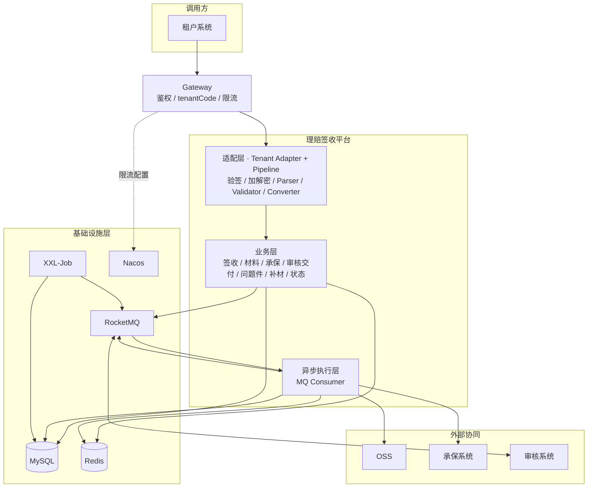
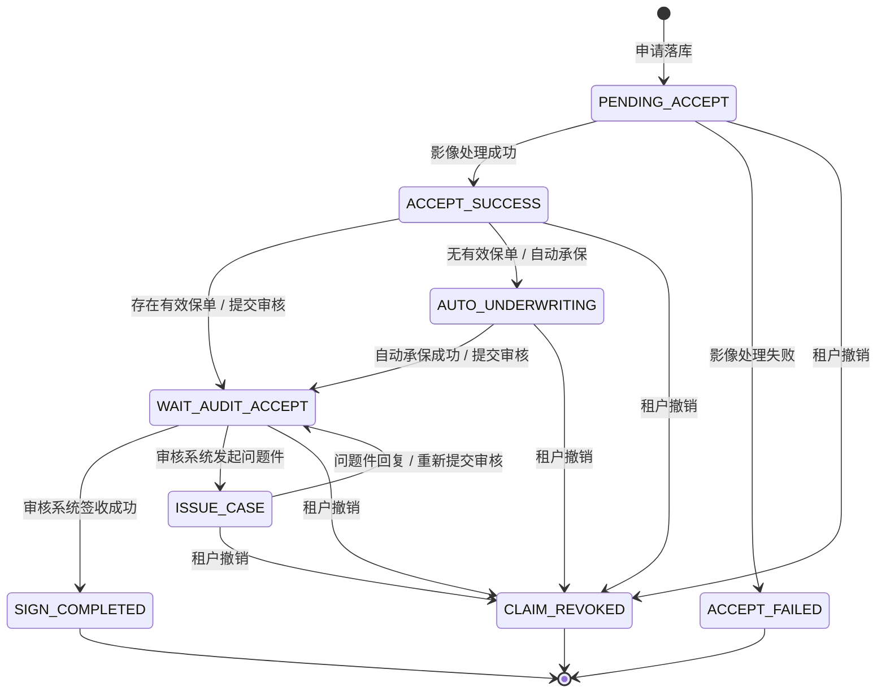
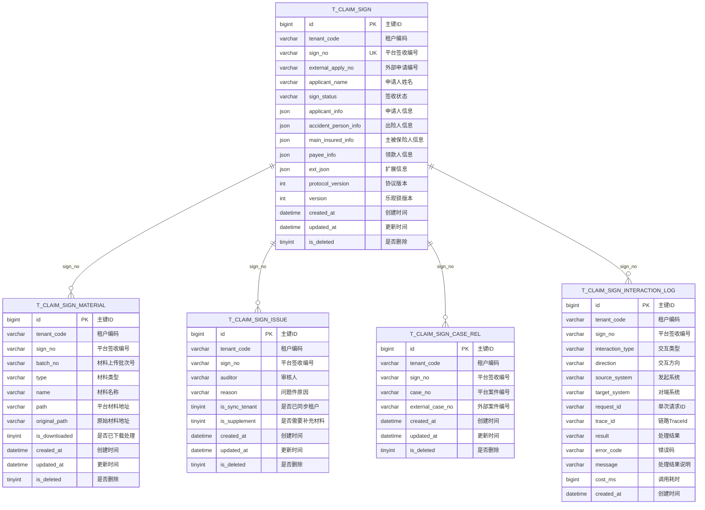
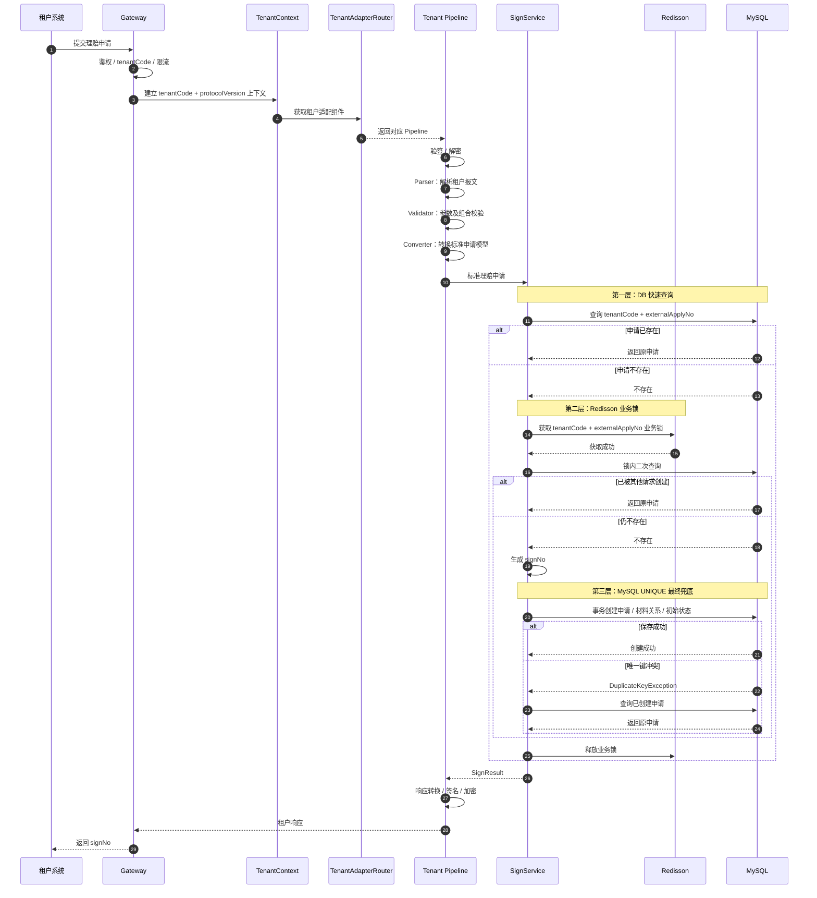
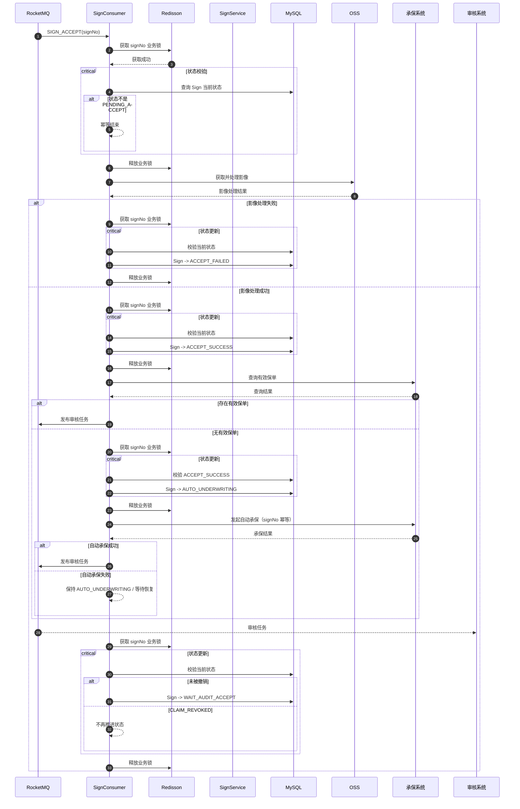
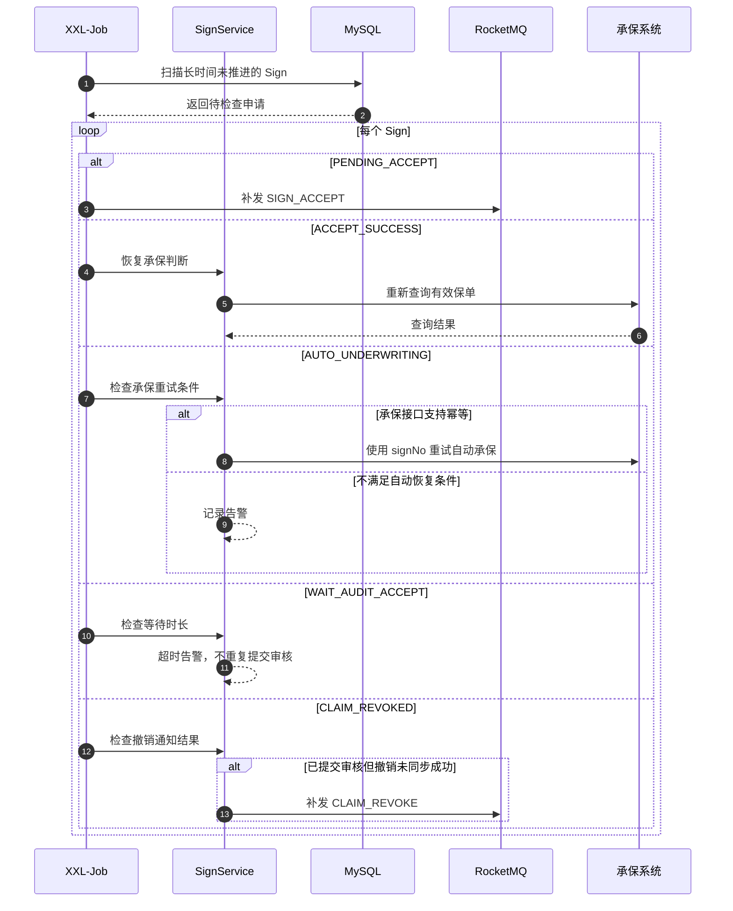
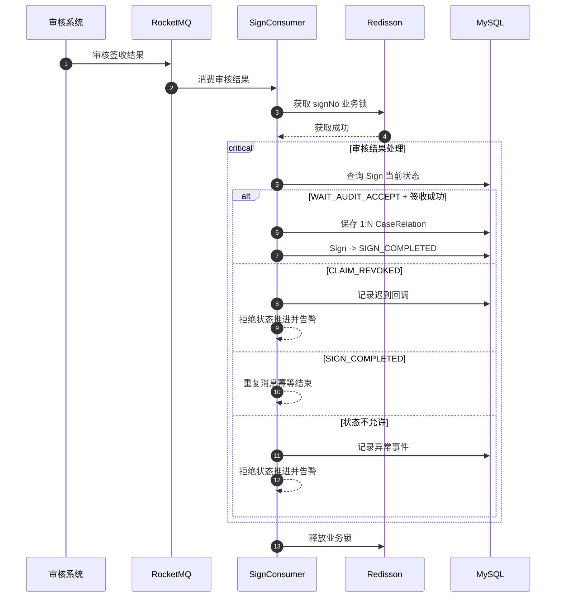
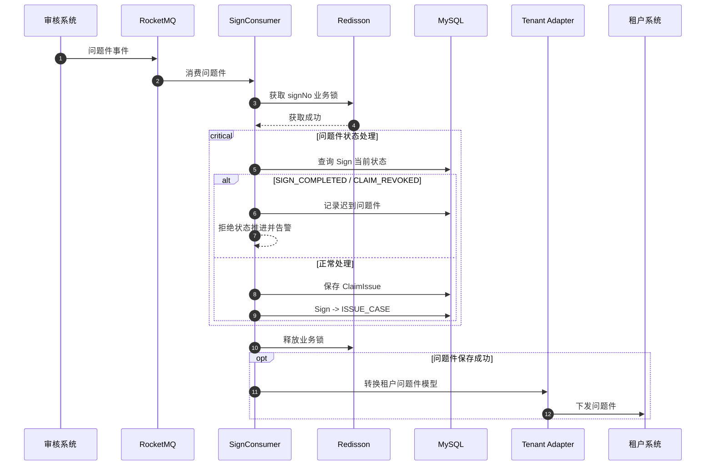
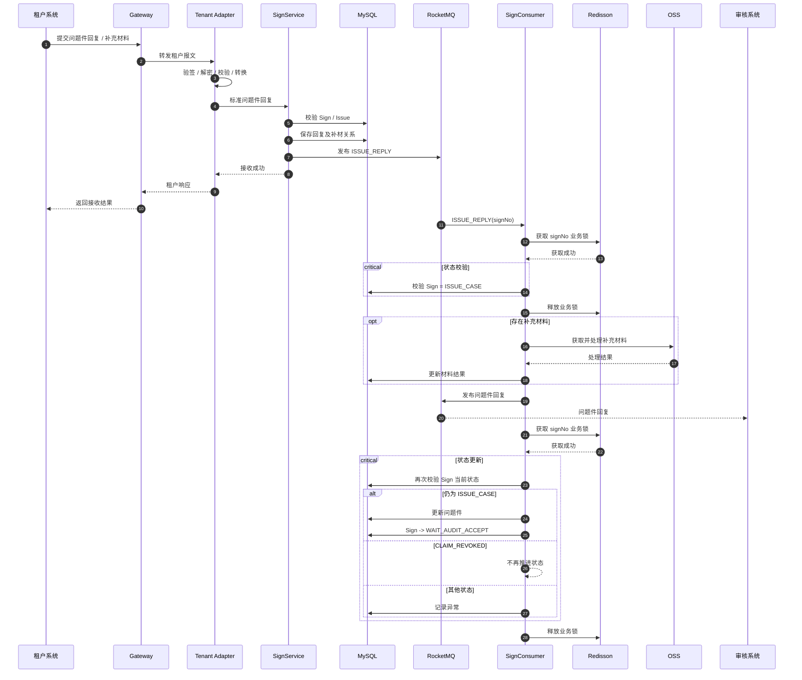
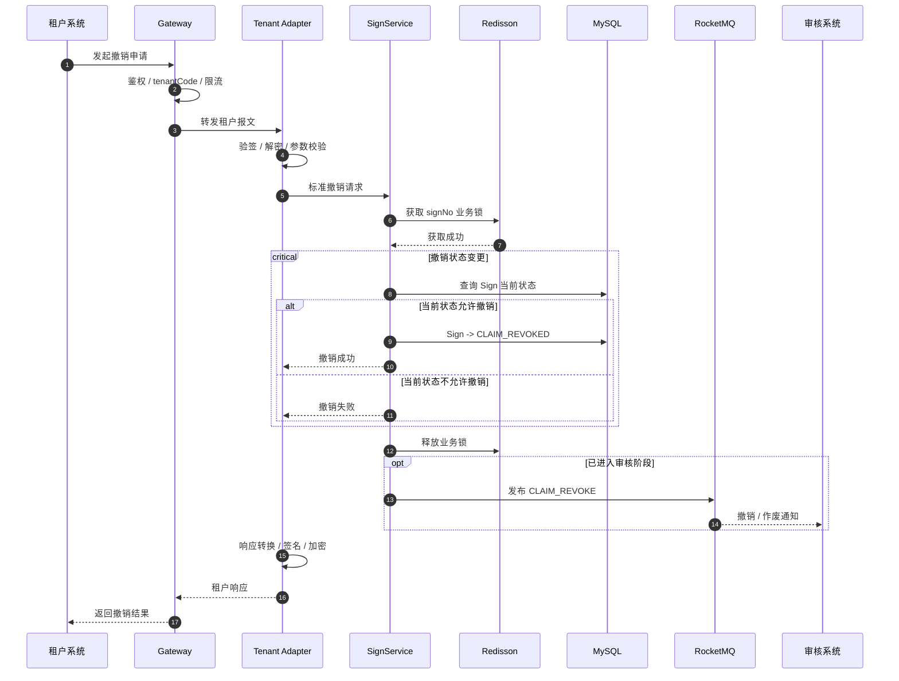

# claim-sign-service 架构基准

本文件是签收服务域内架构的唯一长期基准：分层与租户适配、状态机、数据模型、核心时序、幂等与补偿。签收服务的实现以本文件为准，交付后不删除。

跨服务的公共约束仍以 [项目基线](../specs/baseline.md) 为准：命名词表、技术栈、服务边界、对外契约固定值、租户隔离与脱敏红线。域内细节与本文件冲突时按"平台级优先"报告并修订，不得各写一份。

活动 Feature 的需求与实现增量见 [签收流程需求](../specs/sign-workflow/requirements.md) 与 [签收流程设计](../specs/sign-workflow/design.md)，不复述本文件。

## 1. 架构

### 1.1 分层

- **Gateway**：独立网关服务，负责鉴权、tenantCode 识别、路由、入口限流
- **适配层**：处理租户协议差异，完成验签、加解密、解析、校验、转换
- **业务层**：签收、材料、承保、审核交付、问题件、补材、状态维护
- **异步执行层**：消费签收、审核、问题件等业务事件
- **基础设施层**：MySQL、Redis、RocketMQ、XXL-Job、Nacos



租户 HTTP 请求经过独立 Gateway 后进入理赔签收平台，由 Tenant Adapter + Pipeline 完成租户协议标准化。

落点映射（包结构归属见基线 §6）：适配层 = `interfaces/acl`，业务层 = `application` + `domain`，异步执行层 = `interfaces` 的消息入口 + `application/task` 编排，基础设施层 = `infrastructure`。

### 1.2 同步与异步分界

同步签收只完成：

**申请唯一性判断 → signNo 生成 → 申请及初始材料关系落库 → 返回签收结果**

事务提交后发布签收受理事件，影像处理、承保判断、自动承保、审核交付均异步执行。

XXL-Job 扫描长时间未推进的申请并重新发布对应业务事件，用于 MQ 投递失败或流程中断后的补偿，不维护独立任务模型。

### 1.3 外部协同

审核系统统一通过 RocketMQ 与签收平台交互：

- 平台 → 审核系统：审核任务、问题件回复
- 审核系统 → 平台：签收结果、问题件

承保系统为同步调用，按 `signNo` 幂等。材料原文与影像存 OSS，库内只保留材料信息与地址引用。

## 2. 核心状态流转

| 状态                  | 含义       | 进入条件            |
| ------------------- | -------- | --------------- |
| `PENDING_ACCEPT`    | 待受理      | 申请落库成功          |
| `ACCEPT_SUCCESS`    | 受理成功     | 影像处理成功          |
| `ACCEPT_FAILED`     | 受理失败     | 影像处理失败          |
| `AUTO_UNDERWRITING` | 自动承保中    | 未查询到有效保单，发起自动承保 |
| `WAIT_AUDIT_ACCEPT` | 等待审核系统签收 | 审核任务已成功发送       |
| `SIGN_COMPLETED`    | 签收完成     | 审核系统返回签收成功及案件信息 |
| `ISSUE_CASE`        | 问题件      | 审核系统发起问题件       |
| `CLAIM_REVOKED`     | 已撤销      | 租户发起撤销          |

`sign_status` 是签收生命周期的唯一状态字段，环节语义由状态本身表达，不再维护第二个阶段字段。



`PENDING_ACCEPT`、`ACCEPT_SUCCESS`、`AUTO_UNDERWRITING`、`WAIT_AUDIT_ACCEPT`、`ISSUE_CASE` 为可推进状态；`ACCEPT_FAILED`、`SIGN_COMPLETED`、`CLAIM_REVOKED` 为终态。

## 3. 核心数据模型



补充约束：

- `t_claim_sign`：`sign_no` 全局唯一，`tenant_code + external_apply_no` 业务唯一。
- `t_claim_sign_case_rel`：一个 `sign_no` 可以关联多个 `case_no`。
- 表之间通过 `tenant_code + sign_no` 逻辑关联，不建立物理外键。
- `t_claim_sign_interaction_log` 为追加型日志表，只保留 `created_at`，不需要 `updated_at` 和 `is_deleted`。
- 人员四类信息（申请人、出险人、主被保险人、领款人）以 JSON 列整体入库，不建领域对象与结构化子字段；只有 `applicant_name` 作为可检索列。
- `interaction_type`、`direction`、`source_system`、`target_system` 取值按基线 §10 登记；`error_code`、`cost_ms` 用于告警与定位，不得记录请求响应原文与材料内容。

一个签收申请可以对应多个案件：

```
signNo
├─ caseNo A
├─ caseNo B
└─ caseNo C
```

审核系统签收成功后返回案件信息，平台保存 `1:N` 的 CaseRelation，再将申请推进至 `SIGN_COMPLETED`。

待确认：问题件缺少业务定位标识，多次打回场景下租户回复与补材如何绑定到具体一条 `ClaimIssue` 尚未确定；确定后须先回写基线 §4 的业务标识清单，再增列与契约字段。

## 4. 核心时序

### 4.1 理赔申请签收

同步签收只负责申请标准化、幂等校验、生成 `signNo` 和数据落库，不执行影像、承保和审核处理。



签收创建采用三层幂等控制：

- MySQL 快速查询，直接返回已存在申请
- `tenantCode + externalApplyNo` 业务锁，保证并发创建串行化
- `UNIQUE(tenant_code, external_apply_no)` 作为最终数据库兜底

同步请求结束后，平台异步发布 `SIGN_ACCEPT` 事件启动后续受理流程；事件发布失败时由 XXL-Job 根据 `PENDING_ACCEPT` 状态补偿。

### 4.2 异步受理与审核交付

异步受理负责影像处理、保单判断、自动承保和审核任务提交。

分布式锁只保护 Sign 状态的读取、校验和更新，不覆盖文件 IO、外部调用和 MQ 投递。



外部副作用调用需要具备业务幂等能力：

- 自动承保以 `signNo` 作为业务幂等标识
- 审核任务使用稳定业务标识避免重复创建
- 重复 MQ 消息通过当前 `sign_status` 校验安全结束

### 4.3 XXL-Job 补偿

XXL-Job 不统一"重放上一动作"，而是根据当前状态执行明确的恢复策略。

| 当前状态 | 恢复策略 |
|---|---|
| `PENDING_ACCEPT` | 补发 `SIGN_ACCEPT` |
| `ACCEPT_SUCCESS` | 重新查询有效保单，并继续后续流程 |
| `AUTO_UNDERWRITING` | 承保接口支持幂等时允许重试；否则告警人工处理 |
| `WAIT_AUDIT_ACCEPT` | 不重复提交审核任务，超时告警 |
| `ISSUE_CASE` | 不自动恢复，等待租户回复 |
| `ACCEPT_FAILED` | 不自动恢复 |
| `SIGN_COMPLETED` | 不处理 |
| `CLAIM_REVOKED` | 如已进入审核阶段且撤销通知未成功，则补发撤销事件 |



补偿只重发事件或重试幂等外部调用，不直接改写业务状态；状态推进始终经 Consumer 的锁内校验。

### 4.4 审核结果

审核系统签收成功后返回一个或多个案件号，平台保存 `1:N` 案件关系后完成签收。

`SIGN_COMPLETED` 和 `CLAIM_REVOKED` 均执行终态保护。



### 4.5 问题件下发

只有审核系统的问题件事件可以使 Sign 进入 `ISSUE_CASE`。

审核系统可以多次发起问题件；已完成或已撤销的申请不得再次进入问题件状态。



状态约束：

- 只有审核系统可以使 Sign **进入** `ISSUE_CASE`
- 平台处理问题件回复后可以使 Sign **离开** `ISSUE_CASE`
- 后续审核系统再次打回时，可以再次进入 `ISSUE_CASE`

### 4.6 问题件回复与补材

租户提交问题件回复时，同步链路只保存回复和补材关系；文件处理和审核提交继续异步执行。



一个问题件允许多次回复和补材；重新提交审核后进入 `WAIT_AUDIT_ACCEPT`，审核系统仍可再次发起新的问题件。

### 4.7 申请撤销

撤销由租户发起。

进入 `CLAIM_REVOKED` 后，本地 Sign 不再接受其他业务结果推进；如果申请已经进入审核阶段，还需要通知审核系统执行撤销或作废。



`CLAIM_REVOKED` 为强终态：

- 审核成功回调不得再推进为 `SIGN_COMPLETED`
- 问题件不得再推进为 `ISSUE_CASE`
- 承保、补材等迟到结果只记录交互结果并告警
- 已进入审核阶段的申请需要向审核系统发送撤销 / 作废通知

## 5. 事件与交互

| 类型 | 名称 | 方向 | 触发 |
| --- | --- | --- | --- |
| 领域事件 | `SIGN_ACCEPT` | 平台内 | 签收落库成功，启动异步受理 |
| 领域事件 | `ISSUE_REPLY` | 平台内 | 问题件回复与补材接收成功 |
| 领域事件 | `CLAIM_REVOKE` | 平台 → 审核系统 | 撤销已进入审核阶段的申请 |
| 交互 | `AUTO_UNDERWRITING` | 平台 → 承保系统 | 未查询到有效保单，按 `signNo` 幂等发起 |
| 交互 | `AUDIT_SYNC` | 平台 → 审核系统 | 受理成功或问题件恢复后提交审核 |
| 交互 | `AUDIT_RESULT` | 审核系统 → 平台 | 审核签收结果，携带一个或多个案件号 |
| 交互 | `AUDIT_ISSUE` | 审核系统 → 平台 | 审核发起问题件 |
| 交互 | `ISSUE_NOTIFY` | 平台 → 租户 | 问题件下发 |
| 交互 | `MATERIAL_FETCH` | 平台 → OSS | 影像与补充材料下载处理 |

领域事件载荷必须携带基线 §7 规定的 `eventId`、事件版本、`tenantCode`、聚合类型、聚合标识、发生时间与 `traceId`；`signNo` 是业务定位标识。完整 InteractionType 取值清单以基线 §10 为准。
