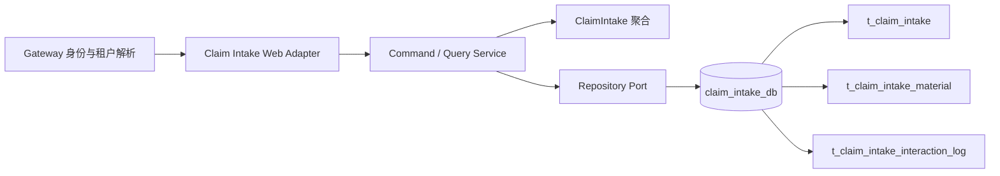
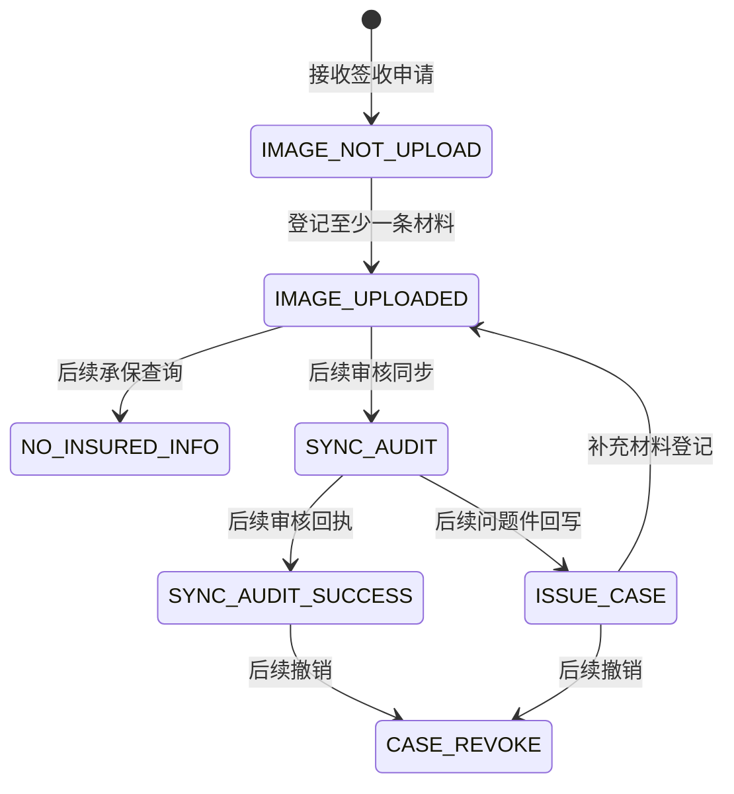

# 签收申请接入设计

## 总体架构



## 核心数据模型

`ClaimIntake` 是聚合根，以 `tenantCode + signNo` 标识；其原子边界包含受理状态和本次登记的材料。问题件表是审核系统回写的预留事实，当前不在本功能中写入；受理与案件关系表为后续 Case Delivery 协作预留，当前仅建表。MyBatis-Plus 的 `*DO`、Mapper 和 MapStruct 映射器仅位于 `infrastructure`，领域层不依赖 ORM 框架。

```text
adapter/web Request DTO + trusted headers
        ↓ 手工组装（租户、Trace 不可来自请求体）
application Command / Query
        ↓ port
infrastructure ClaimIntakeDO / IntakeMaterialDO
        ↓ MapStruct
domain ClaimIntakeState / ClaimIntake 聚合 / IntakeMaterial 值对象
```

- `ClaimIntakeDO ↔ ClaimIntakeState` 由 `ClaimIntakePersistenceMapper` 生成；数据库主键、`version`、逻辑删除标记不会进入领域状态。
- `IntakeMaterialDO → IntakeMaterial` 由同一映射器生成；租户和签收编号由仓储查询边界负责，不成为材料值对象属性。
- 聚合恢复与快照导出由 `ClaimIntake.restore(state)`、`snapshot()` 显式控制，MapStruct 不绕过状态机直接修改聚合。

| 表 | 数据所有者 | 用途 | 核心约束 |
| --- | --- | --- | --- |
| `t_claim_intake` | Claim Intake | 受理事实与状态 | 租户内 `sign_no`、`external_apply_no` 唯一；`version` 乐观锁 |
| `t_claim_intake_material` | Claim Intake | 影像元数据 | 仅通过所属受理的租户范围写入和查询 |
| `t_claim_intake_issue` | Claim Intake | 审核问题件预留事实 | 当前仅迁移建表，不提供写接口 |
| `t_claim_intake_interaction_log` | Claim Intake | 不含材料原文的交互审计 | 关联租户、签收编号与 traceId |
| `t_claim_intake_case_rel` | Claim Intake | 受理与平台案件的关系 | 租户内 `case_no` 唯一；受理 1:N 案件，案件事实由 Case Delivery 拥有 |

受理表仅在本地 Docker 的 MySQL 数据卷首次创建时由 `docker/mysql/init/02-create-claim-intake-tables.sql` 初始化；应用不包含 Schema 管理组件，也不会在启动时执行建表 SQL。`sign` 命名仅保留在业务编号 `sign_no` 上，其余库表、代码与接口一律使用受理（intake）语义。

## 主状态机设计



当前实现只有创建和材料登记两条转换。其他状态由后续明确的反腐层和回执用例拥有，不能通过本 API 直接设置。

## 核心链路设计

1. Web Adapter 校验 `X-Claim-Service-Token`，解析 `X-Claim-Tenant` 和可选 `X-Trace-Id`；请求体无租户字段。
2. 应用服务先以 `tenantCode + externalApplyNo` 查询既有申请，命中时回放既有 `signNo`；未命中时创建聚合。
3. 仓储在一个 Spring 事务中保存申请或材料和交互日志；申请唯一键作为并发下的最终去重屏障。
4. 查询强制使用 `tenantCode + signNo` 条件，避免跨租户可见。

## 分层与包结构

`com.claim.platform.intake` 是 Claim Intake 限界上下文的根包；其下使用 `adapter`、`application`、`domain`、`infrastructure` 四层，层名与根需求分层图一致。根包刻意命名为 `intake` 而非 `application`，避免与 application 层撞名（规则见 `standards/java.md`）；不保留空的平行包。聚合在类级 Javadoc 显式固化不变量：标识为 `tenantCode + signNo`，幂等键为 `tenantCode + externalApplyNo`，并发策略为 `version` 乐观锁。

## 并发控制

- 受理表使用 `version` 乐观锁，处理并发状态更新。
- 外部申请编号的租户内唯一索引是申请签收的最终去重屏障；先查询命中时回放既有签收编号。
- 原始材料表未包含批次唯一键，不将其伪装为请求级幂等能力；补材协议确认后再添加对应约束和状态机。

## 异步一致性与补偿

当前功能不调用审核系统、不发布消息，只在本地事务中记录交互日志。审核同步、消息投递、补偿和死信机制在后续独立 Spec 中设计，届时再根据确认的 DDL 引入 Outbox。

## 接口契约

| 方法 | 路径 | 说明 |
| --- | --- | --- |
| `POST` | `/api/v1/claim-intakes` | 接收申请；请求含 `externalApplyNo`、申请人字段和可选 JSON 信息 |
| `POST` | `/api/v1/claim-intakes/{signNo}/materials` | 批量登记材料；请求含 `batchNo` 和非空 `materials` |
| `GET` | `/api/v1/claim-intakes/{signNo}` | 查询当前租户申请和材料 |

签收接口按 `tenantCode + externalApplyNo` 天然去重；材料接口不声称具备请求级幂等。所有响应使用 `ApiResult`，Adapter 统一映射校验、领域与未知异常，并仅记录脱敏标识和 traceId。领域错误码为 `CLAIM_INTAKE_NOT_FOUND`、`INVALID_INTAKE_STATUS`、`CLAIM_INTAKE_CONCURRENT_MODIFICATION`。

## 测试策略

- TEST-APP-001：聚合创建状态为 `IMAGE_NOT_UPLOAD`。
- TEST-APP-002：允许待上传和问题件状态登记材料，拒绝其他状态。
- TEST-APP-003：`mvn verify` 编译全部模块并运行单元测试。
- TEST-APP-004：MapStruct 映射测试验证 DO 不会把数据库技术字段带入领域状态。
