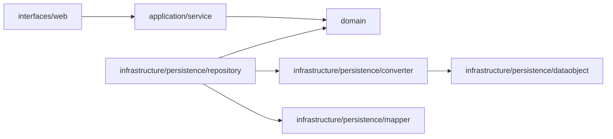

# Claim Intake DDD 包结构重构设计

## 总体架构

本次保持 Claim Intake 的聚合、Store 端口和 HTTP 链路不变，只将实现类型按四层职责移动。`interfaces` 是外部输入边界的具体包名，对应项目根需求中的 Adapter 职责，不额外引入六边形架构。



## 包结构与类型映射

```text
com.claim.platform.intake
├── interfaces/web
│   ├── controller/ClaimIntakeController
│   ├── request/CreateIntakeRequest, UploadMaterialsRequest
│   ├── converter/PersonRequestConverter
│   ├── advice/ClaimIntakeExceptionHandler
│   ├── context/GatewayRequestContext, GatewayRequestContextResolver
│   ├── exception/TenantContextMissingException, UntrustedCallerException
│   ├── interceptor/TraceLoggingInterceptor
│   └── config/WebConfig
├── application
│   ├── service/ClaimIntakeCommandService, ClaimIntakeQueryService
│   ├── command/*Command
│   └── result/*Result
├── domain
│   ├── model/**
│   ├── repository/*Store
│   └── exception/**
└── infrastructure/persistence
    ├── dataobject/**
    ├── mapper/*Mapper
    ├── converter/ClaimIntakePersistenceConverter, PersonConverter
    ├── repository/IntakePersistenceRepositoryImpl
    └── config/MybatisPlusConfiguration
```

不创建 `interfaces/job`、`interfaces/message`、`infrastructure/client`、`messaging`、`cache` 或 `storage`：这些能力在当前模块没有实际类型。

## 核心链路设计

1. Controller 从 `interfaces/web/controller` 接收协议输入，通过 Request、Context 与 `PersonRequestConverter` 组装 Command，调用 `application/service`；人员 JSON 在输入边界直接转换为领域对象，不再经过持久化 DO。
2. Application Service 保持现有事务、幂等回读、聚合调用和 Store 调用顺序。
3. `domain/repository` 保持 Store 抽象；`infrastructure/persistence/repository` 的实现通过 Mapper 与 Converter 读写数据。
4. MapStruct 的对象转换器改名为 `ClaimIntakePersistenceConverter`，以区别 MyBatis `*Mapper`；方法签名与映射规则保持不变。

## 依赖与异常边界

- `interfaces → application → domain`；`infrastructure → domain`。
- Controller、Exception Advice、Interceptor 与 Web Config 可以互相引用同一输入边界类型，但不得访问 Mapper、DO 或 Store 实现。
- Domain 不引用 Spring MVC、MyBatis、MapStruct、Redis 或任何 `interfaces`、`infrastructure` 类型。
- 包调整不改变异常映射；`ClaimIntakeExceptionHandler` 继续在输入边界将既有领域异常和 Web 异常转换为原有 `ApiResult` 响应。

## 并发控制与异步一致性

本次不变更聚合版本号乐观锁、`tenantCode + externalApplyNo` 唯一键幂等屏障、本地事务或交互日志写入顺序；没有新增消息、任务或补偿链路。

## 测试策略

- TEST-REF-001：`ClaimIntakeControllerTest` 迁移至 `interfaces/web/controller`，继续覆盖成功响应与跨租户 404 契约。
- TEST-REF-002：`ClaimIntakeCommandServiceTest` 迁移至 `application/service`，继续覆盖天然幂等与唯一键竞争回读。
- TEST-REF-003：`ClaimIntakeTest` 继续覆盖创建、允许与拒绝的状态迁移。
- TEST-REF-004：转换器测试迁移至 `infrastructure/persistence/converter`，验证 DO 技术字段不进入领域状态。
- TEST-REF-005：执行 `mvn verify`，验证全部模块编译、MapStruct 生成与既有单元测试。
- TEST-REF-006：`PersonRequestConverterTest` 验证人员 JSON 在 `interfaces/web` 内直接转换为领域对象，不依赖持久化 DO。
