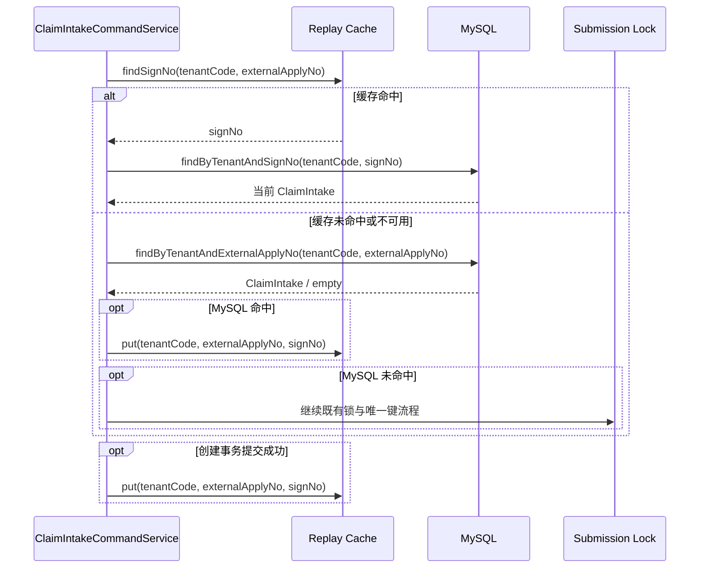

# 理赔申请幂等查询缓存设计

本功能采用 Cache-Aside 模式：缓存只承担幂等键到签收号的定位，MySQL 始终承担当前状态读取、创建事务和最终幂等判断。

## 总体架构



## 核心数据模型

缓存不存储领域聚合，仅保存以下字符串映射：

| 项目 | 规则 |
| --- | --- |
| 键 | `${key-prefix}${SHA-256(tenantCode + "\\n" + externalApplyNo)}` |
| 值 | `signNo` |
| 默认前缀 | `claim:intake:replay:` |
| 默认 TTL | 24 小时 |
| 租户隔离 | 摘要输入必须包含 `tenantCode` |

`signNo` 是稳定标识，不包含个人信息。状态不写入缓存：缓存命中后用 `tenantCode + signNo` 查询 MySQL，保证重放响应中的状态与数据库当前事实一致。

## 核心链路设计

### DS-CIIC-001 应用端口

新增 `IntakeSubmissionReplayCache` 应用端口：

```java
public interface IntakeSubmissionReplayCache {
    Optional<String> findSignNo(String tenantCode, String externalApplyNo);

    void put(String tenantCode, String externalApplyNo, String signNo);

    void evict(String tenantCode, String externalApplyNo);
}
```

端口实现位于 `infrastructure/cache`。应用层不依赖 `StringRedisTemplate`、Redis 异常类型或键构造细节。

### DS-CIIC-002 Cache-Aside 查询与失效处理

`ClaimIntakeCommandService.findByExternalApplyNo` 按以下顺序执行：

1. 调用缓存端口查询签收号。
2. 命中时按 `tenantCode + signNo` 查询仓储；命中即返回当前聚合。
3. 若缓存签收号无法查到聚合，最佳努力删除该缓存项，再按原业务键回源 MySQL。
4. 缓存未命中或不可用时，直接按原业务键回源 MySQL。
5. 回源命中时最佳努力回填映射；回源未命中时继续既有锁、二次查询和唯一键兜底。

缓存端口将 Redis 基础设施异常转换为空结果或无副作用写入；应用层不把缓存异常映射为业务异常。该链路不对 Redis 加分布式事务、补偿事务或写入确认依赖，缓存回填失败只会造成后续请求再次回源 MySQL。

### DS-CIIC-003 事务边界

创建仍由 `ClaimIntakeCreationService` 的独立事务完成。只有其 `create` 方法正常返回（意味着事务已提交）后，`ClaimIntakeCommandService` 才调用缓存回填。缓存写入不在数据库事务内，Redis 不参与事务提交、回滚、业务锁正确性或最终幂等判断；缓存写入失败不回滚数据库事务。

材料上传等状态变更无需写缓存，因为缓存不保存状态；缓存命中后的 MySQL 查询始终读取当前状态。

## 并发控制

- 缓存命中只缩短定位路径，不绕过现有 Redisson 业务锁和 MySQL 唯一键。
- 两个并发创建请求都未命中缓存时，沿用锁内二次查询和唯一键冲突回放。
- 一个请求提交后写缓存失败时，另一个请求回源 MySQL 并按既有幂等语义回放；不产生重复申请。
- 缓存值过期、淘汰或失效只增加 MySQL 查询，不影响正确性。

## 流量治理

新增 `claim.intake.submission.replay-cache` Counter，仅使用 `operation`（`read`、`write`、`evict`）和 `result`（`hit`、`miss`、`success`、`unavailable`）低基数标签。日志可关联 `tenantCode`，但不得记录原始外部申请号或缓存键。

## 测试策略

| 测试 | 覆盖内容 |
| --- | --- |
| TEST-CIIC-001 | 缓存命中后按签收号查询 MySQL，且不按外部申请号查询、不获取锁 |
| TEST-CIIC-002 | 缓存未命中时按外部申请号回源并回填 |
| TEST-CIIC-003 | 缓存签收号失效时删除映射并回源 |
| TEST-CIIC-004 | 创建事务成功后回填，创建失败不回填 |
| TEST-CIIC-005 | Redis 读写异常被适配器吸收，并记录 `unavailable` 指标 |
| TEST-CIIC-006 | 键包含租户摘要、不含原始外部申请号，TTL 与配置生效 |
