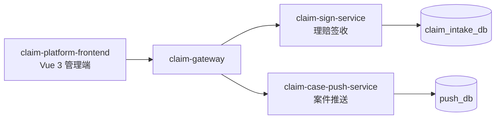
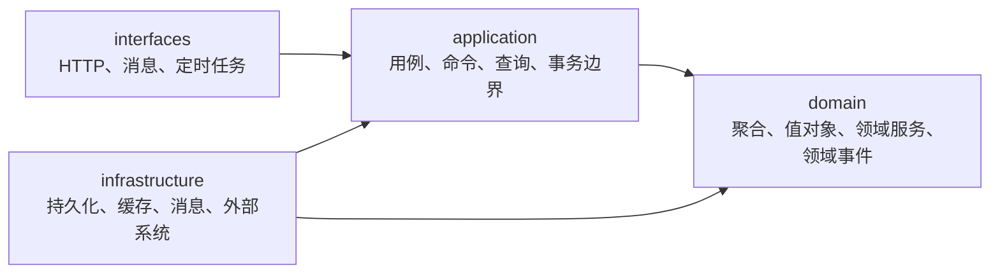

# 项目基线

本文件是 `claim-platform` 唯一长期有效的公共约束来源：产品范围、核心业务规则、技术约束、工程结构、架构分层、全局需求与范围之外。功能级需求写在 `docs/specs/<feature-name>/`，只描述本功能的增量，不重复以下内容，也不得降低本文件的约束。

规则的单一分工：任务流程与全部 Git 操作见 `docs/engineering/workflow.md`，Spec 的建与不建见 `docs/engineering/specification.md`，代码写法与 HTTP 响应细则见 `docs/engineering/implementation.md`，项目导航见 `README.md`。本文件不重复这三份规范的内容，只定义"所有功能都必须遵守"的边界。

## 1. 项目定位

Claim Platform（理赔平台）负责理赔链路的**前段交互**与**后段交互**，不负责中间的案件审核、理算与核赔：

- 前段：理赔申请签收、材料登记、问题件、撤销等与租户的交互。
- 后段：案件生成后，案件推送、回执、重试、状态同步等与保司的交互。

一次理赔申请签收在领域内统一称为 `Sign`，其平台标识统一称为 `SignNo`。平台不再使用"受理（Intake）"作为领域词汇；数据库中仍存在的 `intake` 词汇属历史遗留，见 §8「保留契约与已知偏差」。

## 2. 核心命名

下表是平台内跨文档、跨代码、跨契约的词汇权威，中文与英文命名一一对应，不得并存同义替代词：

| 中文 | 命名 | 归属 |
| --- | --- | --- |
| 理赔平台 | Claim Platform | 项目 |
| 前端项目 | claim-platform-frontend | 前端 |
| 后端项目 | claim-platform-backend | 后端 |
| 网关 | claim-gateway | Edge & Platform |
| 签收服务 | claim-sign-service | Sign |
| 案件推送服务 | claim-case-push-service | Push |
| 签收 | Sign | Sign |
| 签收号 | SignNo | Sign |
| 签收状态 | SignStatus | Sign |
| 材料 | Material | Sign |
| 问题件 | ClaimIssue | Sign |
| 问题件回复 | IssueReply | Sign |
| 案件 | ClaimCase | 平台外部生成，归属见 §8 |
| 推送任务 | PushTask | Push |
| 推送结果 | PushResult | Push |
| 推送记录 | PushRecord | Push |
| 推送回执 | PushReceipt | Push |
| 租户上下文 | TenantContext | Edge & Platform |
| 租户协议适配器 | TenantProtocolAdapter | Edge & Platform |
| 保司推送适配器 | InsurerPushAdapter | Push |

代码内已固化、跨契约使用的补充命名：`tenantCode`（租户编码）、`externalApplyNo`（租户侧申请号，与 `tenantCode` 组成签收幂等键）、`protocolVersion`（租户协议版本）、`traceId`（链路标识）。

命名禁用规则：

- 理赔申请的核心领域统一使用 `Sign`，不使用 `Intake` 或 `Application` 作为类型命名。`Claim` 只用于架构蓝本指定的 `ClaimIssue` 与 `ClaimCase`，不得用来表示签收本身（不存在 `ClaimApplication`、`ClaimIntake`）。
- `application` 一词只表示 DDD 应用层，不得用作业务概念（不存在 `Application` 领域对象、`applicationNo` 业务号）。
- 推送业务统一使用 `Push`，不引入 `Delivery`、`Send`、`Transmit` 等同义命名。

## 3. 技术约束

- 后端：Java 17、Spring Boot 3.2、Spring Cloud、Spring Cloud Alibaba、MySQL 8、Redis 7、RocketMQ、XXL-Job。
- 前端：Vue 3、TypeScript、Vite、Pinia、Vue Router、Axios。
- 可观测：OpenTelemetry、Prometheus、Grafana、Loki。
- 容器：Docker、Docker Compose；本地开发环境的 MySQL 与 Redis 由 `docker/` 提供。
- 版本以根 `pom.xml` 与各模块 `package.json` 为准，不得自行升级 JDK、Spring Boot 或核心依赖。
- 交付必须通过 `docs/engineering/workflow.md` 第 6 节规定的验证门禁。

## 4. 工程结构与服务边界

后端只有三个可执行服务：网关、签收服务、案件推送服务。**不增加新的微服务，也不建立独立查询服务**。

```text
claim-platform
├─ claim-platform-frontend          # 统一前端：sign / material / issue / case / push / tenant
└─ claim-platform-backend
   ├─ claim-gateway                 # 租户接入边缘层：tenant / auth / crypto / protocol / filter / route / limiter
   ├─ claim-sign-service            # 理赔签收：sign / material / issue / withdrawal
   ├─ claim-case-push-service       # 案件推送：task / push / receipt / strategy
   └─ claim-common                  # 无领域事实的技术共享模块，不计入服务结构
```



- `claim-common` 只能包含无领域含义的技术能力和稳定共享契约（当前仅有 `ApiResult<T>` 响应信封）；业务实体、Repository、领域规则和跨上下文共享表不得进入该模块。
- 三个子项目职责保持独立，不跨项目混合业务；一个服务的领域类型不得被另一个服务直接引用。
- 每个限界上下文独立拥有自己的数据库及其建表、变更脚本；禁止跨库 SQL、跨模块 Repository、共享业务实体和共享业务表。
- 跨上下文只能通过版本化同步 API、领域事件或显式反腐层通信。

## 5. 限界上下文与职责

| 限界上下文 | 模块 | 拥有的领域事实 | 对外责任 | 禁止事项 |
| --- | --- | --- | --- | --- |
| 理赔签收（Sign） | `claim-sign-service` | 签收、材料、问题件、撤销、交互日志 | 签收提交、材料登记、问题件处理、撤销、发起下游同步 | 案件审核、理算、核赔；写入案件推送数据库 |
| 案件推送（Push） | `claim-case-push-service` | 推送任务、推送记录、推送回执、推送策略 | 接收案件生成事件并受控推送保司、回执处理、失败重试、状态同步 | 假设案件必须由签收服务创建；写入签收数据库 |
| Edge & Platform | `claim-gateway` | 无领域事实 | 租户识别、认证、验签、加解密、JSON/XML 协议处理、请求与响应转换、路由、限流、Trace | 签收、问题件、案件推送等业务规则；持久化领域状态 |
| Platform Common | `claim-common` | 无领域事实 | 响应信封、租户上下文、Trace、通用错误等稳定技术契约 | 放入申请、案件、策略、审核等领域模型 |

网关约束：

- 网关只负责租户差异、协议、安全、路由；外部请求经过网关后必须已转换为平台标准模型，业务服务不再感知租户报文差异。
- 租户协议差异通过 `TenantProtocolAdapter` 扩展（`StandardTenantProtocolAdapter`、`TenantAProtocolAdapter` 等），不得在业务服务里用 `if (tenantCode)` 分支承载。
- 每个下游服务必须再次校验调用者与租户范围，不能只依赖网关透传。

## 6. 分层与依赖方向

领域服务统一采用四层，依赖只能向内，`domain` 不依赖其他层，也不依赖 Spring MVC、MyBatis、Redis、RocketMQ 或 HTTP 客户端：



```text
interfaces     web（controller / request / response / advice / context / interceptor）/ job / message
application    command（写入用例输入）/ handler（命令处理器）/ service（查询服务）/ result / port / exception
domain         model / repository / service / exception
infrastructure persistence（dataobject / mapper / converter / repository）/ client / messaging / cache / storage
```

Java 包根固定为 `com.claim.platform.sign` 与 `com.claim.platform.push`；架构蓝本中的 `com.xxx.claim.*` 只是占位写法。

用例组织规则（本项目已定，不再逐功能重新决策）：

- 写入用例以"命令 + 命令处理器"成对组织：`SignCommand` → `SignCommandHandler`，`UploadMaterialCommand` → `MaterialCommandHandler`，`CreatePushTaskCommand` → `PushTaskCommandHandler`。
- 读取用例由查询服务承载，按业务归属命名：`SignQueryService`、`MaterialQueryService`、`ClaimIssueQueryService`、`PushTaskQueryService`、`PushRecordQueryService`。**不引入 `GetSignQuery` / `GetSignQueryHandler` 这类读路径处理器**，也不建立独立 query-service 模块。
- 同一个应用层类不得同时承担写入与读取职责。
- 目录按实际需要创建，不预先建立空包；无实现的抽象层不落地。

聚合与领域行为：

- 聚合必须显式定义标识、一致性边界、不变量、合法状态转换、并发策略与幂等键；这些规则不分散到 Controller、Repository 或定时任务中。聚合之间通过领域事件最终一致协作。
- MVP 阶段撤销作为 `Sign` 的领域行为（`sign.withdraw(...)`）实现，不单独建立 Withdrawal 聚合。
- 保司推送差异通过 `InsurerPushAdapter` 隔离，字段转换、请求组装、响应解析都收敛在对应 Adapter 与其工厂内；一个 `ClaimCase` 可以产生多个 `PushTask`。
- 外部系统协议、错误码与 DTO 必须在反腐层终止，不得成为领域对象。

## 7. 全局业务规则

以下规则长期有效，任何功能实现只能细化，不能绕过：

租户与数据隔离：

- `tenantCode` 必须来自受信任的凭证或上下文，不信任请求体、查询参数或路径中的租户字段。
- 每一条租户领域数据的查询和租户业务唯一约束都必须包含当前 `tenantCode`；不同租户的相同 `externalApplyNo` 相互隔离。
- 平台级全局业务编号（如 `SignNo`）可以使用全局唯一约束，并允许为发号读取跨租户聚合最大值；跨租户读取范围仅限发号所需的最大值，不得读取、返回或缓存租户业务明细。

一致性与幂等：

- 签收提交、案件推送、回执处理和人工确认等写入必须可幂等重试，重复请求不得造成重复业务副作用。
- 签收的幂等键固定为 `tenantCode + externalApplyNo`，按三层保障实现：**第一层**幂等回放缓存优先、事实库回源；**第二层**租户级业务锁加锁内二次查询；**第三层**数据库唯一约束最终兜底。事实库是签收事实及其状态的唯一事实来源，缓存与锁不得作为终态依据。
- 锁等待超时必须返回可重试的并发错误；缓存或锁不可用时必须降级，并由唯一约束继续保证幂等；唯一键冲突必须回查并发赢家并回放，回查不到时按编号碰撞处理，不得直接返回未知 500。
- 签收、材料、初始状态与交互日志必须在同一创建事务内提交或回滚；发号与外部调用不得置于该事务中。
- `SignNo` 发号采用 Redis 计数器 + 数据库高水位兜底 + 对账任务校正，任何一条路径都必须能在事实库恢复出正确序号。
- 需要发送领域事件的本地写入必须采用 Outbox 或等效的原子意图记录，不得"先写库再直接发消息"。
- 消费者、回执处理器和补偿任务必须按事件或业务幂等键去重，并记录重复处理结果。
- 外部调用不得置于数据库事务中；调用失败必须转化为可查询的重试、死信或人工介入状态。
- 终态不得被普通自动任务回退；人工补偿需要身份、原因、时间和前后状态的审计记录。
- Redis 仅用于缓存、限流、短期锁或租约，不能作为签收、推送任务与回执终态的唯一事实来源。

敏感信息：

- 个人信息、材料内容、访问令牌、外部凭证不得写入日志、指标标签、Trace 属性；诊断输出必须先脱敏。
- 跨租户数据不得出现在错误信息中；对外响应不得暴露堆栈、SQL 或外部系统原文。

领域事件与契约：

- 领域事件必须携带 `eventId`、事件版本、`tenantCode`、聚合类型、聚合标识、发生时间和 `traceId`。
- 事件只追加兼容字段；破坏性变更必须发布新版本事件，不得静默修改旧事件含义；消费者必须把重复投递、乱序、失败重试和人工介入纳入设计。
- API 与事件只暴露调用方需要的稳定契约；对外契约（HTTP 路径、请求响应字段、错误码字符串、指标名、Redis 键结构）的变更必须由专门的契约版本化 Spec 承接。

## 8. 保留契约与已知偏差

代码现状与目标架构之间存在以下差距。**保留项是刻意不变的外部契约，不是漏改**；偏差项必须由后续 Spec 收敛，新增差异不得继续落入既有偏差。

保留契约（改名与重构时保持不变的值）：

| 对象 | 保留值 | 理由 |
| --- | --- | --- |
| HTTP 路径 | `/api/v1/claim-intakes`、`/api/v1/tenant-intakes` | 对外契约，变更需版本化 |
| 领域错误码 | `SignErrorCode` 全部 6 项的常量名与上报值：`CLAIM_INTAKE_NOT_FOUND`、`INVALID_INTAKE_STATUS`、`INTAKE_SUBMISSION_IN_PROGRESS`、`CLAIM_INTAKE_CONCURRENT_MODIFICATION`、`INTAKE_NUMBER_UNAVAILABLE`、`INTAKE_NUMBER_EXHAUSTED` | 面向调用方的机器可读契约，常量名与上报值一体 |
| 指标名 | `claim.intake.submission*`、`claim.intake.number.*` | 已对接的看板与告警依赖 |
| Redis 键前缀 | `claim:intake:submit:`、`claim:intake:replay:` | 改值会使既有幂等回放缓存整体失效 |
| 数据库 | 库名 `claim_intake_db`，表名 `t_claim_intake*`，列名 `intake_status` | 属于数据库重设计范畴，与代码改名解耦 |

配置命名空间（`claim.sign.*`）、环境变量（`CLAIM_SIGN_*`）、Java 包根、类型与字段命名已完成迁移，不在此列。

已知偏差（留给后续 Spec）：

| 偏差 | 现状 | 收敛归属 |
| --- | --- | --- |
| 租户协议适配位于签收服务而非网关 | `claim-sign-service` 的 `interfaces/tenant/**` 承担协议适配 | Gateway Spec（需把 Servlet 管道重写为响应式过滤器） |
| 验签、加解密、`TenantResolver`、`SignatureVerifier`、`TenantResponseAdapter` | 未实现，仅有服务间凭证校验 | Gateway Spec |
| 网关七个职责包（tenant/auth/crypto/protocol/filter/route/limiter） | 仅有启动类，未建空包 | Gateway Spec 随实现创建 |
| `MaterialStatus`、`SupplementMaterialCommand`、问题件、撤销 | 仅有表，无领域模型与用例 | 签收能力 Spec |
| `PushTask`、`PushRecord`、`PushReceipt`、`InsurerPushAdapter`、`strategy` | 服务仅有启动类，`push_db` 无表 | 案件推送 Spec |
| 前端六个功能域 | `src` 仅有占位文件 | 前端 Spec |
| `ClaimCase` 聚合归属与案件查询落点 | 架构蓝本未定义；前端有 `case` 功能域，§6 的查询服务清单中没有 `CaseQueryService` | 需先修订本基线再实现 |

## 9. 前端约束

- 前端位于 `claim-platform-frontend/`，按业务能力组织为 `sign`、`material`、`issue`、`case`、`push`、`tenant` 六个功能域，而不是按后端服务名组织。
- 前端只负责页面与交互，不实现业务规则；统一通过 `claim-gateway` 暴露的版本化 API 访问后端，不直连领域服务、数据库、消息系统或外部保司系统。
- API 客户端统一处理认证、`traceId` 回传、稳定错误码与租户上下文，不得由单个页面自行拼接鉴权或租户逻辑。
- 前端不得保存外部系统明文凭证、材料原文或可跨租户复用的敏感缓存。
- 能力清单：签收查询、材料查看、问题件处理、案件查询、推送任务查询、推送记录查询、租户配置查看。

## 10. 可观测与全局需求

- 核心请求、任务、消息和外部调用必须关联 `traceId` 与 `tenantCode`，并在已知时关联 `signNo`、`externalApplyNo`、`caseNo`、`taskId`。
- Metrics、Logs、Traces 必须支持按服务、租户和任务状态定位；失败、重试、死信、积压、限流和外部依赖错误必须可告警。
- 网关按租户、调用方和路由执行认证、限流与 Trace 透传；推送按租户、目标系统和协议适配器隔离并发与配额。
- 配置规则按环境和租户隔离，变更必须记录变更人、时间、生效范围和前后值摘要。
- 聚合查询发生局部依赖失败时，必须返回已获得数据、失败来源和 `traceId`，不得将局部失败伪装为空结果。

## 11. 范围之外

- 案件审核、理算、核赔与赔付决策。
- 外部保司与核心业务系统的内部处理。
- Agent 信息收集、证据归纳与处置建议能力：目标架构未纳入，如需建设必须先修订本基线，并在"不新增微服务"约束下确定归属。
- 运营查询与异常诊断上下文：同上，在明确用例出现前不实现。
- `ClaimCase` 聚合的创建与归属：见 §8 待明确项。
- 跨上下文共享数据库、共享业务表与共享业务实体。

## 12. 与功能 Spec 的关系

- 功能 Spec 只写本功能的增量需求与设计，公共内容引用本文件而不复制。
- 功能实现只能细化本文件，不能绕过或降低其中的约束；与 §8 保留契约冲突时，以本文件为准。
- 修改对外 API、领域事件、共享契约、数据库边界、租户模型或功能域划分时，必须先更新本文件并经用户确认，再动代码。
- 功能交付后其 Spec 直接删除，其中长期有效的结论（已定命名、保留契约、既定约束、已知偏差）必须回写本文件的对应章节。
- 规则冲突时的权威顺序：`docs/specs/baseline.md` → `docs/engineering/*.md` → 代码与测试现状。

## 变更记录

| 日期 | 变更 | 评审 |
| --- | --- | --- |
| 2026-10-23 | 按《Claim Platform 架构设计》整体重写：领域词汇统一为 Sign/Push；后端固定为网关 + 签收服务 + 案件推送服务三服务，明确不新增微服务、不建独立查询服务；应用层固化为"命令 + Handler 写入、QueryService 读取"的混合分层；新增核心命名权威表与保留契约/已知偏差登记表；吸收归档 Spec 的长期结论（三级幂等、发号高水位兜底、Outbox、脱敏红线、平台级全局编号的跨租户读取边界）；Agent 与运营诊断移出产品范围，仅保留为范围之外 | 用户决策：活动文档从零重写、engineering 只校订、归档 Spec 全部删除、以架构设计文档为唯一蓝本 |
| 2026-10-23 | 细化多租户唯一约束与查询条款：允许平台级全局业务编号，并限定发号所需的跨租户聚合最大值读取 | 项目级评审通过 |
