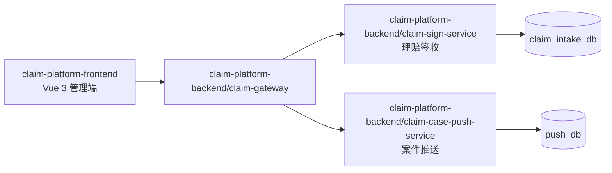
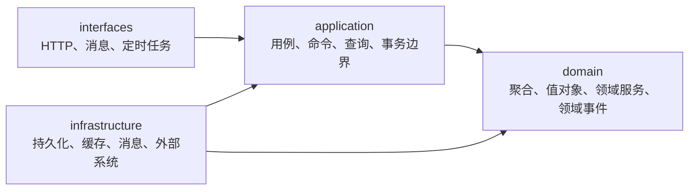

# 项目基线

本文件是 `claim-platform` 长期有效的公共需求与约束，定义所有功能都必须遵守的范围、规则与边界，不列具体接口、表字段和任务。功能级需求写在 `docs/specs/<feature-name>/requirements.md`，只描述本 Feature 的增量，不重复以下内容；重复或细化都不允许降低本文件的约束。

规则的分工：任务流程与 Git 见 `docs/engineering/workflow.md`，Spec 写法见 `docs/engineering/specification.md`，代码写法见 `docs/engineering/implementation.md`。

## Product Scope

- 平台服务于多租户理赔业务，当前覆盖线上申请签收与案件推送。
- 一个线上申请可以关联多个案件；案件也可以独立于申请由线下来源进入平台。
- 理赔签收（Sign）上下文负责签收受理、材料登记与下游同步发起；案件推送（Push）上下文负责接收任意来源案件并受控推送。
- 一次理赔申请签收在领域内统一称为 `Sign`，其平台标识统一称为 `SignNo`，不再使用"受理"作为领域词汇。
- Agent 只负责信息收集、证据归纳、异常分析和处置建议。
- 运营查询与异常诊断在出现明确用例后作为独立限界上下文建设。

## Core Rules

租户与数据隔离：

- Gateway 必须从受信任的身份凭证解析 `tenantId`，不信任请求体、查询参数或路径中的租户字段。
- 每一条租户领域数据的查询和租户业务唯一约束都必须包含或受当前 `tenantId` 约束。
- 平台级全局业务编号（如平台签收号）可以使用全局唯一约束，并允许为发号读取跨租户聚合最大值；跨租户读取范围仅限发号所需的最大值，不得读取、返回或缓存租户业务明细。
- 所有下游服务都必须再次校验调用者与租户范围，不能只依赖 Gateway 的透传。
- 申请、案件、推送、诊断和审计数据不得跨租户读取、聚合、缓存或在错误信息中泄露。

敏感信息：

- 个人信息、材料内容、访问令牌、外部凭证不得写入日志、指标标签、Trace 属性或 Agent 提示词；诊断输出必须先脱敏。

行为与一致性：

- 申请签收、案件推送和人工确认等写入操作必须可幂等重试；重复请求不得造成重复业务副作用。
- 需要发送领域事件的本地写入必须采用 Outbox 或等效的原子意图记录；不得依赖"先写库再直接发消息"的非原子流程。
- 消费者、回执处理器和补偿任务必须按事件或业务幂等键去重，并记录重复处理结果。
- 外部调用不得置于数据库事务中；调用失败必须转化为可查询的重试、死信或人工介入状态。
- 终态不得被普通自动任务回退；人工补偿需要身份、原因、时间和前后状态的审计记录。
- Redis 仅用于缓存、限流、短期锁或租约，不能作为申请、案件和任务终态的唯一事实来源。
- Agent 不得直接修改核心业务数据。

## Technical Constraints

- 后端：Java 17、Spring Boot 3.2、Spring Cloud、Spring Cloud Alibaba、MySQL、Redis、RocketMQ、XXL-Job。
- 前端：Vue 3、TypeScript、Vite、Pinia、Vue Router、Axios。
- 可观测：OpenTelemetry、Prometheus、Grafana、Loki。
- 容器：Docker、Docker Compose；本地开发环境的 MySQL 与 Redis 由 `docker/` 提供。
- 语言与框架版本以根 `pom.xml` 与各模块 `package.json` 为准，不得自行升级 JDK、Spring Boot 或核心依赖。
- 交付必须通过 `docs/engineering/workflow.md` 规定的验证门禁。

## Architecture Constraints



后端只有网关、签收服务、案件推送服务三个可执行服务；`claim-common` 是无领域事实的技术共享模块，不计入服务结构，也不得承载业务规则。

工程边界：

```text
claim-platform-frontend/          # 前端工程：页面、状态管理、API 客户端
claim-platform-backend/           # 后端 Maven 聚合工程
├── claim-gateway/                # 边缘层，不承载领域业务
├── claim-sign-service/           # 理赔签收：签收、材料、问题件、撤销
├── claim-case-push-service/      # 案件推送：推送任务、推送记录、回执、策略
└── claim-common/                 # 共享技术能力与版本化契约，不含领域规则
docs/
├── specs/                        # 项目基线与功能 Spec
│   ├── baseline.md               # 本文件
│   ├── <feature-name>/           # 活动功能 Spec（requirements / design / tasks）
│   └── archive/                  # 已完成功能的决策与验证证据
└── engineering/                  # 流程、Spec 与代码规范
```

限界上下文与数据所有权：

| 限界上下文 | 模块 | 拥有的领域事实 | 对外责任 | 禁止事项 |
| --- | --- | --- | --- | --- |
| 理赔签收（Sign） | `claim-sign-service` | 签收、材料、问题件、交互日志、同步任务 | 签收受理、追踪材料处理、发起下游同步 | 审核案件、写入案件推送上下文数据库 |
| 案件推送（Push） | `claim-case-push-service` | 案件、推送任务、推送记录、回执、死信 | 接收任意来源案件并受控推送 | 假设案件必须由理赔签收创建、写入其数据库 |
| Operations & Diagnosis | 待明确用例后新建独立模块，禁止放入 `claim-common` | 运营记录、诊断报告、人工确认审计 | 聚合展示、辅助诊断、提交受控动作请求 | 直接查询或写入其他限界上下文数据库 |
| Edge & Platform | `claim-gateway` | 无领域事实 | 身份、租户识别、验签与加解密、协议适配、请求与响应转换、路由、限流、Trace | 领域编排、持久化领域状态 |
| Platform Common | `claim-common` | 无领域事实 | 多租户上下文、Trace、通用错误、稳定的共享契约 | 放入申请、案件、策略、审核等领域模型 |

- 租户接入差异通过 `TenantProtocolAdapter` 表达，保司推送差异通过 `InsurerPushAdapter` 表达；外部协议、字段编码与错误码的转换必须在适配器与反腐层内终止。
- 外部请求经网关后转换为平台标准模型，下游服务只面对标准模型，不按租户分支实现业务规则。
- 已知偏差：租户协议适配目前仍位于 `claim-sign-service` 的接入层，网关侧的协议适配、验签与加解密尚未实现；该收敛由 Gateway 专项 Spec 承担，新增租户差异不得继续落入业务服务。

- 每个限界上下文独立拥有自己的数据库及其建表、变更脚本；当前本地开发环境由 Docker 初始化脚本创建 Schema。
- 跨上下文只能通过版本化同步 API、领域事件或显式的反腐层通信；禁止跨库 SQL、跨模块 Repository、共享业务实体和共享业务表。
- `claim-common` 只能包含无领域含义的技术能力和稳定契约；业务实体、Repository、领域规则及跨上下文共享表不得进入该模块。

领域服务分层与依赖方向（依赖只能向内，`domain` 不依赖其他层）：



领域服务统一采用以下四层包结构，目录按实际需要创建：

```text
interfaces
├─ web            controller / request / response / advice / exception / context / interceptor / config
├─ job            调度入口（XXL-Job 等）
└─ message        MQ 消费者

application
├─ handler        命令处理器：一命令一入口，接收 Command、加载领域对象、控制事务边界、返回 Result
├─ service        查询服务与应用内支撑服务：`XxxQueryService` 承载读取用例，其余 Service 只做事务实例创建、发号、对账等内部编排
├─ command        写入用例输入，不含 Web / MyBatis / 外部协议对象
├─ result         应用对外返回结果
├─ port           需要外部能力（锁、缓存、发号、存储）时定义的端口
└─ exception      用例层异常

domain
├─ model          聚合根、实体、值对象、状态、枚举与聚合内部业务行为
├─ repository     面向领域模型的持久化端口，返回 Domain 对象
├─ service        仅当规则无法自然归属单个聚合或实体时使用
└─ exception      领域规则产生的异常

infrastructure
├─ persistence    dataobject（DO，只用于本层）/ mapper（面向数据表）/ converter（DO ↔ Domain）/ repository（实现 Domain Repository）/ config
├─ client         调用其他服务的客户端（OpenFeign）
├─ messaging      向 MQ 发送消息的实现；Consumer 属于 interfaces/message
├─ cache          Redis 等缓存实现
└─ storage        OSS、S3、文件存储等能力
```

- `domain` 不依赖 Spring MVC、JPA、MyBatis、Redis、RocketMQ 或 HTTP 客户端。
- `application` 编排用例与管理事务，不承载 HTTP / 消息协议细节；流程编排不放 Domain Service。
- 写入用例以命令与命令处理器成对组织，读取用例以查询服务承载并按业务归属命名（如 `SignQueryService`、`MaterialQueryService`）；不建立独立查询服务模块，同一应用服务不同时承担写入与读取。
- `interfaces` 把外部输入转换为应用命令或查询并完成鉴权与协议校验：Controller 只做接收请求、基础参数校验、取上下文、Request → Command、调用 Application Service、Result → Response，不直接访问 Repository、Mapper 或数据库；JobHandler 与 Consumer 只做协议解析、参数获取、调用应用服务和记录执行结果，业务状态判断与补偿规则不放在入口。
- `infrastructure` 实现仓储、消息发布、缓存端口和外部系统反腐层；外部 DTO、错误码与协议细节必须在反腐层终止，不穿透到领域层。
- Repository 面向聚合，Mapper 面向数据表；数据库表的拆分不决定领域模型的拆分，聚合加载需要哪些表由 Repository 负责重建。
- 聚合必须显式定义标识、一致性边界、不变量、合法状态转换、并发策略与幂等键；这些规则不分散到 Controller、Repository 或定时任务中。聚合之间最终一致的协作通过领域事件完成。

领域契约：

- 每个写入用例必须定义命令幂等键、聚合标识、合法状态转换、失败分类和补偿路径。
- 领域事件必须携带 `eventId`、事件版本、`tenantId`、聚合类型、聚合标识、发生时间和 `traceId`。
- 领域事件只追加兼容字段；破坏性变更必须发布新版本事件，不得静默修改旧事件含义。事件消费者必须把重复投递、乱序、失败重试和人工介入纳入设计。
- 对外系统接入必须放在反腐层中，映射外部协议、错误码和模型；外部对象不得成为领域对象。
- API 与事件只暴露调用方需要的稳定契约。

前端架构：

- 前端位于 `claim-platform-frontend/`，只通过 Gateway 暴露的版本化 API 访问后端，不直连领域服务、数据库、消息系统或外部保司系统。
- 前端按业务能力而不是后端服务名组织页面和状态；签收、材料、问题件、案件、推送与租户配置可作为独立功能域。
- API 客户端统一处理认证、`traceId` 回传、稳定错误码与租户上下文，不得由单个页面自行拼接鉴权或租户逻辑。
- 前端不得保存外部系统明文凭证、材料原文或可跨租户复用的敏感缓存。

## Global Requirements

- Gateway 按租户、调用方和路由执行认证、限流和 Trace 透传；Push 按租户、目标系统和协议适配器隔离并发与配额。
- 配置规则按环境和租户隔离，变更必须记录变更人、时间、生效范围和前后值摘要。
- 核心请求、任务、消息和外部调用必须关联 `traceId`、`tenantId`，并在已知时关联 `signNo`、`externalApplyNo`、`caseNo`、`taskId`。
- Metrics、Logs、Traces 必须支持按服务、租户和任务状态定位；失败、重试、死信、积压、限流和外部依赖错误必须可告警。
- 聚合查询发生局部依赖失败时，必须返回已获得数据、失败来源和 `traceId`，不得将局部失败伪装为空结果。

## Out of Scope

- 案件审核、赔付决策。
- 外部保司的核心业务处理。
- 运营查询与异常诊断能力（明确用例出现前不实现，届时作为独立限界上下文建设，不进 `claim-common`）。
- 跨上下文共享数据库、共享业务表与共享业务实体。

## 与功能 Spec 的关系

- Feature 的 `requirements.md` 只写本功能的增量需求，公共内容引用本文件而不复制。
- 功能实现只能细化本文件，不能绕过或降低其中的约束。
- 修改跨上下文 API、领域事件、共享契约、数据库边界、租户模型或 Agent 权限时，必须先更新本文件并经用户确认，再动代码。
- 规则冲突时的权威顺序：`docs/specs/baseline.md` → `docs/engineering/*.md` → 代码与测试现状。

## 变更记录

| 日期 | 变更 | 评审 |
| --- | --- | --- |
| 2026-10-23 | 按定稿的目标架构对齐工程边界：目录改为 `claim-platform-frontend` / `claim-platform-backend`，业务服务收敛为 `claim-gateway`、`claim-sign-service`、`claim-case-push-service`，`claim-common` 明确为非业务技术共享模块；限界上下文由 Claim Intake / Case Delivery 更名为理赔签收 / 案件推送，领域词汇统一为 `Sign`、`SignNo`、`Material`、`ClaimIssue`、`PushTask`、`PushReceipt`；application 层拆出 `handler`（命令处理器）与 `service`（查询服务与内部编排）；补齐 `TenantProtocolAdapter` 与 `InsurerPushAdapter` 的适配边界要求，并登记租户协议适配暂留签收服务的已知偏差 | 用户决策：分阶段，先结构对齐；命令用 Handler、查询用 QueryService；保留 `claim-common`；租户适配本轮不迁网关 |
| 2026-10-23 | 细化多租户唯一约束与查询条款：允许平台级全局业务编号，并限定发号所需的跨租户聚合最大值读取 | 项目级评审通过 |
| 2026-10-23 | 由原 `specs/requirements.md` 与 `standards/` 重组为 `docs/specs/baseline.md` + `docs/engineering/`：合并重复的架构与分层规则，恢复 Feature 级三件套 Spec，专项规范不再单独立文件 | 用户决策：保持 MVP，每条规则单一归属文件 |
