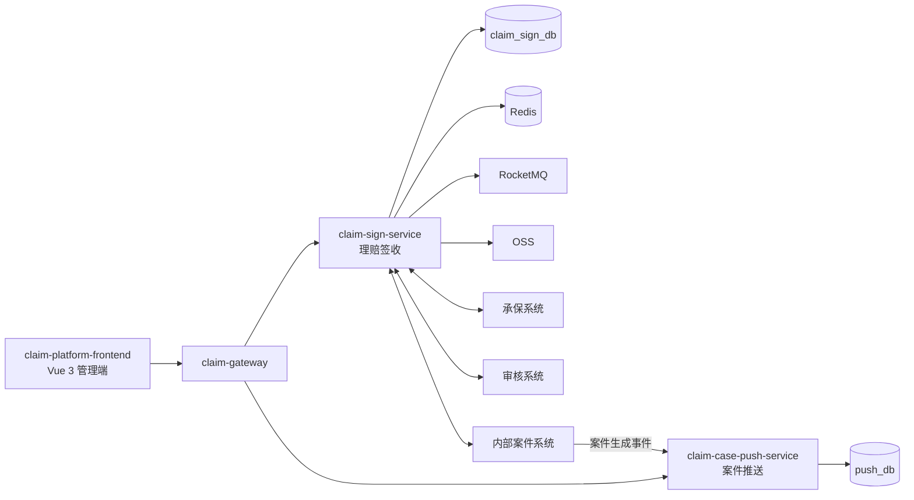
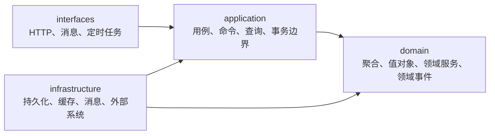

# 项目基线

本文件是 `claim-platform` 唯一长期有效的公共约束来源：产品范围、核心业务规则、技术约束、工程结构、架构分层、全局需求与范围之外。签收域的服务定位、核心模型、状态与阶段、数据表归属、防腐层分工、异步与查询边界均以本文件为准。功能级需求写在 `docs/specs/<feature-name>/`，只描述本功能的增量，不重复以下内容，也不得降低本文件的约束。

规则的单一分工：任务流程与全部 Git 操作见 `docs/engineering/workflow.md`，Spec 的建与不建见 `docs/engineering/specification.md`，代码写法与 HTTP 响应细则见 `docs/engineering/implementation.md`，项目导航见 `README.md`。本文件不重复这三份规范的内容，只定义"所有功能都必须遵守"的边界。

## 1. 项目定位

Claim Platform（理赔平台）负责理赔链路的**前段交互**与**后段交互**，不负责中间的案件审核、理算与核赔：

- 前段：理赔申请签收、材料处理、承保查询、审核同步、问题件、撤销等与租户及内部系统的交互。
- 后段：案件生成后，案件推送、回执、重试、状态同步等与保司的交互。

前段的内部链路固定为：`签收 → 材料处理 → 承保查询 → 审核同步 → 等待内部结果 → 案件生成`。承保系统、审核系统、内部案件系统是签收服务的外部依赖，其内部处理不属于平台范围。

一次理赔申请签收在领域内统一称为 `Sign`，其平台标识统一称为 `SignNo`。平台不使用"受理（Intake）"作为领域词汇；类型、字段、表和契约命名统一使用 `Sign`。

## 2. 核心命名

下表是平台内跨文档、跨代码、跨契约的词汇权威，中文与英文命名一一对应，不得并存同义替代词：

| 中文 | 命名 | 归属 |
| --- | --- | --- |
| 理赔平台 | Claim Platform | 项目 |
| 前端项目 | claim-platform-frontend | 前端 |
| 后端项目 | claim-platform-backend | 后端 |
| 网关 | claim-gateway | Edge & Platform |
| 签收服务 | claim-sign-service | Sign |
| 案件推送服务 | claim-case-push-service | Push |
| 签收 | Sign | Sign |
| 签收号 | SignNo | Sign |
| 签收状态 | SignStatus | Sign |
| 签收阶段 | SignStage | Sign |
| 签收任务 | SignTask | Sign |
| 材料 | Material | Sign |
| 问题件 | ClaimIssue | Sign |
| 问题件回复 | IssueReply | Sign（MVP 不单独建模，见 §7） |
| Sign 与案件关系 | CaseRelation | Sign |
| 跨系统交互日志 | InteractionLog | Sign |
| 交互方向 | IN / OUT | Sign |
| 案件 | ClaimCase | 内部案件系统（Sign 只维护 `CaseRelation`） |
| 推送任务 | PushTask | Push |
| 推送结果 | PushResult | Push |
| 推送记录 | PushRecord | Push |
| 推送回执 | PushReceipt | Push |
| 租户上下文 | TenantContext | Edge & Platform |
| 报文协议适配器 | TenantProtocolAdapter | Edge & Platform（网关侧） |
| 租户业务语义适配器 | Adapter（签收防腐层内，具体类型名由 Spec 定） | Sign |
| 保司推送适配器 | InsurerPushAdapter | Push |

代码内已固化、跨契约使用的补充命名：`tenantCode`（租户编码）、`externalApplyNo`（租户侧申请号，与 `tenantCode` 组成签收幂等键）、`protocolVersion`（租户协议版本）、`traceId`（链路标识）。

命名禁用规则：

- 理赔申请的核心领域统一使用 `Sign`，不使用 `Intake` 或 `Application` 作为类型命名。`Claim` 只用于架构蓝本指定的 `ClaimIssue` 与 `ClaimCase`，不得用来表示签收本身（不存在 `ClaimApplication`、`ClaimIntake`）。
- `application` 一词只表示 DDD 应用层，不得用作业务概念（不存在 `Application` 领域对象、`applicationNo` 业务号）。
- 推送业务统一使用 `Push`，不引入 `Delivery`、`Send`、`Transmit` 等同义命名。
- 撤销统一使用 `Revoke`（状态 `REVOKED`、交互 `SIGN_REVOKE`、`Sign` 聚合行为 `sign.revoke(...)`），不再使用 `Withdraw`、`withdrawal`、`CASE_REVOKE`。
- 签收整体状态只用 `SignStatus`，所处环节只用 `SignStage`，不得把环节语义塞进 `SignStatus`。
- 跨系统交互只使用 §10 登记的 `InteractionType` 常量，不引入同义动作名（如 `POLICY_QUERY`、`AUDIT_PUSH`）。

## 3. 技术约束

- 后端：Java 17、Spring Boot 3.2、Spring Cloud、Spring Cloud Alibaba、MySQL 8、Redis 7、RocketMQ、XXL-Job。
- 前端：Vue 3、TypeScript、Vite、Pinia、Vue Router、Axios。
- 可观测：OpenTelemetry、Prometheus、Grafana、Loki。
- 容器：Docker、Docker Compose；本地中间件编排与建表脚本由交付相应能力的 Spec 一并提供。
- 持久化：所有持久化服务统一使用 MyBatis-Plus（版本以根 `pom.xml` 为准）；不使用 JPA。
- 对象映射：MapStruct（版本以根 `pom.xml` 为准），只做对象转换，不承载业务规则与状态流转。
- 签收服务的存储与中间件固定为 MySQL（业务事实）、Redis（发号、缓存、锁）、RocketMQ（异步任务）、XXL-Job（恢复与对账）、OSS（材料原文）；不引入其他存储。材料原文不落库，库内只保留材料信息、来源与地址引用。
- 版本以根 `pom.xml` 与各模块 `package.json` 为准，不得自行升级 JDK、Spring Boot 或核心依赖。
- 交付必须通过 `docs/engineering/workflow.md` 第 6 节规定的验证门禁。

## 4. 工程结构与服务边界

后端只有三个可执行服务：网关、签收服务、案件推送服务。**不增加新的微服务，也不建立独立查询服务**。下列结构是目标形态。

```text
claim-platform
├─ claim-platform-frontend          # 统一前端：sign / material / issue / case / push / tenant
└─ claim-platform-backend
   ├─ claim-gateway                 # 租户接入边缘层：tenant / auth / crypto / protocol / filter / route / limiter
   ├─ claim-sign-service            # 理赔签收：sign / material / issue / internal / acl
   ├─ claim-case-push-service       # 案件推送：task / push / receipt / strategy
   └─ claim-common                  # 无领域事实的技术共享模块，不计入服务结构
```



- `claim-common` 只能包含无领域含义的技术能力和稳定共享契约（包括 `ApiResult<T>` 响应信封）；业务实体、Repository、领域规则和跨上下文共享表不得进入该模块。
- 三个子项目职责保持独立，不跨项目混合业务；一个服务的领域类型不得被另一个服务直接引用。
- 每个限界上下文独立拥有自己的数据库及其建表、变更脚本；禁止跨库 SQL、跨模块 Repository、共享业务实体和共享业务表。
- 跨上下文只能通过版本化同步 API、领域事件或显式反腐层通信。

### 签收域数据表

签收上下文独立拥有下列表，全部归 `claim-sign-service`：

| 表 | 职责 |
| --- | --- |
| `t_claim_sign` | 签收主数据与业务状态 |
| `t_claim_sign_material` | 材料信息、来源、OSS 引用与单材料处理状态 |
| `t_claim_sign_task` | 异步任务：执行、幂等、重试、超时恢复 |
| `t_claim_sign_issue` | 问题件：原因、状态、回复、补充材料、恢复阶段 |
| `t_claim_sign_case_rel` | `Sign → ClaimCase` 关系 |
| `t_claim_sign_interaction_log` | 跨系统交互日志 |

自增 `id` 只作内部主键，不参与业务语义；业务查询与跨系统对账一律使用 `signNo`、`externalApplyNo`、`materialNo`、`issueNo`、`caseNo`、`taskNo`。建表脚本直接按上表命名。

## 5. 限界上下文与职责

| 限界上下文 | 模块 | 拥有的领域事实 | 对外责任 | 禁止事项 |
| --- | --- | --- | --- | --- |
| 理赔签收（Sign） | `claim-sign-service` | 签收、材料、签收任务、问题件、Sign-案件关系、交互日志 | 签收提交与查询、材料处理、承保查询、审核同步、问题件交互、撤销、维护 `Sign → ClaimCase` 关系 | 案件审核、理算、核赔；持有 `ClaimCase` 业务事实；写入案件推送数据库 |
| 案件推送（Push） | `claim-case-push-service` | 推送任务、推送记录、推送回执、推送策略 | 接收案件生成事件并受控推送保司、回执处理、失败重试、状态同步 | 假设案件必须由签收服务创建；写入签收数据库 |
| Edge & Platform | `claim-gateway` | 无领域事实 | 租户识别、认证、验签、加解密、JSON/XML 协议处理、请求与响应转换、路由、限流、Trace | 签收、问题件、案件推送等业务规则；持久化领域状态 |
| Platform Common | `claim-common` | 无领域事实 | 响应信封、租户上下文、Trace、通用错误等稳定技术契约 | 放入申请、案件、策略、审核等领域模型 |

网关与签收防腐层分工（租户差异只由这两层承载，不得散落）：

- **网关只管协议、安全、流量、路由**：认证、验签、加解密、JSON/XML 报文解析与响应转换、限流、路由、Trace 透传。外部请求到达业务服务时必须是平台标准报文，业务服务不感知租户**报文格式**差异。
- 报文协议差异通过 `TenantProtocolAdapter` 在网关内扩展，不得写成 `if (tenantCode)` 散落分支。
- 每个下游服务必须再次校验调用者与租户范围，不能只依赖网关透传。
- **租户业务语义差异由签收防腐层 `interfaces/acl` 处理**：`Adapter` 选择租户处理策略，`Validator` 做业务字段校验，`Converter` 做证件类型、材料类型、状态编码等业务编码转换，`Mapper` 做对象映射。具体类型名与租户清单由租户接入 Spec 定义。
- 承保、审核、案件系统的调用同样通过对应 Adapter 隔离，租户分支不得进入用例与领域模型。

## 6. 分层与依赖方向

领域服务统一采用四层，依赖只能向内，`domain` 不依赖其他层，也不依赖 MySQL、Redis、RocketMQ、Spring MVC、MyBatis、Feign 或 OSS SDK：



```text
com.claim.platform.sign
├─ interfaces      sign（提交/查询/撤销）/ material / issue / internal（服务间入口）/ acl（租户业务语义防腐）/ advice（边界异常映射）
├─ application     command（命令与命令处理器）/ query（查询模型与查询服务）/ task（异步任务编排）/ port（跨用例出站端口）/ result（用例结果模型）/ exception（用例层异常）
├─ domain          按聚合分包：sign / material / issue；聚合内组织 model、repository、service、exception
└─ infrastructure  persistence（dataobject / mapper / converter / repository）/ cache / mq / oss / insured / audit / internalcase
```

`insured`、`audit` 与 `internalcase` 分别承载承保系统、审核系统与内部案件系统的调用；新增聚合（`SignTask`、`CaseRelation`、`InteractionLog`）按同一条规则在 `domain` 下建自己的聚合包。定时恢复与技术配置类目录按实际需要落在 `infrastructure` 内，不预先建立空包。

端口与异常归属：

- 聚合自身的持久化端口放 `domain/<聚合>/repository`；跨用例的技术端口（发号与对账，以及 Spec 若采用的业务锁、回放缓存）放 `application/port`。两者的实现都由 `infrastructure` 提供，依赖方向只允许 `infrastructure → application → domain`。
- 用例的返回值模型放 `application/result`；外部系统 DTO 按本节反腐层规则在 `acl` 或对应出站包内转换掉，不得穿透到该包。
- 异常按抛出层归属：领域异常放 `domain/<聚合>/exception`，用例编排抛出的异常放 `application/exception`。边界异常映射器放 `interfaces/advice`，只负责本服务异常到 HTTP 状态与上报值的映射。

Java 包根固定为 `com.claim.platform.sign` 与 `com.claim.platform.push`；架构蓝本中的 `com.xxx.claim.*` 只是占位写法。

用例组织规则（本项目已定，不再逐功能重新决策）：

- 写入用例以"命令 + 命令处理器"成对组织并放在 `application/command`：`SignCommand` → `SignCommandHandler`，`UploadMaterialCommand` → `MaterialCommandHandler`，`CreatePushTaskCommand` → `PushTaskCommandHandler`。
- 读取用例由 `application/query` 内的查询服务承载，按业务归属命名：`SignQueryService`、`MaterialQueryService`、`ClaimIssueQueryService`、`PushTaskQueryService`、`PushRecordQueryService`。**不引入 `GetSignQuery` / `GetSignQueryHandler` 这类读路径处理器**，也不建立独立查询服务或 query-service 模块。
- 异步任务的编排与执行状态推进放 `application/task`，不与写入、读取用例混在同一个类。
- 同一个应用层类不得同时承担写入与读取职责。
- 目录按实际需要创建，不预先建立空包；无实现的抽象层不落地。

聚合与领域行为：

- 签收域的模型固定为六个：`Sign`（业务标识 `tenantCode + externalApplyNo`，平台标识 `signNo`）、`SignTask`、`Material`、`ClaimIssue`、`CaseRelation`、`InteractionLog`；不在签收域新增其他聚合，新增必须先修订本文件。
- `SignTask` 的任务类型固定为 `MATERIAL_PROCESS`、`INSURED_QUERY`、`AUDIT_SYNC`、`ISSUE_NOTIFY`、`ISSUE_REPLY_SYNC`。
- 聚合必须显式定义标识、一致性边界、不变量、合法状态转换、并发策略与幂等键；这些规则不分散到 Controller、Repository 或定时任务中。聚合之间通过领域事件最终一致协作。
- 撤销是 `Sign` 聚合的领域行为（`sign.revoke(...)`），不单独建立 Withdrawal 聚合；问题件建模为独立 `ClaimIssue`，MVP 不单独建立 `IssueReply`，回复内容、补充材料与流程恢复阶段都记在 `ClaimIssue` 内。
- 保司推送差异通过 `InsurerPushAdapter` 隔离，字段转换、请求组装、响应解析都收敛在对应 Adapter 与其工厂内；一个 `ClaimCase` 可以产生多个 `PushTask`。
- 外部系统协议、错误码与 DTO 必须在反腐层终止，不得成为领域对象。

## 7. 全局业务规则

以下规则长期有效，任何功能实现只能细化，不能绕过：

状态与阶段：

- `Sign` 主模型只维护两个状态字段：`signStatus` ∈ `SIGNED` / `PROCESSING` / `ISSUE` / `COMPLETED` / `REVOKED`，`currentStage` ∈ `MATERIAL` / `INSURED_QUERY` / `AUDIT_SYNC` / `WAIT_RESULT` / `COMPLETED`。环节语义不得再塞进 `signStatus`。
- `SignTask`、`Material`、`ClaimIssue` 分别维护自己的状态，不回写进 `Sign` 主模型；`Sign` 的阶段与整体状态由子模型结果推进，推进规则集中在 `Sign` 聚合内。
- 技术失败（超时、依赖不可用、调用异常）进入 `SignTask` 重试；业务不满足（缺材料、承保信息不符、审核驳回）创建 `ClaimIssue`，`signStatus` 置 `ISSUE`，租户回复后恢复到问题件登记的流程阶段。
- 撤销只能由 `Sign` 聚合行为完成并置 `REVOKED`；`COMPLETED` 与 `REVOKED` 都是终态。

租户与数据隔离：

- `tenantCode` 必须来自受信任的凭证或上下文，不信任请求体、查询参数或路径中的租户字段。
- 每一条租户领域数据的查询和租户业务唯一约束都必须包含当前 `tenantCode`；不同租户的相同 `externalApplyNo` 相互隔离。
- 平台级全局业务编号（如 `SignNo`）可以使用全局唯一约束，并允许为发号读取跨租户聚合最大值；跨租户读取范围仅限发号所需的最大值，不得读取、返回或缓存租户业务明细。

异步任务与缓存边界：

- 异步链路固定为 `SignTask → RocketMQ → Consumer`；执行、幂等、重试、并发控制与超时恢复由任务承担，`Sign` 主模型不直接执行异步逻辑。
- Consumer 必须支持重复消费，按 `taskNo` 或业务幂等键去重并记录重复处理结果。
- 查询采用 Cache-Aside，MySQL 是业务状态的事实来源；缓存不得参与状态推进、Task 执行、并发判断与撤销判断。
- 承保查询、审核同步、问题件通知等外部调用必须携带业务幂等键（`signNo` 或 `taskNo`），重复调用不得产生重复业务副作用。

一致性与幂等：

- 签收提交、案件推送、回执处理和人工确认等写入必须可幂等重试，重复请求不得造成重复业务副作用。
- 签收的幂等键固定为 `tenantCode + externalApplyNo`。重复请求必须回放既有结果或返回可重试的并发错误，数据库唯一约束是最终保障；事实库是签收事实及其状态的唯一来源，缓存与锁不得作为终态依据。
- 唯一键冲突必须回查并发赢家并回放，回查不到时按编号碰撞处理，不得直接返回未知 500。
- 签收、材料、初始状态与交互日志必须在同一创建事务内提交或回滚；发号与外部调用不得置于该事务中。
- `SignNo` 必须全局唯一，并能从事实库恢复正确序列；数据库唯一键作最终兜底。
- 需要发送领域事件的本地写入必须采用 Outbox 或等效的原子意图记录，不得"先写库再直接发消息"。
- 消费者、回执处理器和补偿任务必须按事件或业务幂等键去重，并记录重复处理结果。
- 外部调用不得置于数据库事务中；调用失败必须转化为可查询的重试、死信或人工介入状态。
- 终态不得被普通自动任务回退；人工补偿需要身份、原因、时间和前后状态的审计记录。
- Redis 仅用于缓存、限流、短期锁或租约，不能作为签收、推送任务与回执终态的唯一事实来源。

敏感信息：

- 个人信息、材料内容、访问令牌、外部凭证不得写入日志、指标标签、Trace 属性；诊断输出必须先脱敏。
- 签收服务不建模人员明细：申请人、主被保险人、出险人、领款人不建立领域对象与结构化字段，只保留 `applicantName` 一个可检索字段，其余内容通过 `extJson` 原样入库；人员明细不得进入日志与对外响应。
- 跨租户数据不得出现在错误信息中；对外响应不得暴露堆栈、SQL 或外部系统原文。

领域事件与契约：

- 领域事件必须携带 `eventId`、事件版本、`tenantCode`、聚合类型、聚合标识、发生时间和 `traceId`。
- 事件只追加兼容字段；破坏性变更必须发布新版本事件，不得静默修改旧事件含义；消费者必须把重复投递、乱序、失败重试和人工介入纳入设计。
- API 与事件只暴露调用方需要的稳定契约；对外契约（HTTP 路径、请求响应字段、错误码字符串、指标名、Redis 键结构）的变更必须由专门的契约版本化 Spec 承接。

## 8. 对外契约基线

下列值是平台当前的对外与运维契约固定值，一律使用第 2 节的词汇，不设命名例外。变更必须先更新本节并经用户确认，再由契约版本化 Spec 承接。

| 对象 | 固定值 | 说明 |
| --- | --- | --- |
| HTTP 路径 | `/api/v1/signs` | 签收资源的根路径；材料、问题件、撤销作为子资源挂在其下 |
| 签收领域错误码 | `SignErrorCode` 六项常量名与上报值：`SIGN_NOT_FOUND`(404)、`INVALID_SIGN_STATUS`(409)、`SIGN_SUBMISSION_IN_PROGRESS`(409)、`SIGN_CONCURRENT_MODIFICATION`(409)、`SIGN_NO_UNAVAILABLE`(503)、`SIGN_NO_EXHAUSTED`(503) | 面向调用方的机器可读契约，常量名与上报值一体；状态模型重构只改内部状态，不改上报值 |
| 平台通用错误码 | 400 `REQUEST_VALIDATION_FAILED`、401 `UNAUTHORIZED`、500 `INTERNAL_ERROR` | 不进入领域错误码枚举，由 `interfaces/advice` 的边界异常映射器使用 |
| 指标名 | `claim.sign.submission*`、`claim.sign.number.*` | 看板与告警按 `claim.<业务域>.*` 命名 |
| Redis 键前缀 | `claim:sign:submit:`、`claim:sign:replay:` | 若 Spec 采用幂等回放缓存或租户级业务锁，键前缀按此保留；第 7 节不强制这两类机制必须存在 |
| 数据库 | 库名 `claim_sign_db` | 表名与列名按第 4 节的数据表归属执行 |

领域异常与上报值同名映射：异常类名取上报值的驼峰形式加 `Exception`（`SIGN_NOT_FOUND` ↔ `SignNotFoundException`），映射表由边界异常映射器持有，不得散落到用例与领域模型中。

未列出的对外契约不得据此推断为可变更；需要变更时同样由契约版本化 Spec 承接。

## 9. 前端约束

`claim-platform-frontend/` 建立后必须遵守下列约束。

- 前端位于 `claim-platform-frontend/`，按业务能力组织为 `sign`、`material`、`issue`、`case`、`push`、`tenant` 六个功能域，而不是按后端服务名组织。
- 前端只负责页面与交互，不实现业务规则；统一通过 `claim-gateway` 暴露的版本化 API 访问后端，不直连领域服务、数据库、消息系统或外部保司系统。
- API 客户端统一处理认证、`traceId` 回传、稳定错误码与租户上下文，不得由单个页面自行拼接鉴权或租户逻辑。
- 前端不得保存外部系统明文凭证、材料原文或可跨租户复用的敏感缓存。
- 能力清单：签收查询、材料查看、问题件处理、案件查询、推送任务查询、推送记录查询、租户配置查看。

## 10. 可观测与全局需求

- 核心请求、任务、消息和外部调用必须关联 `traceId` 与 `tenantCode`，并在已知时关联 `signNo`、`externalApplyNo`、`caseNo`、`taskNo`。
- Metrics、Logs、Traces 必须支持按服务、租户和任务状态定位；失败、重试、死信、积压、限流和外部依赖错误必须可告警。
- 网关按租户、调用方和路由执行认证、限流与 Trace 透传；推送按租户、目标系统和协议适配器隔离并发与配额。
- 配置规则按环境和租户隔离，变更必须记录变更人、时间、生效范围和前后值摘要。
- 聚合查询发生局部依赖失败时，必须返回已获得数据、失败来源和 `traceId`，不得将局部失败伪装为空结果。
- Trace 透传、MDC 日志字段与指标暴露所需的依赖和配置，口径同第 3 节的建表脚本：由首个交付相应能力的 Spec 一并提供。未被任何 Spec 交付前，本节按服务已具备的能力执行，不得把"基线已写"当作"已具备"。

跨系统交互审计（`InteractionLog`）：

- 每次跨系统交互记录一条日志，字段固定为 `interactionType`、`direction`、`sourceSystem`、`targetSystem`、`requestId`、`traceId`、`result`、`errorCode`、`message`、`costMs`。
- `direction`：`IN` = 其他系统 → `claim-sign-service`，`OUT` = `claim-sign-service` → 其他系统；真实调用双方由 `sourceSystem + targetSystem` 表达。
- `InteractionType` 取值固定为 13 项，新增取值必须先修订本文件：`SIGN_SUBMIT`、`SIGN_QUERY`、`SIGN_REVOKE`、`MATERIAL_SUBMIT`、`MATERIAL_FETCH`、`INSURED_QUERY`、`AUDIT_SYNC`、`AUDIT_RESULT`、`AUDIT_ISSUE`、`ISSUE_NOTIFY`、`ISSUE_REPLY`、`CASE_BIND`、`CASE_COMPLETE`。
- 交互日志只记摘要与错误码，不记请求响应原文、材料内容与个人信息，§7 的脱敏红线同样适用。

## 11. 范围之外

- 案件审核、理算、核赔与赔付决策。
- 外部保司与核心业务系统的内部处理。
- Agent 信息收集、证据归纳与处置建议能力：目标架构未纳入，如需建设必须先修订本基线，并在"不新增微服务"约束下确定归属。
- 运营查询与异常诊断上下文：同上，在明确用例出现前不实现。
- `ClaimCase` 业务事实的创建与归属：案件业务事实由内部案件系统拥有，签收侧只维护 `Sign → ClaimCase` 关系（`CaseRelation`），不落案件业务字段。
- 跨上下文共享数据库、共享业务表与共享业务实体。

## 12. 与功能 Spec 的关系

- 功能 Spec 只写本功能的增量需求与设计，公共内容引用本文件而不复制。
- 功能实现只能细化本文件，不能绕过或降低其中的约束；与 §8 登记的对外契约冲突时，以本文件为准。
- 修改对外 API、领域事件、共享契约、数据库边界、租户模型或功能域划分时，必须先更新本文件并经用户确认，再动代码。
- 功能交付后其 Spec 直接删除，其中长期有效的结论（已定命名、对外契约、既定约束）必须回写本文件的对应章节。
- 实现细节不进本文件，由功能 Spec 设计：SQL DDL 与迁移脚本、`SignNo` 格式、Redis Key 的完整结构与恢复算法、Task 状态机与重试与超时恢复、MQ Topic 与 Tag 与 Consumer、Cache Key 与 TTL、租户 Adapter 落地、承保与审核接口、问题件规则、单元测试与集成测试与压测。第 7 节的业务不变式与第 8 节的对外契约值除外。
- 开发链路固定为：架构（本文件）→ `requirements.md` → `design.md` → `tasks.md` → 实现。
- 规则冲突时的权威顺序：`docs/specs/baseline.md` → `docs/engineering/*.md` → 代码与测试。
