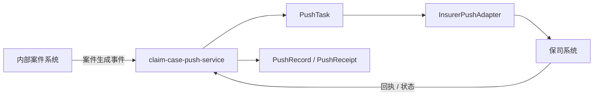

# 案件推送流程设计

## 总体架构

## 核心链路设计

1. 消费案件生成事件后，应用层按事件版本、业务幂等键和当前任务状态校验，创建或回放 `PushTask`。
2. `PushTask` 选择目标保司与 `InsurerPushAdapter`，在事务外发起调用；每一次调用尝试写入 `PushRecord`，回执写入 `PushReceipt`。
3. 推送结果只经聚合显式行为推进任务状态；失败依据已确认策略调度重试，达到阈值后告警，不由 Redis 或 MQ 作为终态事实。
4. 回执入口按回执幂等键校验，重复或乱序消息安全结束并保留必要交互审计。

## 核心数据模型

- 首项实施任务是建立推送架构基准，确定 `PushTask`、`PushRecord`、`PushReceipt`、`PushStrategy` 的标识、状态机、不变量、表结构、迁移方式和恢复策略。
- 推送库由 Push 上下文独立拥有，不建立物理外键，不共享 Sign 表或领域实体。
- 所有跨系统调用必须携带已登记的业务幂等键；`InsurerPushAdapter` 终止保司 DTO、字段转换和错误码语义。

## 异常处理与测试策略

- 外部调用、重试与回执处理不在数据库事务内执行；状态事实与事件意图按架构基准持久化后再投递。
- 覆盖案件事件幂等、一个案件多任务、Adapter 路由、重复/乱序回执、可重试与不可重试失败、重试耗尽、租户并发隔离和跨库禁止访问。
- 后端实现执行 `mvn verify`；消息与保司边界补充契约测试。
