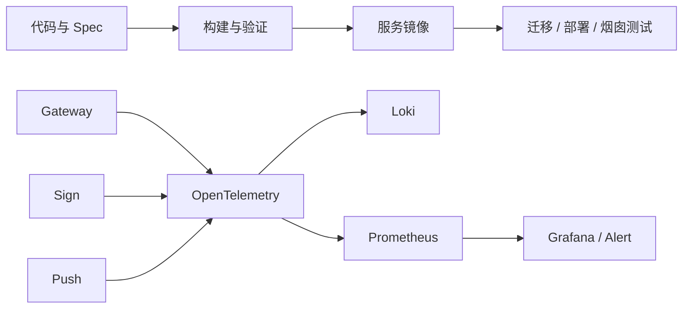

# 交付与可观测设计

## 总体架构

## 核心链路设计

- CI 根据改动范围运行后端或前端门禁，并执行格式、依赖与 Compose 配置校验；仅验证通过的提交构建服务镜像。
- 部署流程先校验配置与迁移顺序，再执行数据库迁移、服务启动和健康检查；失败时停止后续步骤并保留安全诊断信息。
- 网关、Sign 与 Push 在请求、消息消费、补偿和外部调用中统一传播 `traceId`，并关联允许记录的租户和业务标识。
- Metrics、Logs、Traces 使用基线指定的命名和脱敏规则；告警指向服务、时间窗口、失败类型与 `traceId`，不携带报文原文。

## 异常处理与测试策略

- 迁移失败、镜像构建失败、健康检查失败或告警配置无效均阻断发布；业务数据回滚按各领域迁移策略执行，不由流水线直接修改业务状态。
- 验证包括门禁触发条件、镜像可启动、迁移顺序、Trace 跨网关与服务透传、敏感信息扫描以及关键指标与告警规则加载。
