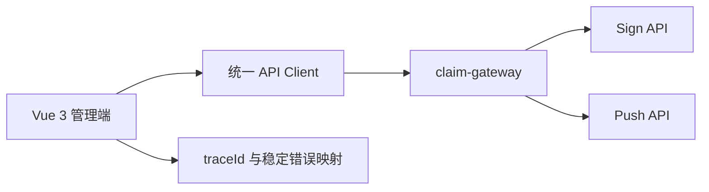

# 运营管理台设计

## 总体架构

## 核心链路设计

- 页面按 `sign`、`material`、`issue`、`case`、`push`、`tenant` 组织，每个域包含路由、页面、必要 Store、Composable 与 API 模块。
- 统一 API Client 负责认证、网关地址、`traceId`、`ApiResult<T>` 解包和稳定错误映射；业务页面只处理展示与用户交互。
- 查询页使用服务端分页、条件过滤和返回的租户范围；材料页面仅展示受控访问地址或元数据，不缓存材料原文。
- 聚合查询局部失败时，页面保留成功区域，呈现失败来源与 `traceId`，并提供安全重试入口。

## 接口与测试策略

- API 类型、字段和错误码只从平台契约版本化 Spec 已登记的版本维护；禁止页面自行猜测 DTO。
- 前端不持久化租户业务明细、外部凭证或跨租户缓存；路由守卫和 API Client 以网关认证与租户上下文为准。
- 覆盖路由权限、统一错误映射、`traceId` 回传、分页/空结果、局部失败与敏感信息不落客户端存储；执行 `npm run typecheck` 与 `npm run build`。
