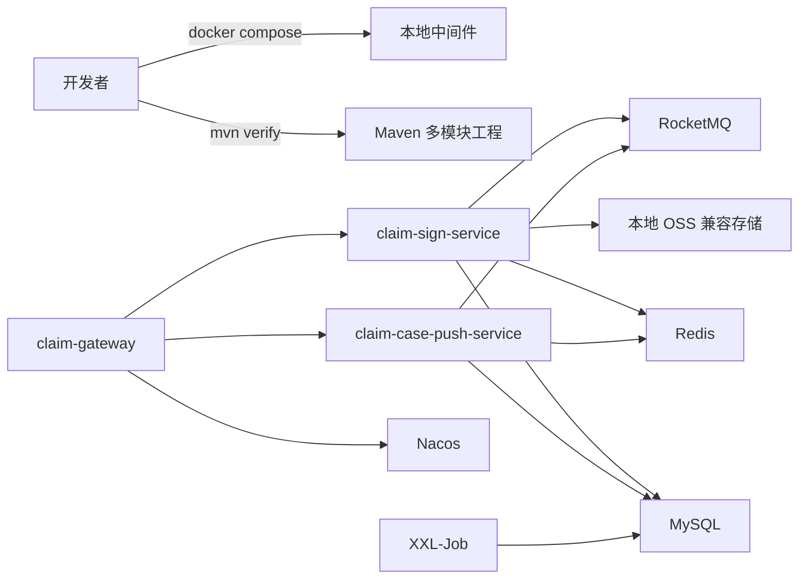

# 平台工程启动设计

本 Spec 只落地平台基础设施，服务边界、共享模块限制、技术版本与响应契约均遵循 [项目基线](../baseline.md)。签收领域实现由 [签收流程 Spec](../sign-workflow/requirements.md) 承接，不在此重复或提前实现。

## 总体架构

## 核心链路设计

1. 根 `pom.xml` 统一锁定 Java 17、Spring Boot 3.2 及基线指定依赖版本；四个模块由根工程聚合构建。
2. `claim-common` 提供 `ApiResult<T>`、Trace 上下文、通用错误响应模型和无领域含义的基础工具；不得引入 Sign 或 Push 类型。
3. 每个可执行服务提供 local profile、Actuator 健康检查和结构化安全日志。`traceId` 由入口透传；缺失时在网关或服务入口生成，并写入 MDC 与响应。
4. `claim-gateway` 从 Nacos 读取本地路由与限流配置，只转发版本化服务入口。认证凭证到 `TenantContext` 的映射尚未确认，本 Spec 不伪造信任来源，也不允许从业务请求体读取 `tenantCode`。
5. Compose 将 MySQL 8、Redis 7、RocketMQ、Nacos、XXL-Job 与 OSS 兼容存储编排为有健康检查的本地依赖。配置通过不含真实凭证的环境变量模板注入；本地持久卷只保存可重建的开发数据。
6. Compose 的 app profile 使用各服务 Dockerfile 构建并启动三个后端服务；infra profile 可单独供 IDE 直接启动服务使用。

## 核心模块与配置边界

| 模块或文件 | 职责 | 禁止内容 |
| --- | --- | --- |
| 根 `pom.xml` | 模块聚合、版本与插件管理 | 领域依赖和业务实现 |
| `claim-common` | 响应信封、Trace、通用错误模型 | 领域实体、Mapper、Repository、业务异常 |
| `claim-gateway` | 路由、限流、Trace 入口与本地配置 | 租户报文解析、领域状态、持久化业务事实 |
| `claim-sign-service` | 可启动应用与健康检查 | 提前创建 Sign 领域模型、表或消息消费者 |
| `claim-case-push-service` | 可启动应用与健康检查 | 提前创建 Push 领域模型、表或消息消费者 |
| `compose.yaml` 与环境模板 | 本地依赖、网络、卷、健康检查 | 真实密钥、生产地址与业务 DDL |

## 异常处理与安全

- 中间件不可用时，服务健康检查必须反映依赖状态；启动或调用日志仅记录依赖名称、服务名与 `traceId`，不记录账号、令牌、连接串或请求原文。
- Compose 默认凭证只适用于本地开发，提交的配置文件只保留占位值或开发专用值；生产凭证不进入仓库。
- 服务无法识别可信租户时，不得建立 `TenantContext` 或以请求中的业务字段替代；待租户认证协议确认后由后续实现补齐。

## 测试策略

- Maven：根工程执行 `mvn verify`，验证四个模块可编译、基础健康与 Trace 单元测试通过。
- Compose：执行 `docker compose --profile infra up -d`，等待所有依赖健康；执行 `docker compose --profile app up --build -d`，验证三个服务健康检查可达。
- 网关：验证路由、限流配置加载以及入口 `traceId` 的生成与透传；验证失败响应不暴露实现细节。
- 边界：验证 `claim-common` 不依赖任何领域模块，且本 Feature 未引入业务 DDL、业务 Controller、消息 Topic/Tag 或租户协议实现。
