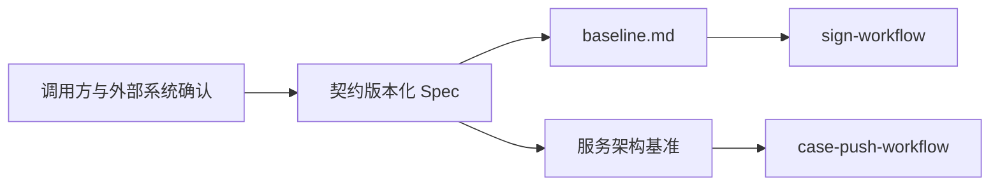

# 平台契约版本化设计

## 核心链路设计

## 核心数据模型

本 Spec 不新增业务表、缓存键或消息实现。每项契约登记如下内容：

| 契约类别 | 必填内容 | 长期归属 |
| --- | --- | --- |
| Sign HTTP | 路径、方法、请求响应字段、错误码、鉴权前提 | `baseline.md` §8 |
| Sign 事件 | Topic、Tag、消费者组、版本、载荷、幂等键、顺序要求 | 基线与签收架构基准 |
| 问题件定位 | `ClaimIssue` 业务定位、回复与补材关联规则 | 基线与签收架构基准 |
| 下游 Adapter | 调用方、请求响应映射、幂等键、超时与错误映射 | 对应架构基准 |
| Push 契约 | 案件生成、保司推送与回执字段、版本、兼容策略 | 推送架构基准与基线 |

## 异常处理与测试策略

- 新字段只追加；破坏性变更发布新版本并提供迁移窗口。
- 未确认字段、错误语义或幂等键不得由代码猜测；关联任务维持阻塞。
- 文档样例与契约测试不得包含报文原文、凭证、材料内容或个人信息。
- 确认后由对应实现 Feature 补充 HTTP 与消息契约测试，覆盖版本兼容、重复投递、乱序和错误映射。
