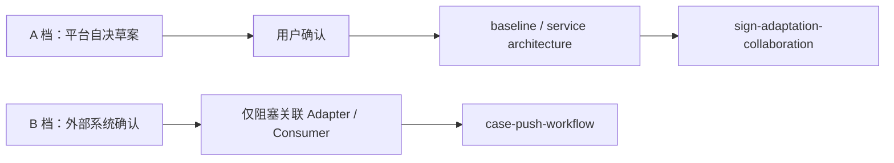

# 平台契约版本化设计

## 总体架构

## 契约分档

| 档位 | 契约项 | 决策与解锁方式 | 长期归属 |
| --- | --- | --- | --- |
| A | 签收与子资源 HTTP 字段草案、鉴权前提、错误触发条件 | AI 起草 → 用户确认 → 回写后解锁对应 Controller/契约测试 | `baseline.md` §8 |
| A | `SIGN_ACCEPT`、`ISSUE_REPLY`、`CLAIM_REVOKE` 的 Topic、Tag、消费者组、重试与消费失败口径 | AI 起草 → 用户确认 → 回写后解锁消息定义/路由 | 基线与签收架构基准 |
| A | 问题件的**对外**定位字段命名、消息载荷与多次打回时回复/补材的绑定语义；内部标识 `issueNo` 已由架构基准 §3 固定，不在待确认范围 | AI 起草 → 用户确认 → 回写后解锁问题件协同 | 基线与签收架构基准 |
| A | 已登记错误到 `SignErrorCode` 的映射边界 | AI 起草 → 用户确认 → 回写后解锁边界映射 | 基线与签收架构基准 |
| B | 审核、承保的真实请求响应、超时、幂等和错误语义 | 外部责任人确认；只解锁对应 Sign Adapter/Consumer | 签收架构基准 |
| B | 每个真实租户的验签算法、加解密方式、报文字段与凭证 | 租户责任人确认；只解锁该租户自己的接入 Spec，不解锁平台适配抽象 | 签收架构基准 §1.1 与租户接入 Spec |
| B | 案件生成事件的拥有方、载荷与版本 | 内部案件系统责任人确认；只解锁 Push 事件消费 | 推送架构基准与基线 |
| B | 保司推送与回执协议 | 保司责任人确认；只解锁 `InsurerPushAdapter` 和回执处理 | 推送架构基准 |

## 核心链路设计

1. A 档先产出不含真实个人信息、凭证和原始报文的版本化契约草案；草案必须说明调用方行为、幂等键、失败处理和兼容性。
2. 只有用户确认后的 A 档内容可以写入基线或服务架构基准，并解除精确对应的实现任务。
3. B 档在外部责任人确认前只维护决策台账：责任人、待确认项目、阻塞范围和下一步；不创建默认 DTO、伪 Topic 或 mock 协议。
4. 新字段仅追加；破坏性变更发布新版本并定义迁移窗口。实现 Feature 再据已确认内容补充 HTTP 或消息契约测试。

## 异常处理与一致性

- 基线与架构基准记录长期固定值，活动 Spec 只保留本轮草案、实施顺序和阻塞状态。
- 文档样例与契约测试不得包含生产凭证、材料原文或个人信息。
- 发现同一契约在基线与架构基准表述不一致时，按基线优先报告并先修订文档，不能由实现自行选择。
