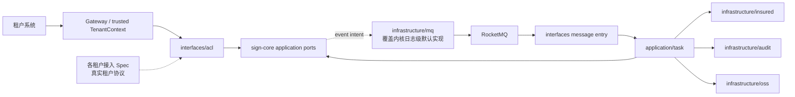

# 签收适配与协同设计

本 Spec 只承接协议和外部协同增量。稳定状态机、数据模型、创建幂等与补偿基线见 [签收服务架构基准](../../architecture/claim-sign-service.md)，内核实现见 [sign-core](../sign-core/design.md)。

## 总体架构

## 核心链路设计

1. Gateway 先建立可信 `TenantContext`；`TenantAdapterRouter` 再以 `tenantCode + protocolVersion` 选择 Pipeline。Pipeline 顺序为验签/解密、`Parser`、`Validator`、`Converter`，响应反向完成转换与保护。本 Spec 交付这条抽象与编排，并用 `local` profile 的测试租户 Pipeline 验证；真实租户的 Pipeline 属于该租户自己的接入 Spec。
2. Controller 和 MQ 入口只做协议反腐、调用用例和边界异常映射；命令、查询和状态推进调用 `sign-core` 的应用端口，DTO 不得进入领域层。租户侧问题件定位字段在 ACL 内映射为平台 `issueNo` 后才离开适配层。HTTP 子资源按 `POST /api/v1/signs` 同步创建先行、其余子资源随后的顺序交付，因为压测与端到端可见性都挂在这个入口上。
3. 外部调用先写入或准备所需的安全审计，再在事务外调用对应 Adapter。返回后由 `application/task` 取得状态锁、校验当前状态并调用聚合行为；重复、乱序或终态消息安全结束。
4. `InteractionLog` 的首次提交记录已由内核事务写入；后续审核、承保、OSS、补偿和迟到回调通过独立事务追加摘要。审计失败不得撤销既有外部副作用，但必须输出结构化失败信号。
5. `sign-core` 的补偿 Handler 调用本 Feature 提供的恢复端口；`WAIT_AUDIT_ACCEPT` 仅记录超时信号，不得重提审核任务。

## 契约分档与实现闸门

| 档位 | 内容 | 实现规则 |
| --- | --- | --- |
| A：平台自决 | HTTP 子资源字段草案、Topic/Tag/消费者组命名、`SignErrorCode` 映射、MQ 重试与消费失败口径、问题件的**对外**定位字段命名与回复绑定语义 | 由契约 Spec 起草、用户确认并回写后实现；未经确认不得创建对应 Controller、消息定义或错误映射。问题件的内部定位 `issueNo` 已由架构基准 §3 固定，不属于 A 档待确认内容 |
| B：外部依赖 | 审核/承保真实报文、案件生成事件归属、保司接口字段与回执语义 | 只阻塞对应 Adapter/Consumer；任务必须标明外部责任人和待确认内容，不得用默认 DTO 或 mock 协议替代 |
| 租户接入：外部依赖 | 每个真实租户的验签算法、加解密方式、报文字段与凭证 | 由该租户的接入 Spec 承接，不在本 Spec 解锁范围内；本 Spec 只保证抽象可被实现和测试 |

## 组件与包位置

| 角色 | 落点 |
| --- | --- |
| Tenant Adapter、Pipeline、租户协议 DTO/Converter | `interfaces/acl` |
| HTTP Controller、消息入口、异常映射 | `interfaces/sign`、`interfaces/material`、`interfaces/issue`、`interfaces/internal`、`interfaces/advice` |
| 消费与外部协同编排 | `application/task` |
| 承保、审核、OSS、RocketMQ 实现 | `infrastructure/insured`、`infrastructure/audit`、`infrastructure/oss`、`infrastructure/mq` |

## 并发控制与流量治理

- ACL 和 Adapter 不自行修改 Sign 状态；状态锁、聚合校验与幂等由内核端口统一执行。
- 网关按租户、调用方和路由限流；适配与协同层不以租户分支绕过网关规则。
- Consumer 必须按业务幂等键和当前状态去重；不可达、重试耗尽、积压和超时记录 `traceId`、`tenantCode`、`signNo`、失败类别与恢复动作的结构化日志，跨系统场景追加审计。

## 测试策略

- ACL：`local` 测试租户 Pipeline 的完整角色链、路由命中与未命中、非法凭证、上下文缺失和响应保护；真实租户 Pipeline 在其接入 Spec 内测试。
- 协同：外部幂等键、异常映射、重复/乱序消息、终态迟到消息、问题件多次往返、撤销通知补发。
- 契约：已确认 A/B 项对应的 HTTP 与消息契约测试；B 档未确认不创建伪契约测试，真实租户协议未到位时也不得为其编写假报文测试。
- 压测：Docker Compose 依赖健康后运行 Gatling Java，同键与不同键并发均有硬断言；任何依赖不可达、断言失败或报告缺失均返回失败。
- 后端门禁：`mvn verify`。
