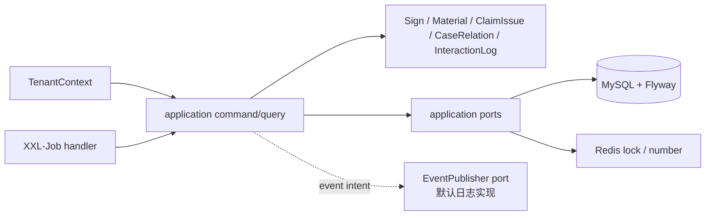

# 签收内核设计

长期分层、状态机、数据模型和补偿策略以 [签收服务架构基准](../../architecture/claim-sign-service.md) 为准。本 Spec 只定义稳定内核的代码落点和交付边界；业务需求见 [requirements.md](requirements.md)。

## 总体架构

## 核心数据模型

- Flyway SQL 位于 `claim-sign-service/src/main/resources/db/migration`，按基线 §3 的版本化规则交付；每个迁移可在空库执行一次，禁止手工建表和运行时临时 DDL。
- 五个聚合及五张表、字段、状态机、唯一索引与逻辑关联均以架构基准 §2、§3 为准，并按其**最终列**一次建表：`ClaimIssue` 自带平台定位列 `issue_no`（在 `tenantCode + signNo` 范围内唯一，由内核在保存问题时发放）与 `ext_json` 扩展列。平台契约 A 档只决定问题件的对外字段名、消息载荷与回复绑定语义，一律映射到已存在的 `issue_no`，不在本 Feature 之后为对外命名变更 DDL；确实需要新增可检索列时，先回写架构基准 §3，再作为独立版本化 `ALTER` 交付。
- `SignRepository` 承担事实库快查和并发赢家回查；业务锁与回放缓存通过 `application/port` 访问 Redis，均不作为事实来源。
- 首次 `SIGN_SUBMIT` 审计与创建事实在同一事务；后续交互日志由调用方通过独立事务端口写入，并执行基线脱敏约束。

## 组件与包位置

| 角色 | 落点 |
| --- | --- |
| 聚合、值对象、状态与领域异常 | `domain/sign`、`domain/material`、`domain/issue`、`domain/caserelation`、`domain/interactionlog` |
| 创建、撤销与内核查询用例 | `application/command`、`application/query`、`application/result` |
| 发号、锁、回放、事件发布、恢复调度端口 | `application/port` |
| 恢复策略编排 | `application/task` |
| MyBatis-Plus DO / Mapper / Converter / Repository | `infrastructure/persistence` |
| Redis 发号、锁和回放实现 | `infrastructure/cache` |
| 事件发布端口的日志级默认实现 | `infrastructure/event` |
| Flyway、XXL-Job 执行器与补偿 Handler 配置 | `infrastructure` |

`interfaces/acl`、HTTP Controller、MQ Consumer 及外部 Adapter 不属于本 Spec，不创建空包或占位实现。唯一允许的默认实现是 `EventPublisher` 端口的日志级实现：它只输出架构基准 §4.1 要求的结构化事件意图日志，不建表、不持久化、不保证投递，因而不是 Outbox；适配与协同交付 RocketMQ 实现后覆盖它。缺少这一实现时本 Feature 无法独立启动，也不能通过 `mvn verify`。

## 核心链路设计

1. 上层已验证的 `TenantContext` 与标准化命令进入 `SignCommandHandler`；先按 `tenantCode + externalApplyNo` 快查。
2. 未命中时取得业务锁，在锁内二次快查、发放 `SignNo`，并以一个事务写入 Sign、初始 Material、初始状态和 `SIGN_SUBMIT` 审计。
3. 数据库唯一键冲突时回查并发赢家并回放；回查失败抛出可重试的签收并发错误，不能返回未知 500。
4. 事务提交后经 `EventPublisher` 端口表达事件意图，回放已存在申请时不重复表达；具体 MQ 路由由适配与协同实现。本 Feature 交付期间该端口只有日志级默认实现，因此异步受理链路不在本 Feature 端到端运行，内核以应用层集成测试验证事件意图正确表达。端口失败只记录恢复所需事实与结构化日志，不回滚已提交事实、不改变同步响应，交由当前状态的补偿扫描重发。
5. XXL-Job 调用恢复编排：其执行器、Handler 与本地调度均在本 Feature 交付。恢复编排根据架构基准 §4.3 调用事件或外部协同恢复端口；没有可自动恢复条件时记录结构化人工处理/超时信号，绝不直接改写状态。

## 并发控制与异常处理

- 创建锁只覆盖读、校验和短事务；`signNo` 状态锁与创建锁分离，文件 IO、外部调用和事件投递不持锁。
- 所有 Repository 查询以当前 `TenantContext.tenantCode` 限定；全局 `SignNo` 发号的最大值读取是唯一允许的跨租户读取。
- 领域异常由 `domain/*/exception` 表达；HTTP 映射和外部错误映射不在内核实现。
- 补偿、恢复失败和不可自动恢复状态按基线 §10 记录结构化日志；跨系统交互由适配与协同层追加 `InteractionLog`。不把日志称为生产告警。

## 测试策略

- 聚合：状态转移、终态保护、问题件往返、撤销前置条件。
- 应用：三层幂等、锁未获取、唯一键冲突回放、租户隔离、创建事务原子性和 `SignNo` 恢复；事件端口在默认实现下可使应用上下文启动，断言创建成功才表达事件意图、回放不重复表达、端口失败不影响已提交事实。
- 持久化：Flyway 空库迁移、无外键、唯一约束、逻辑索引、审计脱敏字段边界。
- 补偿：执行器注册、Handler 可调用、按状态选择恢复端口、不可自动恢复只产生结构化信号。
- 后端门禁：`mvn verify`。
