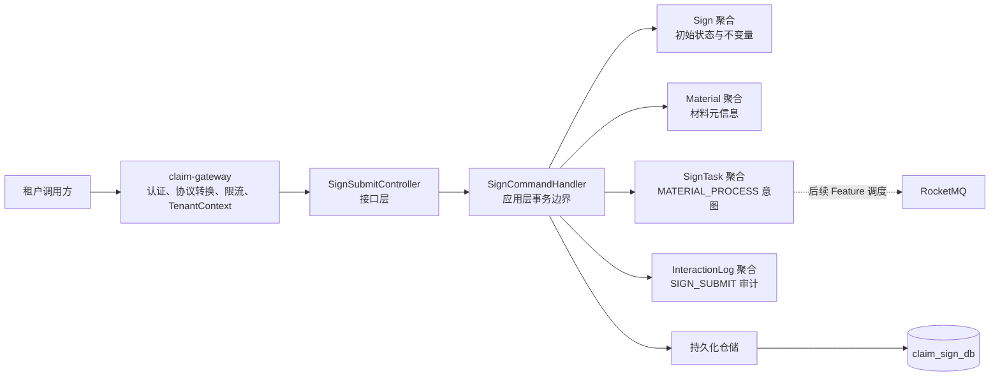
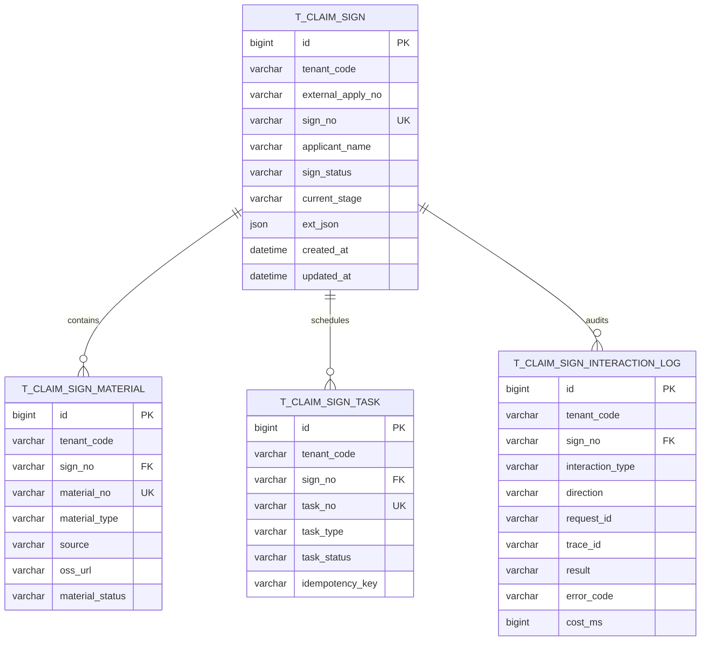
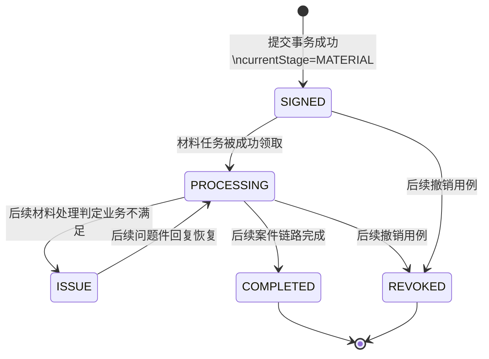
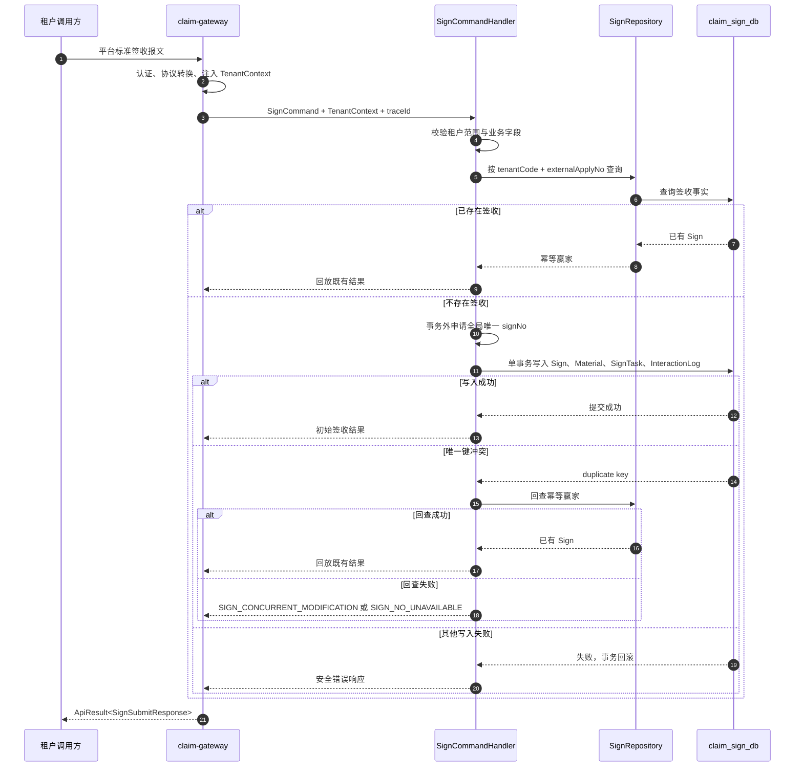

# 签收提交设计

## 总体架构

平台级服务边界、分层方向和长期对外契约遵循 [项目基线](../baseline.md)。本设计只补充签收提交在既定边界中的组件协作。

- 网关只提供已认证、已转换的平台标准报文与租户上下文；签收服务必须复核调用者允许操作该租户。
- `SignCommandHandler` 是写入用例及事务边界；`Sign` 聚合集中验证幂等前置条件、初始状态和阶段，不在 Controller 或 Mapper 中作领域决策。
- `SignTask` 是异步工作的原子意图记录：先与签收事实一同落库，再由后续任务调度能力安全投递至 RocketMQ，避免“写库后直接发消息”的双写风险。

## 核心数据模型

- `t_claim_sign` 的业务唯一键为 `(tenant_code, external_apply_no)`；`sign_no` 全局唯一。所有租户业务查询都带 `tenant_code`。
- `t_claim_sign_material` 仅保存材料类型、来源、OSS 地址引用和处理状态；原文不入库。材料编号全局唯一或按租户唯一的最终选择在 DDL 阶段与编号策略统一确定。
- `t_claim_sign_task` 创建一条 `MATERIAL_PROCESS` 初始任务，其 `task_no` 与业务幂等键支持重复投递、领取、重试和超时恢复；任务状态机的完整实现由材料处理 Feature 细化。
- `t_claim_sign_interaction_log` 使用基线固定字段集合，并关联 `sign_no` 以支撑链路定位。它不保存原始请求、响应或个人信息。
- DDL、索引、字段长度、审计列和 `SignNo` / `materialNo` / `taskNo` 的格式均是本 Feature 的实现细节；落地时随服务迁移脚本一并交付。

## 主状态机设计

本 Feature 只创建 `SIGNED / MATERIAL` 初始事实；虚线之外的转移由后续 Feature 实现。`COMPLETED` 与 `REVOKED` 保持终态，不能被普通异步任务回退。

## 核心链路设计

## 接口与契约

计划新增 `POST /api/v1/signs`，但它的请求字段、字段校验、成功响应字段、网关路由暴露方式及新增错误码尚未获得用户确认。编码前必须：

1. 确认平台标准请求至少如何表达 `externalApplyNo`、`applicantName`、`extJson` 与材料元信息；
2. 确认成功结果是否只返回 `signNo`、状态和阶段，或需要补充查询数据；
3. 将确认后的 HTTP 契约回写到 `docs/specs/baseline.md` §8，并确认是否需要新增领域错误码；
4. 再据此定义 `SignSubmitRequest`、`SignSubmitResponse`、`SignCommand` 与边界异常映射。

在该确认前，既有基线错误码按以下语义使用：找不到签收用 `SIGN_NOT_FOUND`；不合法状态用 `INVALID_SIGN_STATUS`；进行中的提交用 `SIGN_SUBMISSION_IN_PROGRESS`；唯一键竞争且无法回放时用 `SIGN_CONCURRENT_MODIFICATION`；发号故障用 `SIGN_NO_UNAVAILABLE` 或 `SIGN_NO_EXHAUSTED`。

## 并发控制与异步一致性

- 先按幂等键读取，再由 `(tenant_code, external_apply_no)` 唯一键最终仲裁；任何本地锁或回放缓存只能削峰，不能成为业务事实来源。
- 唯一键冲突后必须在新的只读路径中回查赢家；若查询受瞬时隔离或尚未可见影响，返回调用方可重试的 409，不将未知异常映射为 500。
- `signNo` 由应用层端口在事务外申请，事实库唯一键兜底；发号器必须能依据事实库恢复序列。
- 初始 `SignTask` 与业务事实同事务写入，它本身是后续投递的原子意图。后续 Dispatcher / Consumer 必须按 `taskNo` 或业务幂等键去重，且不在数据库事务中调用外部系统。

## 测试策略

- 单元测试覆盖 `Sign` 的初始状态、阶段与非法构造；覆盖同租户幂等、跨租户隔离及唯一键冲突后的回放。
- 仓储集成测试覆盖唯一索引、事务回滚、材料/任务/审计日志的原子创建与租户过滤。
- 接口测试覆盖参数错误、租户不匹配、成功提交、重复提交、竞争冲突及安全响应信封。
- 任务能力落地后补充重复投递和未投递任务恢复测试；本 Feature 不模拟承保、审核或案件外部调用。
