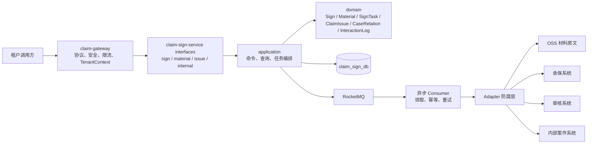
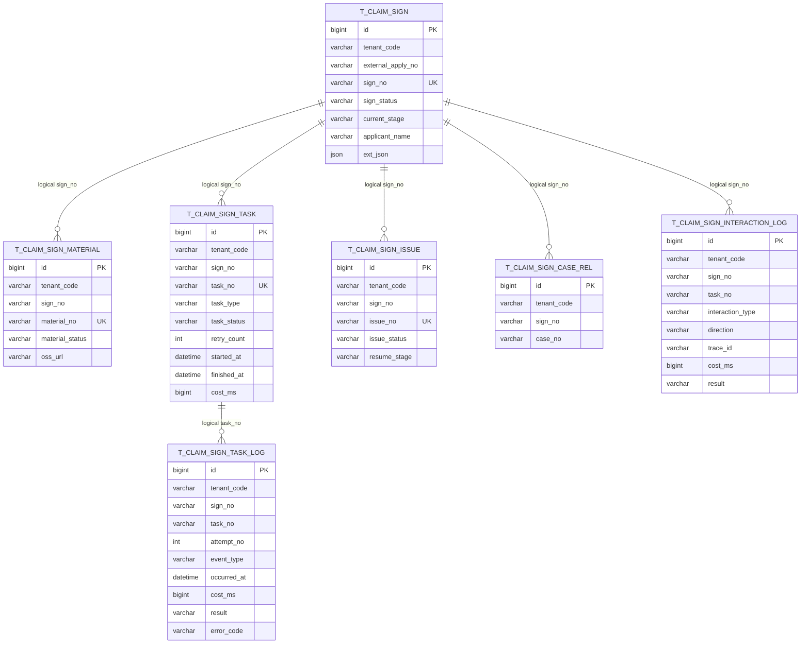
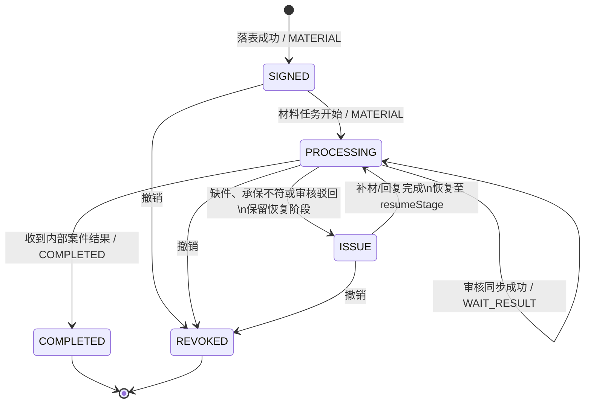
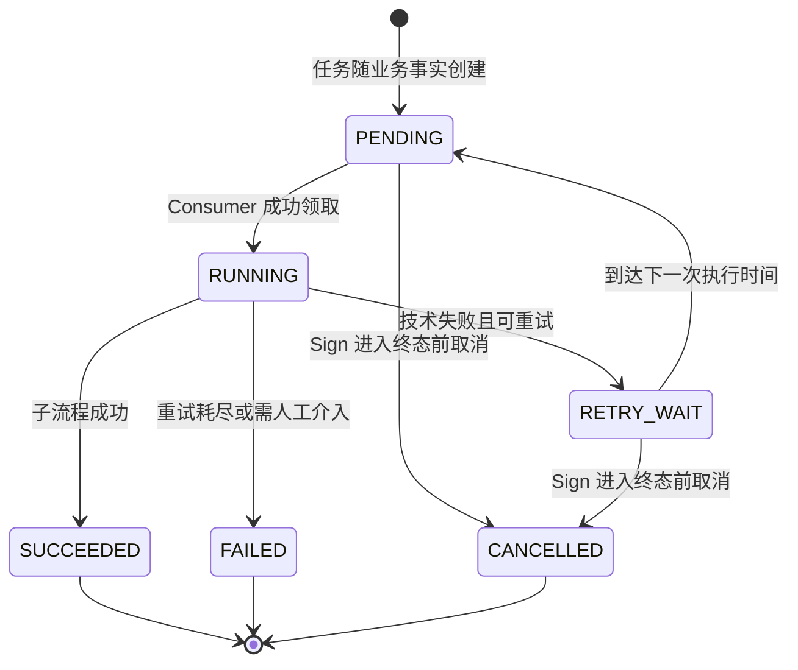
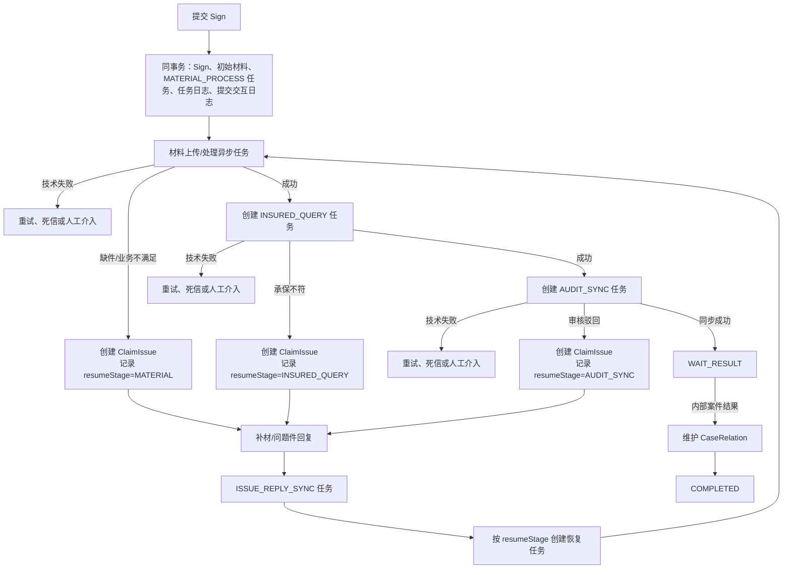
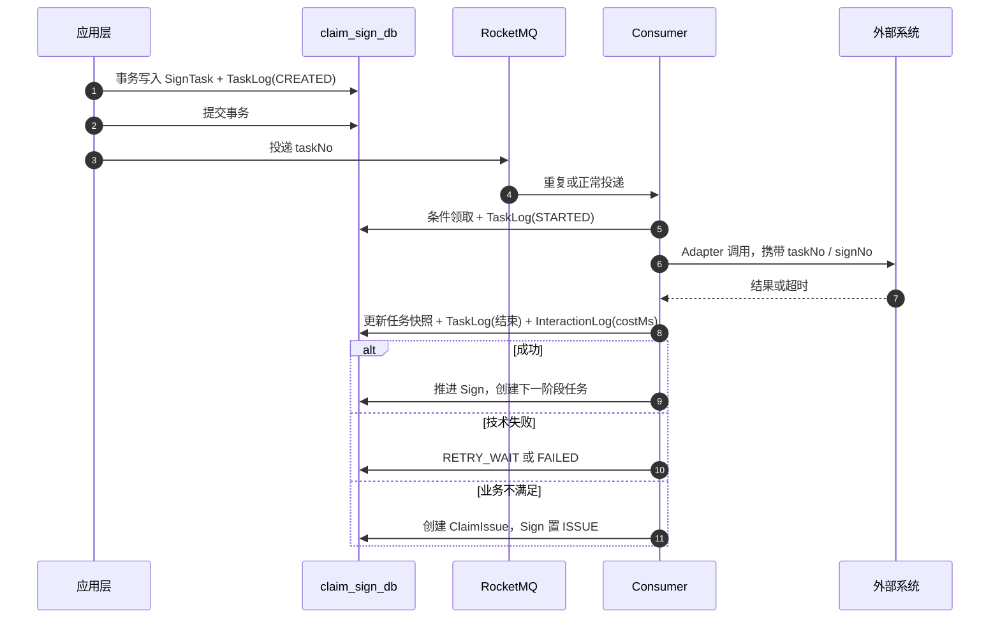

# 签收流程设计

## 总体架构

平台级服务边界和分层方向遵循 [项目基线](../baseline.md)。本 Feature 在既定 Sign 上下文内编排子流程，不新增微服务或独立查询服务。

- Controller、MQ Consumer 和 JobHandler 只作为入口；事务编排、任务创建和流程推进在 `application`，状态合法性集中在领域聚合。
- 材料上传入口只保存材料元信息和 OSS 引用；材料原文不进入 MySQL、日志、指标或 Trace。
- `SignTask` 是异步工作的事实与原子意图记录。Dispatcher 只投递已提交任务，Consumer 领取后再调用 Adapter；数据库事务中不调用外部系统。

## 核心数据模型

- 图中的连线是业务逻辑关联，**不是外键**。所有子表保留 `tenant_code + sign_no`，任务相关表再保留 `task_no`；这些列建立组合索引以支持租户隔离、恢复和审计查询。
- `t_claim_sign` 的唯一键为 `(tenant_code, external_apply_no)`，`sign_no` 为全局唯一。`id` 仅为内部主键。
- `t_claim_sign_task` 保存最新执行快照；`t_claim_sign_task_log` 追加记录 `CREATED`、`DISPATCHED`、`STARTED`、`SUCCEEDED`、`RETRY_SCHEDULED`、`FAILED`、`CANCELLED`，记录每次尝试的开始/结束与耗时。它是 `SignTask` 的历史实体，不是新聚合。
- `t_claim_sign_interaction_log` 只记录跨系统交互摘要；任务执行日志记录内部生命周期。两者共同回答“哪个子流程、何时开始/结束、耗时多久、结果如何”。

## 主状态机设计

## 核心流程设计

- `MATERIAL_PROCESS`、`INSURED_QUERY`、`AUDIT_SYNC` 是三项主异步子流程；问题件通知和回复同步使用既定的 `ISSUE_NOTIFY`、`ISSUE_REPLY_SYNC` 任务类型。
- 同一时刻每个 `signNo + taskType + stage` 只允许一个有效任务被领取；状态推进使用乐观锁或条件更新，数据库唯一索引只保障事实幂等，不承担流程锁。
- 业务失败与技术失败分流：前者创建问题件并暂停签收，后者保留签收阶段、进入任务重试，不把依赖超时伪装为缺件。

## 异步一致性与日志设计

- Producer 只发送已持久化的任务；若消息发送失败，由定时恢复任务扫描可投递任务，形成等效原子意图而非“先写库再直接发消息”。
- Consumer 条件领取失败代表重复消费或并发赢家已处理，应记录安全的重复处理结果后成功结束，不再调用外部系统。
- `started_at`、`finished_at` 与 `cost_ms` 记录本次任务执行耗时；交互日志的 `costMs` 单独记录一次外部调用耗时。查询流程 SLA 时以任务日志聚合，排查外部依赖时以交互日志定位。

## 接口与契约

计划暴露签收、材料、问题件与内部结果四类版本化入口，均以 `/api/v1/signs` 为根路径。具体方法、请求响应字段、材料上传方式、内部结果事件版本及 MQ Topic/Tag 尚未确认；这些稳定契约须先得到用户确认并回写基线，再创建 Controller、DTO 和消息定义。

## 测试策略

- 聚合测试：状态/阶段推进、终态保护、问题件恢复阶段与撤销前置条件。
- 任务测试：领取竞争、重复消息、重试耗尽、超时恢复、任务开始/结束/耗时日志。
- 集成测试：无外键 DDL、业务唯一键、租户过滤、逻辑关联校验和跨表事务回滚。
- Adapter 与接口测试：材料、承保、审核的成功、业务拒绝、超时、重复调用及脱敏响应。
- 验收测试：从签收落表到 `WAIT_RESULT`、问题件补材恢复、内部案件结果完成的端到端流程。
