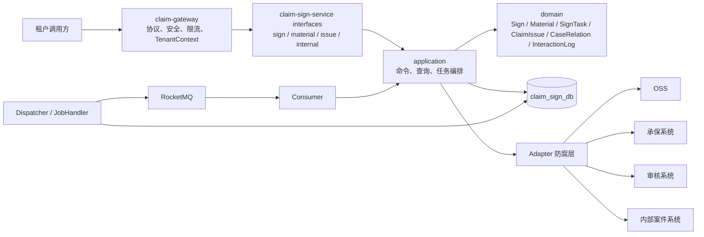
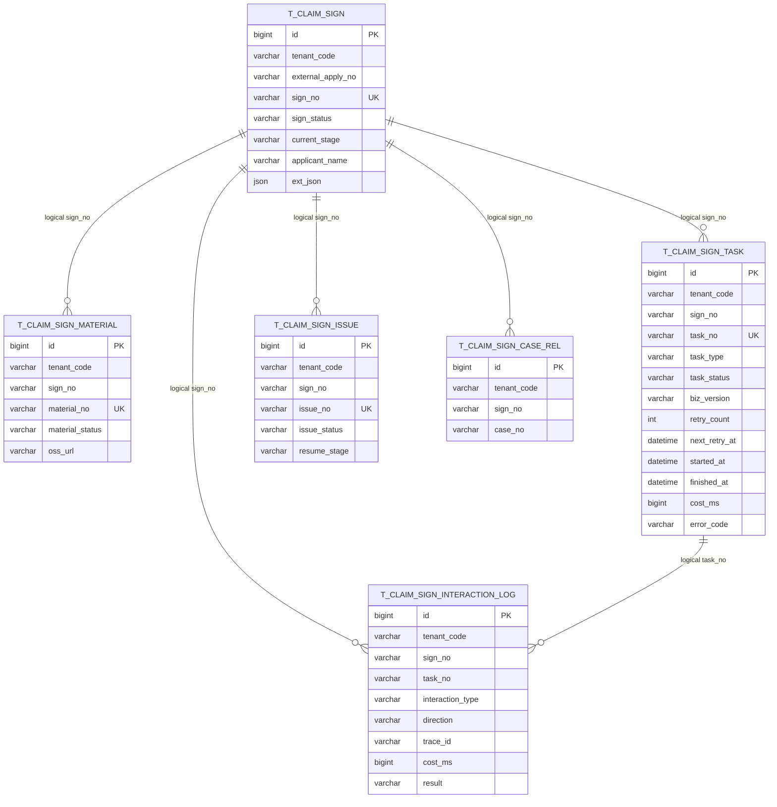
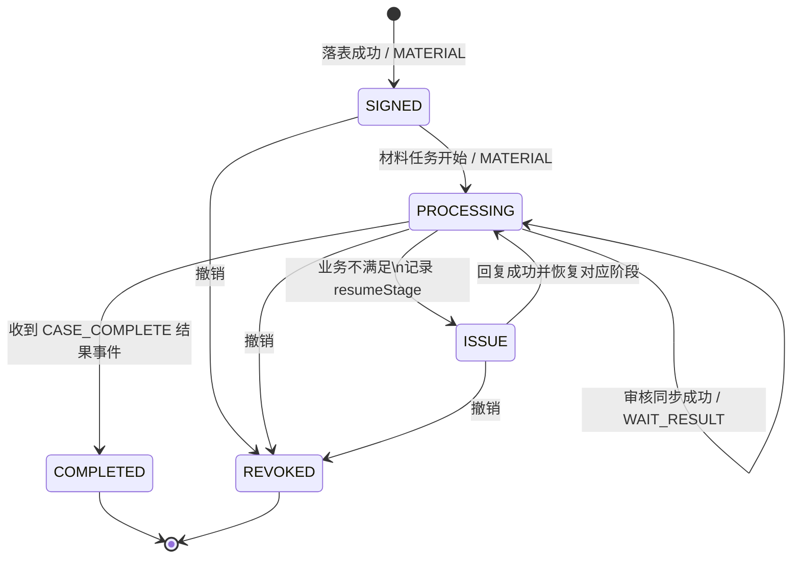
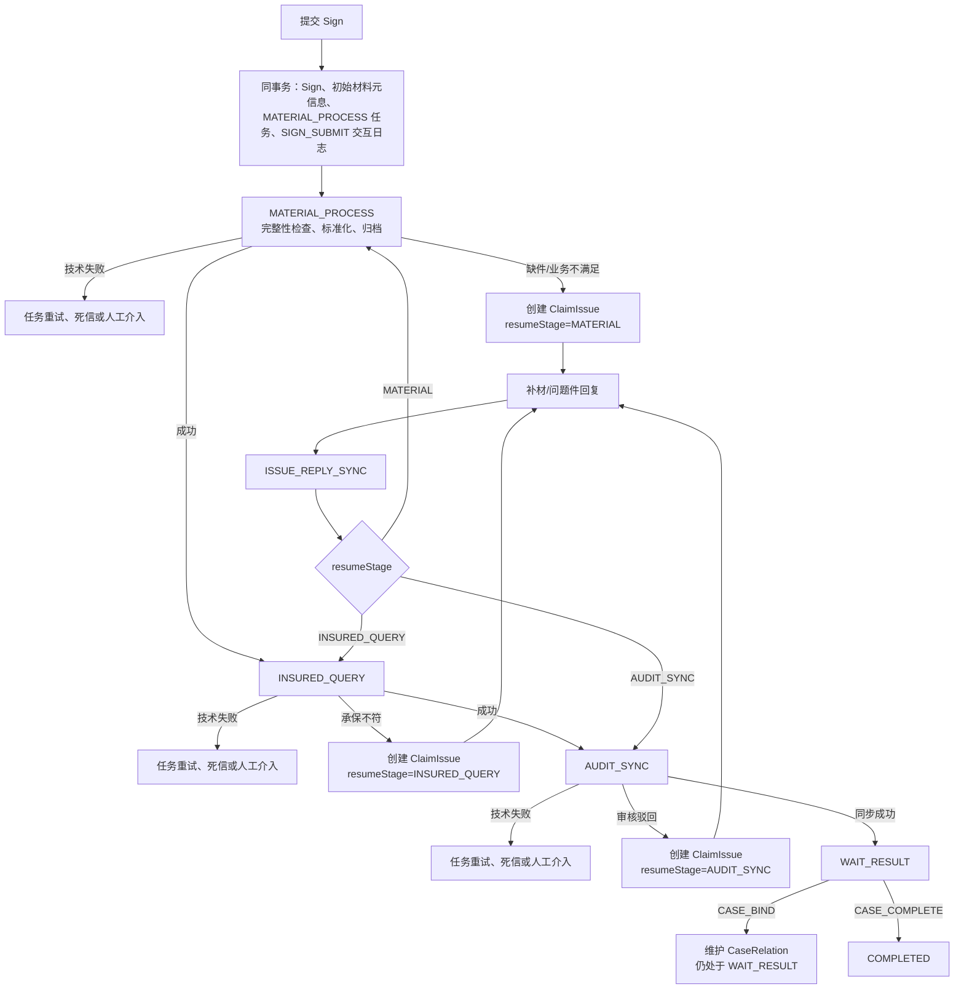
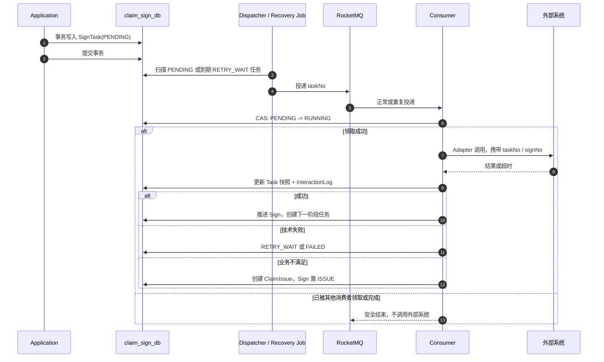

# 签收流程设计

## 架构与边界

平台级服务边界和分层方向遵循 [项目基线](../baseline.md)。本 Feature 在既定 Sign 上下文内编排业务流程，不新增微服务、独立查询服务或通用工作流引擎。

- Gateway 负责协议、安全、租户和流量；签收服务只处理平台标准报文，并再次校验调用方租户范围。
- Controller、Consumer、JobHandler 都只是入口。事务编排与流程推进位于 `application`，状态合法性位于领域聚合。
- `SignTask` 是“当前需要执行什么、执行是否成功、失败何时重试”的异步执行事实与可靠消息载体，不承担通用工作流、完整执行事件审计或 SLA 平台职责。
- 外部系统调用仅经 Adapter，且不在数据库事务中执行。

## 核心数据模型

- 图中连线是业务逻辑关联，**不是物理外键**。写入前由应用层校验关联事实，逻辑关联列建立查询索引，删除或状态变更不依赖数据库级联。
- `t_claim_sign` 的业务唯一键是 `(tenant_code, external_apply_no)`，`sign_no` 全局唯一；`id` 只作内部主键。
- `t_claim_sign_task` 只保存当前/最近一次执行快照。创建幂等使用 `sign_no + task_type + biz_version` 业务键；`biz_version` 表示该阶段的第几次有效执行，用于区分问题件恢复后的新任务。
- `t_claim_sign_interaction_log` 保留每次外部交互。一条 `SignTask` 可以对应多条交互日志，例如审核同步过程中的鉴权、附件传递和结果查询；它不记录材料原文或个人信息。

## 状态与流程

`signStatus` 只表示签收生命周期，`currentStage` 只表示当前处理位置；`SignTask.taskStatus` 表示子流程的执行状态，三者不混用。

- 材料上传与材料处理不是同一概念：上传入口只接收并保存 OSS 引用和材料元信息；`MATERIAL_PROCESS` 异步执行材料完整性检查、标准化或归档等后续处理，不代替调用方上传原文。
- `CaseRelation` 仅维护 `signNo ↔ caseNo`。收到 `CASE_BIND` 只建立或更新关系；只有明确的 `CASE_COMPLETE` 内部结果事件才将 `Sign` 推至 `COMPLETED`，因此可支持一个签收关联多个案件。
- 业务不满足创建 `ClaimIssue` 并暂停流程；技术失败只改变任务状态并重试。问题件解决后依据 `resumeStage` 创建对应任务，不统一回到材料处理。

## 异步任务与一致性

任务状态保持最小集合：`PENDING → RUNNING → SUCCEEDED`；可重试技术失败走 `RUNNING → RETRY_WAIT → PENDING`，重试耗尽或人工介入走 `FAILED`，签收终态前未执行任务可置 `CANCELLED`。`startedAt`、`finishedAt`、`costMs` 仅保存最近一次执行摘要，不建立独立任务事件历史表。

- Application 不直接发送 MQ。Dispatcher 扫描已提交的 `PENDING` 任务及到期 `RETRY_WAIT` 任务后投递；投递失败保留任务事实并由恢复 Job 再次扫描，实现可靠消息而不引入额外 Outbox 表。
- 数据库唯一键负责“不要重复创建”：同一 `signNo + taskType + bizVersion` 只能创建一个有效任务。条件更新负责“不要重复执行”：`UPDATE ... SET task_status = 'RUNNING' WHERE task_no = ? AND task_status = 'PENDING'` 仅影响一行时才允许调用外部系统。
- `SignTask` 记录一次业务动作的当前执行事实；`InteractionLog` 记录其执行过程中每一次跨系统交互，二者不重复承担任务事件历史。

## 接口与测试

计划暴露签收、材料、问题件与内部结果四类版本化入口，均以 `/api/v1/signs` 为根路径。具体 HTTP 字段、材料上传方式、内部结果事件版本和 MQ Topic/Tag 尚未确认；确认后须先回写基线再创建 Controller、DTO 和消息定义。

- 聚合测试：生命周期/阶段推进、终态保护、问题件恢复阶段与撤销前置条件。
- 任务测试：创建幂等、条件领取、重复消息、重试耗尽、到期恢复与最近执行摘要更新。
- 集成测试：无外键 DDL、业务唯一键、租户过滤、逻辑关联校验与跨表事务回滚。
- Adapter 与接口测试：材料、承保、审核的成功、业务拒绝、超时、重复调用及脱敏响应。
- 验收测试：签收至 `WAIT_RESULT`、问题件按阶段恢复、多个 `CaseRelation` 与 `CASE_COMPLETE` 事件完成流程。
