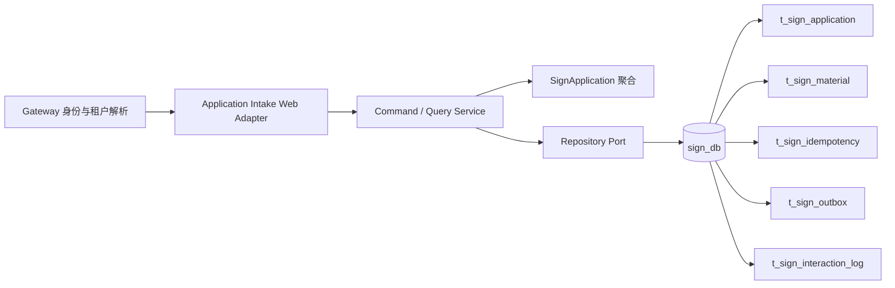
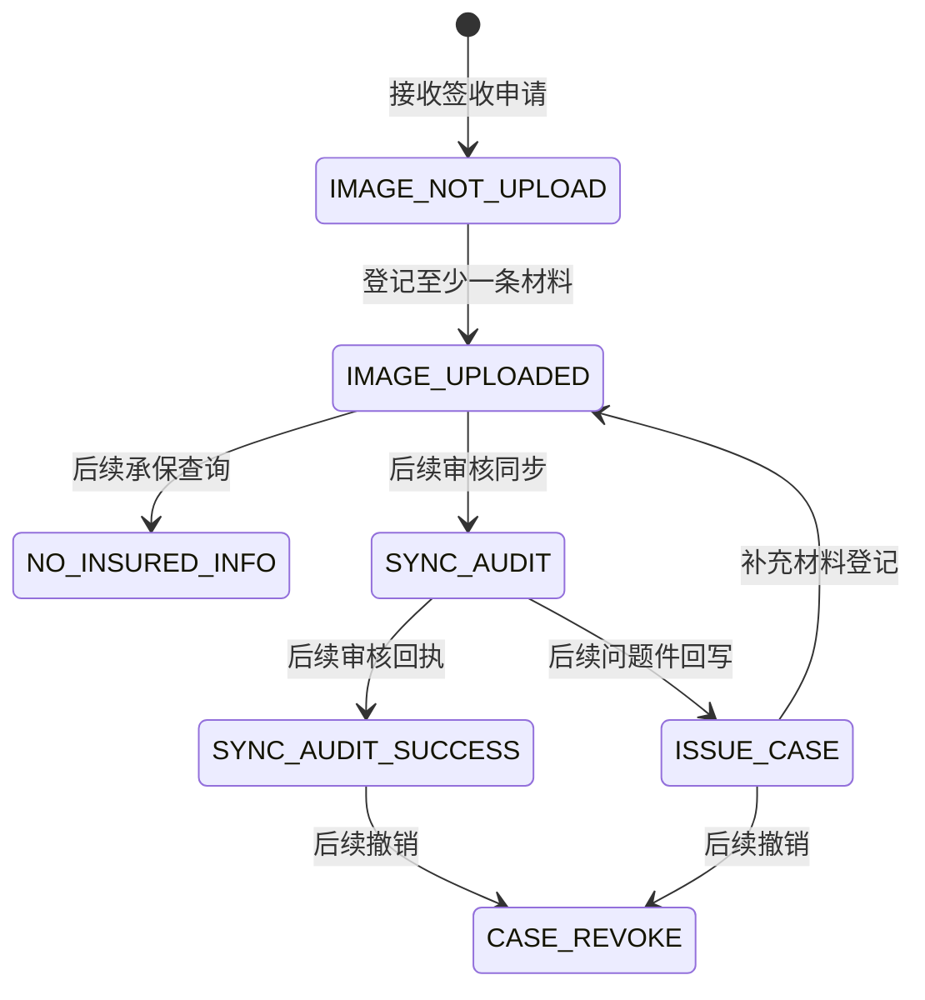

# 签收申请接入设计

## 总体架构



## 核心数据模型

`SignApplication` 是聚合根，以 `tenantCode + signNo` 标识；其原子边界包含申请状态和本次登记的材料。问题件表是审核系统回写的预留事实，当前不在本功能中写入。MyBatis-Plus 的 `*DO`、Mapper 和 MapStruct 映射器仅位于 `infrastructure`，领域层不依赖 ORM 框架。

```text
adapter/web Request DTO + trusted headers
        ↓ 手工组装（租户、Trace、幂等键不可来自请求体）
usecase Command / Query
        ↓ port
infrastructure SignApplicationDO / SignMaterialDO
        ↓ MapStruct
domain SignApplicationState / SignApplication 聚合 / SignMaterial 值对象
```

- `SignApplicationDO ↔ SignApplicationState` 由 `SignApplicationPersistenceMapper` 生成；数据库主键、`version`、逻辑删除标记不会进入领域状态。
- `SignMaterialDO → SignMaterial` 由同一映射器生成；租户和签收编号由仓储查询边界负责，不成为材料值对象属性。
- 聚合恢复与快照导出由 `SignApplication.restore(state)`、`snapshot()` 显式控制，MapStruct 不绕过状态机直接修改聚合。

| 表 | 数据所有者 | 用途 | 核心约束 |
| --- | --- | --- | --- |
| `t_sign_application` | Application Intake | 申请事实与状态 | 租户内 `sign_no`、`external_apply_no` 唯一；`version` 乐观锁 |
| `t_sign_material` | Application Intake | 影像元数据 | 仅通过所属申请的租户范围写入和查询 |
| `t_sign_problem` | Application Intake | 审核问题件预留事实 | 当前仅迁移建表，不提供写接口 |
| `t_sign_interaction_log` | Application Intake | 不含材料原文的交互审计 | 关联租户、签收编号与 traceId |
| `t_sign_idempotency` | Application Intake | 命令去重及结果回放 | `tenant_code + operation + idempotency_key` 唯一 |
| `t_sign_outbox` | Application Intake | 原子事件投递意图 | `event_id` 唯一，待发布状态可重试 |

## 主状态机设计



当前实现只有创建和材料登记两条转换。其他状态由后续明确的反腐层和回执用例拥有，不能通过本 API 直接设置。

## 核心链路设计

1. Web Adapter 校验 `X-Claim-Service-Token`，解析 `X-Claim-Tenant` 和可选 `X-Trace-Id`；请求体无租户字段。
2. 应用服务以 `tenant + operation + Idempotency-Key` 尝试创建幂等记录。已完成命令回放保存的结果；内容摘要不一致返回冲突；处理中返回可重试冲突。
3. 应用服务加载或创建聚合，执行状态校验；仓储在一个 Spring 事务中保存聚合、材料、交互日志、Outbox 和幂等结果。
4. 查询强制使用 `tenantCode + signNo` 条件，避免跨租户可见。

## 分层与包结构

`com.claim.platform.application` 是 Application Intake 限界上下文的根包；其下使用 `adapter`、`usecase`、`domain`、`infrastructure` 四层。`usecase` 替代易混淆的 `application.application`；不保留空的 `sign` 平行包。

## 并发控制

- 申请表使用 `version` 乐观锁，处理并发状态更新。
- 幂等记录先占位为 `PROCESSING`；唯一索引保证相同键只有一个首请求。竞争请求收到 `IDEMPOTENCY_REQUEST_IN_PROGRESS` 后使用同键重试。
- 外部申请编号的租户内唯一索引是最终去重屏障；唯一键冲突转换为稳定领域错误。

## 异步一致性与补偿

写入事务同时落库 Outbox，不在事务中调用审核系统。后续发布器按 `PENDING → PUBLISHED/FAILED` 更新并基于 `event_id` 重试；消费者按 `event_id` 去重。发布连续失败后应转入死信或人工介入状态，该组件不在当前范围。

## 接口契约

| 方法 | 路径 | 说明 |
| --- | --- | --- |
| `POST` | `/api/v1/sign-applications` | 接收申请；请求含 `externalApplyNo`、申请人字段和可选 JSON 信息 |
| `POST` | `/api/v1/sign-applications/{signNo}/materials` | 批量登记材料；请求含 `batchNo` 和非空 `materials` |
| `GET` | `/api/v1/sign-applications/{signNo}` | 查询当前租户申请和材料 |

写接口均要求 `Idempotency-Key`。所有响应使用 `ApiResult`，Adapter 统一映射校验、领域与未知异常，并仅记录脱敏标识和 traceId。

## 测试策略

- TEST-APP-001：聚合创建状态为 `IMAGE_NOT_UPLOAD`。
- TEST-APP-002：允许待上传和问题件状态登记材料，拒绝其他状态。
- TEST-APP-003：`mvn verify` 编译全部模块并运行单元测试。
- TEST-APP-004：MapStruct 映射测试验证 DO 不会把数据库技术字段带入领域状态。
