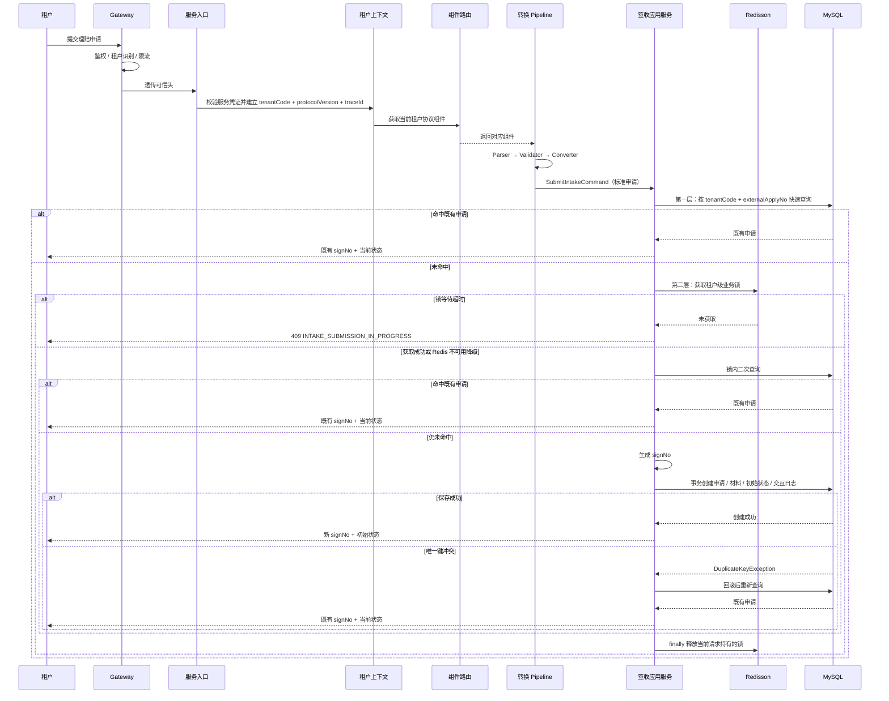

# 理赔申请签收标准流程设计

## 文档状态

| 项目 | 内容 |
| --- | --- |
| 状态 | Draft（设计完成，待评审后实现） |
| 关联需求 | `specs/claim-intake-standard-flow/requirements.md` |
| 所属限界上下文 | Claim Intake |
| 模块 | `backend/claim-intake-service` |

## DS-CISF-001 职责边界与总体流程

本设计把用户给出的标准签收时序落到现有分层：Gateway 和服务入口负责可信上下文，租户组件包负责协议转换，Application 负责标准用例、幂等和事务，Infrastructure 负责 Redisson 和 MySQL。



职责边界：

| 能力 | 归属 | 本设计处理方式 |
| --- | --- | --- |
| 鉴权、租户识别、限流、Trace | Gateway / Edge & Platform | 外部依赖；服务只消费可信头并再次校验 |
| 服务凭证、租户头、协议版本头校验 | Claim Intake `interfaces` | 复用 `GatewayRequestContextResolver`、`TenantIntakeContextResolver` |
| 协议组件路由 | Claim Intake `interfaces/tenant` | 复用 `TenantProtocolHandlerRegistry` |
| 报文解析、校验、转换 | Claim Intake `interfaces/tenant` | 复用 `DefaultIntakeConvertPipeline` |
| 标准命令幂等与创建 | Claim Intake `application` | 本设计新增 |
| 分布式业务锁 | Claim Intake `infrastructure` | 本设计新增 Redisson 适配器 |
| 申请、材料、日志事实 | Claim Intake `domain` + `infrastructure` | 复用现有聚合和 MySQL 表 |

`SubmitIntakeCommand` 是转换层和标准签收用例之间的边界。验签、解密不属于本设计；进入 Pipeline 的报文视为已由受信任上游完成该步骤。

## DS-CISF-002 标准命令与材料

`SubmitIntakeCommand` 增加材料元数据列表，作为标准申请的一部分：

```java
public record SubmitIntakeCommand(String tenantCode, String traceId, String externalApplyNo,
                                  String applicantName, Applicant applicant, AccidentPerson accidentPerson,
                                  MainInsured mainInsured, Payee payee, List<IntakeMaterial> materials,
                                  String extJson) {
}
```

约束：

- `materials` 在 Record 紧凑构造器中转为不可变列表，`null` 按空列表处理。
- 材料只包含元数据，不包含二进制内容、下载地址访问凭证或 OSS 信息。
- `reference` Converter 和既有 `/api/v1/claim-intakes` 入口传空列表；真实租户 Converter 支持随申请提交材料时再填充。
- 重放请求携带的材料不补写、不覆盖、不重复插入；材料补充仍使用 `uploadMaterials` 用例。
- 材料列表不进入 `ClaimIntake` 聚合的内存状态；聚合只负责初始状态和 `registerMaterials()` 状态迁移，材料元数据由 `IntakeMaterialStore` 在同一事务写入。

创建规则：

```text
材料为空 → ClaimIntake.create(...) → IMAGE_NOT_UPLOAD
材料非空 → ClaimIntake.create(...) → registerMaterials() → IMAGE_UPLOADED
```

`ClaimIntake.create` 仍只从 `IMAGE_NOT_UPLOAD` 开始，状态迁移通过聚合方法完成，不在服务中直接赋值。该设计解决 `specs/tenant-adapter-intake/` 的 A-1；实现完成后需回写旧 Spec。

## DS-CISF-003 三级幂等与 Redisson 业务锁

### 幂等层次

| 层次 | 触发时机 | 动作 | 命中结果 |
| --- | --- | --- | --- |
| 第一层 | 进入 `submit` 后、获取锁前 | 按 `tenantCode + externalApplyNo` 查询 | 直接回放，不获取锁、不写库 |
| 第二层 | 第一层未命中 | 获取租户级 Redisson 锁，锁内再次查询 | 回放或进入创建 |
| 第三层 | 创建事务唯一键冲突 | 回滚创建事务，按幂等键重新查询 | 回放并发赢家 |

三层使用同一业务键。锁层是降低冲突的优化，唯一键层是正确性保证。

### 锁键与参数

锁键由 Infrastructure 生成，应用层只传业务键：

```text
prefix + SHA-256(tenantCode + "\n" + externalApplyNo)
```

- 前缀默认 `claim:intake:submit:`，可配置。
- 使用摘要避免超长键、特殊字符和业务编号直接暴露在 Redis 键中。
- 锁键包含租户，不同租户的相同 `externalApplyNo` 不互相阻塞。
- 不包含 `protocolVersion`；协议版本不改变申请幂等语义。

默认参数：

| 参数 | 默认值 | 约束 |
| --- | --- | --- |
| `wait-time` | 3 秒 | 必须大于等于 0；超时返回 409 |
| `lease-time` | 10 秒 | Redisson watchdog 基础租期，必须大于 0 |
| `key-prefix` | `claim:intake:submit:` | 非空白 |

`lease-time` 作为 Redisson `lockWatchdogTimeout`：锁持有期间 watchdog 每三分之一基础租期自动续期，避免慢事务、GC 或网络抖动导致锁提前释放；显式释放、Redisson 客户端关闭、进程崩溃或续期失败后 watchdog 停止续期，锁最迟在一个基础租期后释放。持有线程退出但客户端仍存活时 watchdog 仍会续期，因此释放责任始终由入口的 `finally` 承担。续期属于 Infrastructure 实现细节，应用层端口不暴露续期操作。

### 锁获取与降级

应用层通过端口获取锁：

```java
public interface IntakeSubmissionLock {
    IntakeSubmissionLockHandle tryAcquire(String tenantCode, String externalApplyNo);
}

public interface IntakeSubmissionLockHandle extends AutoCloseable {
    LockAcquireStatus status(); // ACQUIRED、TIMEOUT、UNAVAILABLE
    @Override
    void close();
}
```

- `ACQUIRED`：进入锁内二次查询和创建。
- `TIMEOUT`：抛出 `IntakeSubmissionInProgressException`，不写数据库，由入口映射为 409。
- `UNAVAILABLE`：Redis 连接或锁命令不可用；记录告警和降级指标，继续执行一次即时复查并走唯一键兜底路径。
- `close()` 在 `finally` 中调用；只对当前线程持有的锁执行 `unlock()`。续期失败、租约已过期或所有权丢失时不强制删除键，只记录告警。
- `InterruptedException` 必须恢复线程中断标记，并按锁获取失败处理，不能吞掉中断。

### 应用编排

`ClaimIntakeCommandService.submit` 不开启数据库事务：

```java
ClaimIntakeResult submit(SubmitIntakeCommand command) {
    Optional<ClaimIntake> existing = intakeStore.findByTenantAndExternalApplyNo(
            command.tenantCode(), command.externalApplyNo());
    if (existing.isPresent()) {
        return replay(existing.get(), "quick-query");
    }

    try (IntakeSubmissionLockHandle handle = submissionLock.tryAcquire(
            command.tenantCode(), command.externalApplyNo())) {
        if (handle.status() == LockAcquireStatus.TIMEOUT) {
            throw new IntakeSubmissionInProgressException();
        }
        if (handle.status() == LockAcquireStatus.UNAVAILABLE) {
            metrics.recordLockDegraded();
        }

        existing = intakeStore.findByTenantAndExternalApplyNo(
                command.tenantCode(), command.externalApplyNo());
        if (existing.isPresent()) {
            return replay(existing.get(), "locked-double-check");
        }

        for (int attempt = 0; attempt < 2; attempt++) {
            String signNo = signNoGenerator.generate();
            try {
                return creationService.create(command, signNo);
            } catch (DuplicateKeyException exception) {
                existing = intakeStore.findByTenantAndExternalApplyNo(
                        command.tenantCode(), command.externalApplyNo());
                if (existing.isPresent()) {
                    return replay(existing.get(), "unique-conflict");
                }
                if (attempt == 1) {
                    throw exception;
                }
                metrics.recordSignNoRetry();
            }
        }
        throw new IllegalStateException("unreachable");
    }
}
```

关键点：

- 快速查询和锁内二次查询都在事务外执行，避免长期占用数据库连接和行锁。
- 锁内二次查询保证大多数并发请求在创建前回放。
- `signNo` 在事务外生成；生成器不读取租户报文，避免租户控制平台编号。
- 创建调用必须经过独立 Spring Bean 的事务代理；不能在 `ClaimIntakeCommandService` 内自调用 `@Transactional` 方法。
- 锁等待、Redis 降级和锁释放都不改变业务数据；只有创建事务写库。

### 锁内伪代码的并发含义

两个请求 A、B 同时提交同一幂等键：

1. A、B 快速查询均未命中。
2. A 获取锁，B 等待。
3. A 创建并提交，释放锁；B 获取锁。
4. B 锁内二次查询命中，直接回放，不再创建。
5. 若 B 在 A 提交前因租约或降级进入创建，唯一键只允许一方成功，另一方回滚后回查回放。

## DS-CISF-004 事务边界与唯一键兜底

### 现状问题

现有 `ClaimIntakeCommandService.submit` 在单个 `@Transactional` 方法内完成快速查询、创建和 `DataIntegrityViolationException` 回查。该结构有两个问题：

- 锁等待如果加入现有方法，会被包在数据库事务中；
- 唯一键冲突后的回查与失败插入处于同一事务，事务状态和锁持有时间难以控制。

本设计把编排和创建拆成两个 Bean：

| 步骤 | 事务 | 说明 |
| --- | --- | --- |
| 第一层快速查询 | 无事务 | 单条自动提交查询，读取已提交事实 |
| 获取/释放锁 | 无事务 | Redis 等待不占用数据库连接 |
| 锁内二次查询 | 无事务 | 读取最新已提交事实 |
| 创建申请、材料、日志 | `REQUIRES_NEW` | 独立事务，失败整体回滚 |
| 唯一键冲突后回查 | 无事务或独立只读事务 | 必须看到并发赢家已提交的事实 |
| 编号碰撞重试 | 新的 `REQUIRES_NEW` 事务 | 重新生成编号后再次创建 |

`ClaimIntakeCreationService.create` 是独立 Spring Bean，方法使用 `@Transactional(propagation = Propagation.REQUIRES_NEW)`：

```java
@Transactional(propagation = Propagation.REQUIRES_NEW)
public ClaimIntakeResult create(SubmitIntakeCommand command, String signNo) {
    ClaimIntake intake = ClaimIntake.create(command.tenantCode(), signNo, command.externalApplyNo(),
            command.applicantName(), command.applicant(), command.accidentPerson(),
            command.mainInsured(), command.payee(), command.extJson());
    if (!command.materials().isEmpty()) {
        intake.registerMaterials();
    }
    intakeStore.save(intake);
    if (!command.materials().isEmpty()) {
        materialStore.saveAll(command.tenantCode(), signNo, command.materials());
    }
    interactionLogStore.recordSuccess(command.tenantCode(), signNo, "SIGN_RECEIVE", null, command.traceId());
    return new ClaimIntakeResult(signNo, intake.status());
}
```

### 唯一键冲突处理

- 只捕获 `DuplicateKeyException`；其他 `DataIntegrityViolationException`（非唯一键问题）继续抛出，按内部错误处理。
- 创建事务抛出异常后由 Spring 回滚，外层已无活动事务；回查使用普通查询，能看到并发赢家。
- 回查命中 → 回放既有结果。
- 回查未命中 → 说明冲突来自 `uk_tenant_sign_no`，重新生成编号并最多重试一次。
- 第二次仍冲突且回查未命中 → 抛出原始异常，由入口返回 `INTERNAL_ERROR`，避免无限重试。
- 不做“失败后修改唯一键”或“删除既有申请”的补偿，唯一键事实不可绕过。

### 提交与崩溃语义

| 场景 | 结果 |
| --- | --- |
| 创建事务提交前进程崩溃 | 事务回滚，无申请；客户端重试可重新创建 |
| 创建事务提交后、响应前崩溃 | 申请已存在；客户端重试第一层命中并回放 |
| 锁租约在事务中过期 | 其他请求可能进入；唯一键保证最多一条申请 |
| 唯一键冲突回查时并发事务尚未可见 | 单库主库读已提交；冲突插入返回时并发事务已完成，回查可见 |
| 交互日志写入失败 | 整个创建事务回滚，不返回成功 |

## DS-CISF-005 失败语义与错误映射

新增应用异常：

```java
public class IntakeSubmissionInProgressException extends RuntimeException {
    public IntakeSubmissionInProgressException() {
        super("申请正在处理中");
    }
}
```

入口映射：

| 异常/场景 | 错误码 | HTTP | 日志 |
| --- | --- | --- | --- |
| `IntakeSubmissionInProgressException` | `INTAKE_SUBMISSION_IN_PROGRESS` | 409 | `tenantCode`、`traceId`、`result=lock_timeout` |
| `DuplicateKeyException` 且回查命中 | 无异常 | 200 | 回放日志 |
| `DuplicateKeyException` 重试后仍失败 | `INTERNAL_ERROR` | 500 | 异常类别、`tenantCode`、`traceId`，不记录 SQL |
| 其他数据库异常 | `INTERNAL_ERROR` | 500 | 异常类别、`traceId` |
| Redis 不可用 | 无异常 | 正常业务结果 | `result=lock_degraded` 告警指标 |
| 转换/校验异常 | 保持既有错误码 | 400 | 保持既有日志 |

`INTAKE_SUBMISSION_IN_PROGRESS` 是稳定、可重试的并发错误码，不代表申请已创建失败；调用方必须使用相同 `externalApplyNo` 重试。响应文案固定为“申请正在处理中，请稍后重试”，不包含锁键、租户内部标识或异常堆栈。

现有 `ConcurrentIntakeModificationException` 继续用于材料上传的乐观锁冲突，不复用于签收提交的锁等待。

## DS-CISF-006 锁配置

新增 `IntakeSubmissionLockProperties`，前缀 `claim.intake.submission.lock`：

| 配置项 | 类型 | 默认值 | 校验 |
| --- | --- | --- | --- |
| `wait-time` | `Duration` | `3s` | 大于等于 0 |
| `lease-time` | `Duration` | `10s` | Redisson watchdog 基础租期，必须大于 0 |
| `key-prefix` | `String` | `claim:intake:submit:` | 非空白 |

- 使用 `@ConfigurationProperties` + `@Validated`，启动时绑定和校验；非法配置阻止启动，避免运行期静默使用错误锁参数。
- 新增 `IntakeSubmissionLockConfiguration`，通过 `RedissonAutoConfigurationCustomizer` 在 Redisson 客户端创建前将 `lease-time` 设置为 `lockWatchdogTimeout`。
- 复用现有 `redisson-spring-boot-starter` 和 `spring.data.redis` 连接配置，不新增 Redis 连接。
- 环境可通过配置中心或环境变量覆盖默认值；本功能不新增 Nacos 配置项以外的专门配置类。
- 锁键前缀变更会导致新旧实例使用不同锁键；滚动发布期间应保持前缀一致，或接受短暂的锁不互斥，由唯一键兜底。

## DS-CISF-007 可观测与安全

### 指标

| 指标 | 类型 | 标签 | 用途 |
| --- | --- | --- | --- |
| `claim.intake.submission` | Counter | `result=created/replayed_quick/replayed_locked/replayed_conflict/lock_timeout/lock_degraded/error` | 提交结果分布 |
| `claim.intake.submission.lock` | Timer | `result=acquired/timeout/unavailable` | 锁获取耗时和失败率 |
| `claim.intake.submission.conflict` | Counter | `type=external_apply_no/sign_no_retry` | 唯一键冲突和编号重试 |

标签不得包含 `tenantCode`、`externalApplyNo`、`signNo` 或个人信息，避免高基数和租户数据泄露；租户维度通过日志和 Trace 关联。

### 日志

- 创建成功：`tenantCode`、`signNo`、`traceId`、`result=created`，INFO。
- 回放：`tenantCode`、`signNo`、`traceId`、`layer`，DEBUG 或 INFO；高频重复时使用 DEBUG。
- 锁超时、锁降级、唯一键冲突、编号重试、释放失败：WARN，携带 `tenantCode`、`traceId`、结果类别；已知时携带 `signNo`。
- 不记录原始报文、完整标准命令、人员姓名、证件号、手机号、银行卡号、令牌、锁键原文或 SQL。
- 异常堆栈只进入服务端日志，并且必须经过脱敏；响应只返回固定文案和 `traceId`。

### 安全

- 锁键使用摘要，不直接暴露业务编号。
- 租户和幂等键来自可信上下文；锁键、查询和唯一约束都包含租户。
- 重放不返回其他租户数据；查询强制带 `tenantCode`。
- Redis 不保存申请内容，只保存锁所有权信息。

## DS-CISF-008 分层与包结构

```text
application
├─ command
│  └─ SubmitIntakeCommand              # 增加 materials
├─ exception
│  └─ IntakeSubmissionInProgressException
├─ port
│  ├─ IntakeSubmissionLock
│  └─ IntakeSubmissionLockHandle
└─ service
   ├─ ClaimIntakeCommandService        # 非事务编排
   ├─ ClaimIntakeCreationService       # REQUIRES_NEW 创建事务
   └─ SignNoGenerator                  # 平台编号生成，便于替换和测试

infrastructure
├─ cache
│  └─ RedissonIntakeSubmissionLock     # 锁端口实现，使用 watchdog 续期
└─ config
   ├─ IntakeSubmissionLockConfiguration # watchdog 超时配置
   └─ IntakeSubmissionLockProperties
```

依赖方向：

```text
interfaces → application → domain
application → application.port ← infrastructure.cache
infrastructure.config → application.port
```

- `domain` 不依赖 Redisson、Spring 事务或 Micrometer。
- `application` 只依赖锁端口和领域端口，不直接依赖 Redisson API。
- `infrastructure` 实现锁端口和配置绑定。
- `ClaimIntakeCommandService` 不标注 `@Transactional`；`ClaimIntakeCreationService` 标注 `@Transactional(propagation = REQUIRES_NEW)`。
- 锁端口句柄使用 `AutoCloseable`，调用方用 try-with-resources 保证释放。

## DS-CISF-009 测试策略

### 单元测试

| 测试 | 场景 | 断言 |
| --- | --- | --- |
| TEST-CISF-001 | 第一层命中 | 返回既有结果；锁未获取；无写库；无成功日志 |
| TEST-CISF-002 | 第一层未命中、锁内二次命中 | 返回既有结果；不创建 |
| TEST-CISF-003 | 材料为空创建 | `IMAGE_NOT_UPLOAD`；申请与日志写入 |
| TEST-CISF-004 | 材料非空创建 | `IMAGE_UPLOADED`；申请、材料、日志写入同一创建调用 |
| TEST-CISF-005 | 重复提交 | 回放既有结果；材料不重复；日志不重复 |
| TEST-CISF-006 | 唯一键冲突且回查命中 | 回滚后回放，不返回 500 |
| TEST-CISF-007 | 唯一键冲突且回查未命中 | 重新生成 `signNo` 并重试一次；再次失败抛出 |
| TEST-CISF-008 | 锁等待超时 | 抛出 `IntakeSubmissionInProgressException`；无写库 |
| TEST-CISF-009 | Redis 不可用 | 降级继续；仍走唯一键语义；记录降级指标 |
| TEST-CISF-010 | 异常路径释放锁 | `finally` 调用 `close()`；不释放未持有的锁 |
| TEST-CISF-011 | 租户隔离 | 不同租户相同 `externalApplyNo` 使用不同锁键并独立创建 |
| TEST-CISF-012 | 非唯一键完整性异常 | 原样传播，不错误回放 |
| TEST-CISF-013 | 配置绑定 | 默认值和覆盖值正确；非法值启动失败 |
| TEST-CISF-015 | 指标与日志脱敏 | 不含敏感字段、锁键原文和原始报文 |
| TEST-CISF-016 | 既有两个入口回归 | 响应结构和错误行为不变；命令材料为空列表 |
| TEST-CISF-017 | Redisson watchdog 续期 | 跨越基础租期后锁仍被持有；释放后其他线程可获取；`lease-time` 正确映射为 `lockWatchdogTimeout` |

### 集成测试

TEST-CISF-014 使用真实 MySQL 和 Redis 并发提交同一幂等键，验证：

- 只创建一条 `t_claim_intake`；
- 材料只写入一次；
- `SIGN_RECEIVE` 日志只有一条；
- 所有成功响应返回相同 `signNo`；
- 不出现 500。

优先复用 `docker/` 下的本地 MySQL/Redis 容器；若引入 Testcontainers，需在实现任务中评估测试依赖和 CI 可行性。并发测试必须使用真实数据库唯一键，不能用 Mockito 替代。

TEST-CISF-017 使用真实 Redis 验证续期：将 watchdog 基础租期设为 1 秒，持有锁超过 2 秒后由另一线程以短等待获取，必须得到 `TIMEOUT`；释放后同一业务键必须可以重新获取。若仅使用固定租期而不续期，锁会在 1 秒后失效，该测试将失败。

### 构建验证

完成后执行：

```bash
mvn verify
```

并补充并发测试的运行方式和证据。

## DS-CISF-010 兼容性与发布

- 不新增数据库表、字段或索引；沿用 `uk_tenant_external_apply_no` 和 `uk_tenant_sign_no`。
- 不修改既有 HTTP 路径、请求体、`ApiResult` 结构和 `ClaimIntakeResult` 字段。
- `SubmitIntakeCommand` 增加字段属于模块内部契约变化，需要同步更新：
  - `ClaimIntakeController`；
  - `ReferenceRequestConverter`；
  - `ClaimIntakeCommandServiceTest`；
  - `ReferenceTenantAdapterTest`；
  - 其他构造该命令的测试。
- 新增配置项有安全默认值，不配置也可启动。
- 新增错误码 `INTAKE_SUBMISSION_IN_PROGRESS` 只在新流程的锁等待超时出现；既有错误码不变。
- 回滚策略：回退代码即可；Redis 锁键在租期后自然消失，无需数据迁移。
- 已知限制：Gateway 和验签/解密未实现；同一幂等键的报文差异不检测；Redis 故障期间数据库冲突增加；续期失败或进程崩溃后唯一键兜底仍保证一条申请。

## DS-CISF-011 设计决策与替代方案

| 决策 | 理由 | 未采用的替代方案 |
| --- | --- | --- |
| DB 快速查询 → Redisson 锁 → 锁内二次查询 → 唯一键兜底 | 大多数重复请求在锁前回放；锁减少并发创建；唯一键保证正确性 | 只依赖唯一键：正确但冲突和回滚更多 |
| 锁等待和释放不包在数据库事务中 | 避免 Redis 等待占用数据库连接和行锁 | 在 `@Transactional` 方法内加锁：连接占用时间长、事务边界不清晰 |
| 创建使用独立 `REQUIRES_NEW` 事务 | 唯一键冲突可干净回滚，外层能重新查询已提交赢家 | 在同一事务内捕获冲突并回查：事务状态和可见性难以保证 |
| Redis 不可用时降级 | 根需求规定 Redis 不是事实来源；唯一键仍保证幂等 | Redis 失败直接报错：降低可用性 |
| 重新生成 `signNo` 并最多重试一次 | 处理极低概率的平台编号碰撞，避免无限循环 | 无限重试：可能放大故障；直接失败：不必要地放弃请求 |
| 保留 `signNo` 命名 | 既有数据库、接口和 Spec 已使用；图中 `intakeNo` 语义对应 `signNo` | 重命名为 `intakeNo`：产生大范围兼容性变更 |
| 材料进入标准命令 | 支持标准申请与材料同事务创建，解决 A-1 | 永远只走材料上传用例：无法满足图示的原子创建 |
| 使用 Redisson watchdog 自动续期 | 慢事务或 GC 不会导致锁提前释放；进程崩溃后仍在一个基础租期后释放 | 固定租期不续期：长事务下丢失互斥；应用层自建续期线程：`RLock.renew()` 受线程所有权约束，跨线程无法续期 |

## DS-CISF-012 数据所有权与一致性

- Claim Intake 独占 `claim_intake_db` 的申请、材料、交互日志等业务表；本功能不跨上下文写库。
- Redis 只保存短期锁，不保存申请、材料或状态；锁丢失不影响最终事实。
- 本功能不发布领域事件，不引入 Outbox、MQ 或外部调用；交互日志和业务写入在同一本地事务内完成。
- 唯一键 `tenantCode + externalApplyNo` 是并发和重试的最终一致性边界。
- 失败路径不产生半成品；进程崩溃由事务回滚和租约过期恢复。
- 租户隔离在锁键、查询条件和唯一约束三个层面同时生效。

## DS-CISF-013 Redisson 锁续期

- `lease-time` 映射为 Redisson 客户端级 `lockWatchdogTimeout`，在客户端创建前由 `IntakeSubmissionLockConfiguration` 设置。
- 适配器使用 `RLock.tryLock(waitTime, TimeUnit)`，不向 Redisson 传入固定租期，使获取成功的锁自动进入 watchdog 续期。
- watchdog 在锁持有期间每三分之一基础租期续期一次，续期任务由 Redisson 内部调度，不占用业务线程。
- 显式释放、Redisson 客户端关闭、JVM 退出或续期失败时停止续期，锁最迟在一个基础租期后释放；持有线程退出但客户端仍存活时 watchdog 仍按定时任务续期，锁不会因线程结束自动释放，入口必须保证 `finally` 释放。
- Redis 持续不可用时续期任务失败，Redisson 移除续期条目，锁在基础租期后自然过期；MySQL 唯一键仍是最终正确性保证。
- 不在应用层自行创建续期线程：`RLock.renew()` 使用当前线程 ID 校验所有权，跨线程调用无法为业务线程续期；也不使用 `forceUnlock()` 等绕过所有权的操作。
- 续期失败不改变本次业务结果，由 Redisson 和锁释放告警反映；入口不得因此返回新的业务错误码。
