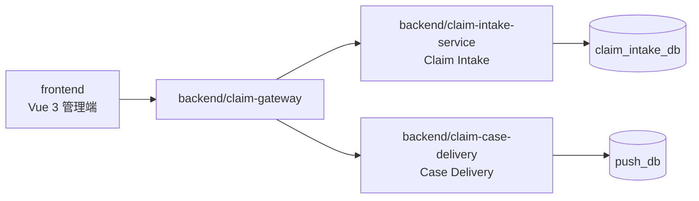
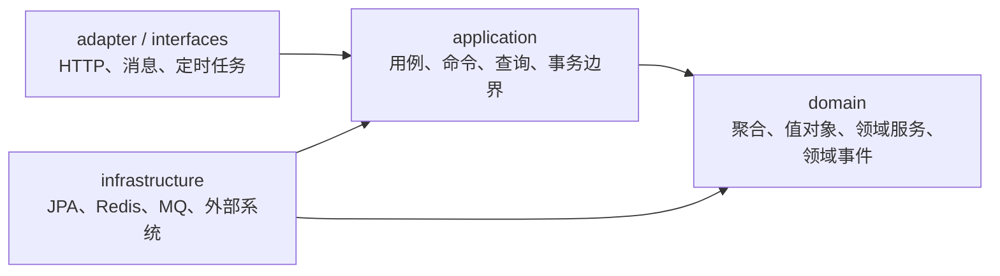

# 项目背景与目标

## 文档定位

本文件是 `claim-platform` 的根需求，定义所有功能都必须遵守的稳定约束。它不是某一项功能的实现方案，也不列出具体接口、表字段或任务。

后续功能应在 `specs/active/<feature-name>/` 新建子目录，记录该功能的需求变更、设计和任务。活动与归档目录的选择规则见 `specs/README.md`。功能文档只能细化本文件，不能绕过或降低其中的约束；如果根约束需要变化，必须先修改本文件并完成项目级评审。

## 业务边界

- 平台服务于多租户理赔业务，当前覆盖线上申请签收与案件推送；运营查询与异常诊断在出现明确用例后作为独立限界上下文建设。
- 平台不承担案件审核、赔付决策或外部保司的核心业务处理。
- 一个线上申请可以关联多个案件；案件也可以独立于申请由线下来源进入平台。
- Agent 只负责信息收集、证据归纳、异常分析和处置建议；Agent 不得直接修改核心业务数据。

# 总体架构



## 工程边界

```text
frontend/                         # 前端工程：页面、状态管理、API 客户端
backend/                          # 后端 Maven 聚合工程
├── claim-gateway/                # 边缘层，不承载领域业务
├── claim-intake-service/         # Claim Intake：理赔受理限界上下文
├── claim-case-delivery/          # Case Delivery：案件推送限界上下文
└── claim-common/                 # 共享技术能力与版本化契约，不含领域规则
specs/                            # 根约束、活动 Spec 与归档证据
├── requirements.md               # 项目稳定约束
├── README.md                     # 当前活动 Spec 选择器
├── active/                       # 正在实施、评审、发布或受阻的功能 Spec
└── archive/                      # 已完成功能的决策与验证证据
standards/                        # 按任务加载的工程规范
AGENTS.md                         # Agent 规则路由与执行门禁
```

# DDD 设计约束

## 限界上下文与数据所有权

| 限界上下文 | 模块 | 拥有的领域事实 | 对外责任 | 禁止事项 |
| --- | --- | --- | --- | --- |
| Claim Intake | `claim-intake-service` | 受理、材料、同步任务 | 签收受理、追踪材料处理、发起下游同步 | 审核案件、写入 Case Delivery 数据库 |
| Case Delivery | `claim-case-delivery` | 案件、推送任务、回执、死信 | 接收任意来源案件并受控推送 | 假设案件必须由 Claim Intake 创建、写入其数据库 |
| Operations & Diagnosis | 待明确用例后新建独立模块，禁止放入 `claim-common` | 运营记录、诊断报告、人工确认审计 | 聚合展示、辅助诊断、提交受控动作请求 | 直接查询或写入其他限界上下文数据库 |
| Edge & Platform | `claim-gateway` | 无领域事实 | 身份、租户识别、路由、限流、Trace | 领域编排、持久化领域状态 |
| Platform Common | `claim-common` | 无领域事实 | 多租户上下文、Trace、通用错误、稳定的共享契约 | 放入申请、案件、策略、审核等领域模型 |

每个限界上下文独立拥有自己的数据库及其建表、变更脚本。当前本地开发环境由 Docker 初始化脚本创建 Schema；跨上下文只能通过版本化同步 API、领域事件或显式的反腐层通信；禁止跨库 SQL、跨模块 Repository、共享业务实体和共享业务表。

## 后端分层规则

每个领域服务内部应采用以下依赖方向，依赖只能向内：



- `domain` 表达业务规则，不依赖 Spring MVC、JPA、Redis、RocketMQ 或 HTTP 客户端。
- `application` 编排用例、管理事务、调用领域对象与端口，不承载 HTTP/消息协议细节。
- `adapter` 负责将 HTTP、消息、定时任务等输入转换为应用命令或查询，并完成鉴权和协议校验。
- `infrastructure` 实现仓储端口、消息发布端口、缓存端口和外部系统反腐层；外部 DTO 不得穿透到领域层。
- 聚合必须定义一致性边界和状态转换规则；聚合之间最终一致的协作通过领域事件完成。

## 领域契约规则

- 每个写入用例必须定义命令幂等键、聚合标识、合法状态转换、失败分类和补偿路径。
- 领域事件必须携带 `eventId`、事件版本、`tenantId`、聚合类型、聚合标识、发生时间和 `traceId`。
- 领域事件只追加兼容字段；破坏性变更必须发布新版本事件，不得静默修改旧事件含义。
- 对外系统接入必须放在反腐层中，映射外部协议、错误码和模型；外部对象不得成为领域对象。

# 多租户与安全约束

- Gateway 必须从受信任的身份凭证解析 `tenantId`，不信任请求体、查询参数或路径中的租户字段。
- 每一条租户领域数据的查询和租户业务唯一约束都必须包含或受当前 `tenantId` 约束。
- 平台级全局业务编号（如平台签收号）可以使用全局唯一约束，并允许为发号读取跨租户聚合最大值；跨租户读取范围仅限发号所需的最大值，不得读取、返回或缓存租户业务明细。
- 所有下游服务都必须再次校验调用者与租户范围，不能只依赖 Gateway 的透传。
- 申请、案件、推送、诊断和审计数据不得跨租户读取、聚合、缓存或在错误信息中泄露。
- 个人信息、材料内容、访问令牌、外部凭证不得写入日志、指标标签、Trace 属性或 Agent 提示词；诊断输出必须先脱敏。

# 可靠性与一致性约束

- 申请签收、案件推送和人工确认等写入操作必须可幂等重试；重复请求不得造成重复业务副作用。
- 需要发送领域事件的本地写入必须采用 Outbox 或等效的原子意图记录；不得依赖“先写库再直接发消息”的非原子流程。
- 消费者、回执处理器和补偿任务必须按事件或业务幂等键去重，并记录重复处理结果。
- 外部调用不得置于数据库事务中；调用失败必须转化为可查询的重试、死信或人工介入状态。
- 终态不得被普通自动任务回退；人工补偿需要身份、原因、时间和前后状态的审计记录。
- Redis 仅用于缓存、限流、短期锁或租约，不能作为申请、案件和任务终态的唯一事实来源。

# 流量治理与可观测约束

- Gateway 按租户、调用方和路由执行认证、限流和 Trace 透传；Push 按租户、目标系统和协议适配器隔离并发与配额。
- 配置规则按环境和租户隔离，变更必须记录变更人、时间、生效范围和前后值摘要。
- 核心请求、任务、消息和外部调用必须关联 `traceId`、`tenantId`，并在已知时关联 `applicationNo`、`caseNo`、`taskId`。
- Metrics、Logs、Traces 必须支持按服务、租户和任务状态定位；失败、重试、死信、积压、限流和外部依赖错误必须可告警。
- 聚合查询发生局部依赖失败时，必须返回已获得数据、失败来源和 `traceId`，不得将局部失败伪装为空结果。

# 前端约束

- 前端位于 `frontend/`，只通过 Gateway 暴露的版本化 API 访问后端。
- 前端按业务能力而不是后端服务名组织页面和状态；申请、案件、推送、运行监控和诊断可作为独立功能域。
- API 客户端统一处理认证、`traceId` 回传、稳定错误码与租户上下文，不得由单个页面自行拼接鉴权或租户逻辑。
- 前端不得保存外部系统明文凭证、材料原文或可跨租户复用的敏感缓存。

# 需求表达与变更流程

- 功能 Spec 的可验收需求使用 EARS：`WHEN [条件] THEN THE SYSTEM SHALL [行为]`。
- 每项需求必须明确所属限界上下文、非范围、失败行为、幂等与兼容性影响。
- 修改跨上下文 API、领域事件、共享契约、数据库边界、租户模型或 Agent 权限时，必须更新根需求并进行项目级评审。
- 未建立或未确认对应 `specs/active/<feature-name>/` 变更文档时，不开始生产代码实现；紧急修复也必须补充最小变更记录和回归测试说明。

# 工程规范与 Spec 门禁

项目稳定业务与架构约束由本文件定义；实现、建模、语言、前端和提交等执行规则按任务从 `standards/` 增量读取。规则权威顺序与读取路由以 `AGENTS.md` 为准。

## 功能 Spec 最小要求

- 每项新增功能、跨限界上下文改动、共享契约变更或关键缺陷修复，必须在 `specs/active/<feature-name>/` 建立变更记录。
- 功能 Spec 必须包含范围、非范围、所属限界上下文、验收标准、失败行为、幂等方式和兼容性影响。
- 生产代码实现前必须完成需求、设计和任务；完成后必须回写测试证据、迁移说明和已知限制。
- 功能 Spec 的完整结构、编号、追踪链路和测试要求见 `standards/spec-coding.md`。

# 变更记录

| 日期 | 变更 | 评审 |
| --- | --- | --- |
| 2026-10-23 | 细化多租户唯一约束与查询条款：允许平台级全局业务编号，并限定发号所需的跨租户聚合最大值读取 | 项目级评审通过，关联 `specs/active/sign-no-generation/` TK-SNG-001 |
