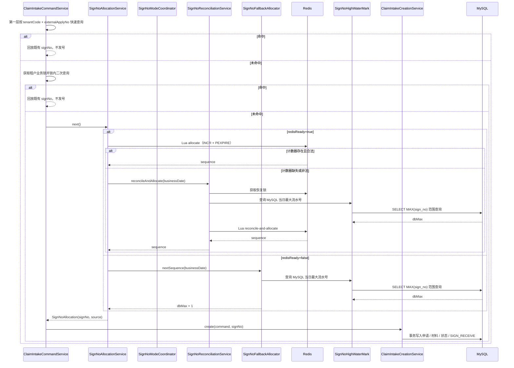

# 签收号生成设计

## 文档状态

| 项目 | 内容 |
| --- | --- |
| 状态 | Implemented（2026-10-23 实现完成，已按实际实现回写偏差） |
| 关联需求 | `specs/sign-no-generation/requirements.md` |
| 所属限界上下文 | Claim Intake |
| 模块 | `backend/claim-intake-service` |

## DS-SNG-001 方案评估与选择

| 方案 | 优点 | 问题 | 结论 |
| --- | --- | --- | --- |
| UUID（现状） | 实现简单、无中心 | 无序、过长、不可读、无法按日期组织 | 不采用 |
| Snowflake | 分布式、高性能 | 依赖机器号和时钟，业务编号不直观，需要额外机器号治理 | 不采用 |
| MySQL 自增 | 强一致、简单 | 每次发号依赖数据库连接和写入，吞吐和可用性受数据库影响 | 不作为主路径 |
| MySQL 号段 | 性能高、可靠 | 需要号段表和批量预取，恢复与段边界复杂 | 当前不采用，作为后续演进 |
| MySQL 序列表 | 恢复简单、强一致 | 每次发号访问数据库，失去 Redis 性能优势 | 后续演进 |
| Redis INCR | 原子递增、集群共享、实现简单、按日组织 | Redis 故障时不可用；主从切换可能丢失或回退序列 | 采用为主路径 |
| Redis INCR + MySQL 降级 + 唯一键 | 正常性能高；Redis 故障仍可签收；唯一性最终由数据库保证 | 降级依赖 `MAX + 重试`，高并发下冲突和重试放大 | 采用 |

最终方案：

```text
正常：Redis INCR → 生成 signNo → MySQL INSERT（uk_sign_no 兜底）
Redis 不可用：MySQL MAX(sign_no) + 1 → 生成 signNo → INSERT → 冲突重试
Redis 恢复：恢复锁 → MySQL MAX(sign_no) → max(Redis, MySQL) → 校准后再 INCR
异常冲突：回查外部申请号 → 回放或恢复 → 有限重试
```

选择理由：

- 正常路径只有一次 Redis 原子操作，不占用数据库连接和行锁；
- Redis 完全不可用时仍能完成签收，避免把缓存故障放大为业务不可用；
- MySQL `uk_sign_no` 是唯一性最终屏障，Redis 不是终态事实来源；
- 按日计数器和 TTL 让历史序列自然清理；
- 降级和恢复的并发上限明确，后续可用独立 Sequence 行演进。

明确不承诺：

- MySQL 降级下的严格并发串行；
- 流水号严格连续；
- Redis 和 MySQL 降级在任意部分网络分区下完全互斥；
- 跨日期的严格递增。

## DS-SNG-002 编号结构与时间

### 格式

```text
S + yyyyMMdd + 8 位十进制流水号（左补零）
S2026102300000125
```

| 组成 | 长度 | 说明 |
| --- | --- | --- |
| 前缀 | 1 | 固定大写 `S`，表示平台签收号 |
| 业务日期 | 8 | `yyyyMMdd`，配置时区（默认 `Asia/Shanghai`） |
| 流水号 | 8 | 每日从 1 开始，`1..99,999,999` |
| 总长度 | 17 | 与历史 `SIGN` + 20 位十六进制编号共存 |

校验规则：

- 新编号正则：`^S\d{16}$`。
- 历史编号 `SIGN` + 20 位大写十六进制（24 字符）保持合法，不参与新格式解析。
- 流水号小于 1 或大于 99,999,999 时拒绝格式化，不截断、不回绕。
- 格式化使用 `DateTimeFormatter.BASIC_ISO_DATE` 和 `Locale.ROOT`，不使用 `SimpleDateFormat`。

### 历史编号共存

`S` 与历史 `SIGN` 共享首字母，必须同时使用以下条件区分：

- 新格式固定 17 字符；
- 历史格式固定 24 字符；
- 高水位查询使用日期范围 `[SyyyyMMdd, SyyyyMMdd+1)`，不使用 `LIKE 'S%'`；
- 解析流水号使用 `SignNoFormat.parseSequence`，只接受新格式。

`SIGN` 字符串在字典序上大于 `SyyyyMMdd+1` 区间上界，且长度不同，因此不会进入新格式高水位。实现和测试都必须同时校验范围与长度，不能只依赖前缀。

### 领域格式对象

在 `domain/model` 新增 `SignNoFormat`，只承载纯规则：

```java
public final class SignNoFormat {
    public static final String PREFIX = "S";
    public static final int SEQUENCE_DIGITS = 8;
    public static final long MAX_SEQUENCE = 99_999_999L;

    public static String format(LocalDate businessDate, long sequence);
    public static boolean isCurrentFormat(String signNo);
    public static LocalDate parseDate(String signNo);
    public static long parseSequence(String signNo);
    public static String dateRangeStart(LocalDate businessDate);
    public static String dateRangeEnd(LocalDate businessDate);
}
```

约束：

- `SignNoFormat` 不依赖 Redis、Spring、MyBatis 或数据库。
- 不在 `ClaimIntake` 聚合中强制校验历史编号格式；聚合仍保存 `String signNo`，避免历史 `SIGN` 编号无法恢复。
- `parseDate`、`parseSequence` 只用于新格式；遇到历史格式或非法格式抛出明确异常，由恢复流程记录告警，不静默纠正。

### 业务日期

- 注入 `Clock`，`LocalDate businessDate = LocalDate.now(clock)`。
- 时区来自 `claim.intake.number.zone`，默认 `Asia/Shanghai`，与 JDBC `serverTimezone` 保持一致。
- 每次分配只计算一次业务日期，后续格式化、降级、恢复和日志使用同一个值。
- 跨午夜时，不同请求可能分别生成前一日和后一日的编号；两者都合法，不保证跨日期严格递增。
- 实例时钟偏差由 NTP 控制；编号日期与数据库 `created_at` 日期不要求一致。

## DS-SNG-003 发号路径总览

发号位于现有三级幂等之后、创建事务之前：



关键点：

- 发号在数据库事务之外；Redis 等待和 MySQL 高水位查询不占用创建事务。
- 正常路径和降级路径都只生成候选编号，不预留；最终由创建事务中的 `uk_sign_no` 决定谁落库。
- 创建事务对申请使用严格 `INSERT`，`sign_no` 冲突必须转换为 `DuplicateKeyException` 进入重试，不得静默更新既有行。
- 降级路径不获取恢复锁，也不假定 `MAX` 查询具有并发串行能力。
- 回放路径不调用 `SignNoAllocationService`，不消耗流水号。
- `signNo` 由平台生成，不读取或拼接租户报文。
- 创建事务仍使用 `REQUIRES_NEW`，唯一键冲突可整体回滚并重新查询并发赢家。
- 发号失败发生在创建事务之前，不会留下半成品申请。

## DS-SNG-004 Redis 计数器与 Lua

### Key 与 TTL

| Key | 默认值 | 说明 |
| --- | --- | --- |
| 计数器 | `sign:no:{yyyyMMdd}` | 全局按日共享；示例 `sign:no:20261023` |
| 恢复锁 | `sign:no:reconcile-lock:{yyyyMMdd}` | 按业务日期隔离；示例 `sign:no:reconcile-lock:20261023` |

- Key 只包含日期，不包含租户、人员信息、外部申请编号或 `signNo`。
- TTL 默认 3 天，最小 2 天；每次发号通过 Lua 重新设置，历史日期自然清理。
- 单 Key Lua 在 Redis Cluster 下落在同一 slot，不使用跨 slot 脚本。
- 计数器值必须是正整数；非法值不静默重置，由恢复脚本按 MySQL 高水位修复。

### 脚本

`allocate.lua`：正常发号，并区分“计数器缺失”和“计数器非法”。

```lua
local raw = redis.call('GET', KEYS[1])
if not raw then
    return -1
end
local current = tonumber(raw)
if current == nil or current < 0 or current % 1 ~= 0 then
    return -2
end
local sequence = redis.call('INCR', KEYS[1])
redis.call('PEXPIRE', KEYS[1], ARGV[1])
return sequence
```

`reconcile-only.lua`：后台校准和冲突后校准，不消耗流水号；同时修复缺失或非法值。

```lua
local raw = redis.call('GET', KEYS[1])
local before = tonumber(raw)
if before == nil or before < 0 or before % 1 ~= 0 then
    before = 0
end
local target = tonumber(ARGV[1])
if target == nil or target < 0 then
    return redis.error_reply('invalid high water mark')
end
local after = before
if target > after then
    after = target
end
redis.call('SET', KEYS[1], after)
redis.call('PEXPIRE', KEYS[1], ARGV[2])
return {before, after}
```

`reconcile-and-allocate.lua`：请求路径恢复并立即发号，校准与自增原子完成。

```lua
local raw = redis.call('GET', KEYS[1])
local before = tonumber(raw)
if before == nil or before < 0 or before % 1 ~= 0 then
    before = 0
end
local target = tonumber(ARGV[1])
if target == nil or target < 0 then
    return redis.error_reply('invalid high water mark')
end
local after = before
if target > after then
    after = target
end
redis.call('SET', KEYS[1], after)
local sequence = redis.call('INCR', KEYS[1])
redis.call('PEXPIRE', KEYS[1], ARGV[2])
return {sequence, before, after}
```

说明：

- `allocate.lua` 返回 `-1` 表示 Key 缺失，返回 `-2` 表示值非法；合法流水号从 1 开始，不与错误码混淆。
- 恢复脚本先读当前值，再取 `max(current, target)` 写入，避免恢复把计数器写回更小值。
- `reconcile-only.lua` 返回 `{before, after}`；`reconcile-and-allocate.lua` 返回 `{sequence, before, after}`，用于恢复日志记录校准前后值和序列差值，避免调用方额外读取 Redis。
- `reconcile-only.lua` 和 `reconcile-and-allocate.lua` 都总是 `SET` 并刷新 TTL：前者避免后台校准后第一次发号再次走缺失恢复，后者确保缺失或非法值在 `INCR` 前已被修复，即使 MySQL 高水位为 0 也不会对非法字符串执行自增；高水位参数非法时脚本返回错误，不写 Key。
- 恢复脚本读取的是执行瞬间的 Redis 值，不会使用调用方读到的过期值。
- `PEXPIRE` 使用毫秒，配置 `Duration` 转换为毫秒。
- 如果 Redis 命令失败、脚本执行失败或返回非预期类型，适配器转换为 `SignNoUnavailableException`，不在 Lua 中吞错。

### 适配器

`RedisSignNoSequenceCounter` 实现 `SignNoSequenceCounter`：

```java
public interface SignNoSequenceCounter {
    IncrementResult tryIncrement(LocalDate businessDate);
    long reconcileAndIncrement(LocalDate businessDate, long dbHighWaterMark);
    long reconcile(LocalDate businessDate, long dbHighWaterMark);
}

public sealed interface IncrementResult {

    record Allocated(long sequence) implements IncrementResult {
    }

    enum Missing implements IncrementResult {
        INSTANCE
    }

    enum Invalid implements IncrementResult {
        INSTANCE
    }
}
```

- `tryIncrement` 返回 `Allocated`、`Missing` 或 `Invalid`；应用层据此记录 `missing_counter`/`invalid_counter` 并进入恢复。
- `reconcileAndIncrement` 用于请求路径恢复，返回下一个可用流水号。
- `reconcile` 用于后台校准和冲突后校准，只更新计数器，不消耗流水号，返回校准后的值。
- 适配器负责 Key 构造、TTL、脚本注册和异常转换；应用层不出现 Redis API。

## DS-SNG-005 恢复与高水位

### 触发条件

| 触发 | 调用方 | 是否消耗流水号 | 说明 |
| --- | --- | --- | --- |
| 计数器 Key 缺失或值非法 | 请求路径 | 是（校准后立即分配） | Redis 可用但计数器异常 |
| 签收号唯一冲突且 Redis 就绪 | 请求路径 | 否（下一轮重新发号） | 按失败编号日期校准 |
| 启动校准 | 后台执行器 | 否 | 校准当日和前一业务日期 |
| 周期校准 | 后台执行器 | 否 | 默认每 5 分钟，单线程 |
| Redis 恢复探测 | 后台执行器 | 否 | 校准成功后允许重新使用 Redis |
| 人工触发 | 后台执行器 | 否 | 异步提交；本功能不新增 HTTP 入口 |

### 服务契约

```java
public record SignNoAllocation(String signNo, SignNoSource source) {
}

public enum SignNoSource {
    REDIS,
    MYSQL_FALLBACK
}

public class SignNoAllocationService {
    SignNoAllocation next();
    void recoverAfterConflict(LocalDate businessDate, SignNoSource source);
}

public class SignNoReconciliationService {
    SignNoReconcileAllocationOutcome reconcileAndAllocate(LocalDate businessDate, SignNoRecoveryTrigger trigger);
    SignNoReconciliationResult reconcile(LocalDate businessDate, SignNoRecoveryTrigger trigger);
}

public record SignNoReconcileAllocationOutcome(long sequence, long counterBefore, long counterAfter) {
}

public record SignNoReconcileOutcome(long counterBefore, long counterAfter) {
}

public class SignNoModeCoordinator {
    boolean isRedisReady();
    void markRedisUnavailable();
    void markRedisReady();
}
```

| 方法 | 用途 | 脚本 | 消耗流水号 |
| --- | --- | --- | --- |
| `SignNoAllocationService.next()` | 按实例就绪状态选择 Redis 或 MySQL 降级 | `allocate.lua` / `reconcile-and-allocate.lua` | 是 |
| `SignNoAllocationService.recoverAfterConflict(...)` | Redis 来源冲突后校准；降级来源不做 Redis 校准 | `reconcile-only.lua` | 否 |
| `SignNoReconciliationService.reconcileAndAllocate(businessDate, trigger)` | 请求路径缺失/非法 Key 恢复并立即发号 | `reconcile-and-allocate.lua` | 是 |
| `SignNoReconciliationService.reconcile(businessDate, trigger)` | 启动、周期、人工、恢复探测校准；锁未获取返回 `SKIPPED` | `reconcile-only.lua` | 否 |

### 请求路径恢复

#### 计数器缺失或非法（`next()` 内部）

```text
1. allocate.lua 返回 -1 或 -2，使用本次分配已计算的当前业务日期
2. 获取恢复锁（wait-time 默认 1 秒，Redisson watchdog 续期）
3. 若锁不可用：标记 redisReady=false，按降级开关处理
4. 若锁等待超时：重试 allocate.lua 一次；Key 已存在则成功，仍失败则标记 redisReady=false 并降级
5. 查询 MySQL 主库当日最大流水号 dbMax
6. 执行 reconcile-and-allocate.lua，target = dbMax；脚本内部取 max(Redis 当前值, target) 并自增
7. finally 释放当前线程持有的恢复锁
8. 校验返回流水号不超过 99,999,999，格式化 signNo
```

#### 唯一冲突后校准（`recoverAfterConflict`）

```text
1. 来源为 MYSQL_FALLBACK：直接返回；下一轮 next() 重新查询 MySQL 最大值
2. 实例 redisReady=false：直接返回；下一轮继续走降级
3. 使用失败编号中解析出的业务日期
4. 获取恢复锁（wait-time 默认 1 秒，Redisson watchdog 续期）
5. 锁不可用或等待超时：标记 redisReady=false 并返回，下一轮走降级
6. 查询 MySQL 主库当日最大流水号 dbMax
7. 执行 reconcile-only.lua，target = dbMax；只校准，不消耗流水号
8. 校准失败：标记 redisReady=false 并返回，下一轮走降级
9. finally 释放当前线程持有的恢复锁；成功时保持 redisReady=true
```

### 后台校准

```text
1. 单线程执行器依次处理当日和前一业务日期
2. 尝试获取恢复锁；未获取则跳过本次并记录 skipped
3. 查询 MySQL 主库 dbMax
4. 执行 reconcile-only.lua，target = dbMax
5. 记录校准前值、校准后值、dbMax、正序列差值和触发来源
6. 当日校准成功时标记 redisReady=true；Redis 连接失败时标记 false
7. 失败只记录告警和指标，不影响请求处理，不重试到阻塞
```

### MySQL 高水位查询

```sql
SELECT MAX(sign_no)
FROM t_claim_intake
WHERE sign_no >= ?
  AND sign_no < ?
  AND CHAR_LENGTH(sign_no) = 17;
```

参数：

- `start = 'S' + yyyyMMdd`，例如 `S20261023`。
- `end = 'S' + yyyyMMdd(次日)`，例如 `S20261024`。
- 不添加 `is_deleted = 0`：软删除行仍占用 `uk_sign_no`，必须计入最大值。
- 不读取历史 `SIGN` 编号：范围以 `S` + 日期开头，长度固定 17；不得只用 `LIKE 'S%'`。
- 使用主库和 `uk_sign_no` 索引；`MAX` 在固定长度、同构格式下等价于数值最大。
- 查询必须在创建事务之外执行，确保每次重试读取最新已提交的最大值。
- 返回 `null` 按 0 处理。
- 用 `RIGHT(sign_no, 8)` 解析流水号；解析失败或超出 `1..99,999,999` 时抛恢复失败，不猜测、不重置。

### 并发与在途分配

- 恢复锁按业务日期隔离，防止多个实例同时执行 MySQL 最大值查询和写入。
- 恢复锁不能防止“已分配但未提交”的编号不在 MySQL 中：
  - Redis 数据丢失或降级切换后，`dbMax` 可能低于此前已发出的候选值；
  - 恢复或降级可能重新发出相同候选值；
  - `uk_sign_no` 会拒绝重复插入，请求进入唯一冲突恢复和重试；
  - 重试有上限，持续冲突会告警，不能无限循环。
- 恢复脚本只在 `target > current` 时写入，避免把仍在 Redis 中的更高计数器回退。
- 恢复锁释放只针对当前线程持有的锁；续期失败、租约过期或所有权丢失时不强制删除 Key。

### 恢复失败

| 失败 | 处理 |
| --- | --- |
| Redis 连接或命令失败 | 标记 `redisReady=false`；降级开启则走 MySQL 降级，否则 503 |
| 恢复锁不可用或等待超时 | 标记 `redisReady=false`；请求改走降级；后台跳过 |
| MySQL 查询失败 | `SignNoUnavailableException` → 503，不写库；无法降级 |
| MySQL 最大值非法 | `SignNoUnavailableException`，ERROR 告警，不重置计数器 |
| 校准脚本失败 | 标记 `redisReady=false`；请求改走降级 |
| 流水号耗尽 | `SignNoSequenceExhaustedException` → 503，不写库 |

## DS-SNG-006 唯一冲突与重试

### 判定

创建事务抛出 `DuplicateKeyException` 后：

1. 按 `tenantCode + externalApplyNo` 重新查询既有申请。
2. 命中：视为并发请求或重复提交，回放既有 `signNo` 和状态；不执行恢复。
3. 未命中：视为签收号冲突；记录冲突类型，按失败编号解析出的业务日期执行恢复，重新发号并重试创建。
4. 来源为 `MYSQL_FALLBACK` 时，不做 Redis 恢复；下一轮 `next()` 重新查询 MySQL 最大值。
5. 来源为 `REDIS` 且实例仍就绪时，执行 `reconcile-only` 校准；校准失败则标记 Redis 不可用，下一轮走降级。

创建事务使用 `REQUIRES_NEW`，异常后已回滚；外层回查使用普通查询，能读取并发赢家已提交的数据。若冲突来自尚未提交的并发事务，插入会在唯一索引上等待对方提交或回滚，再返回冲突；回查时可见赢家。

### 重试编排

```java
int maxAttempts = properties.getMaxAttempts();
for (int attempt = 1; attempt <= maxAttempts; attempt++) {
    SignNoAllocation allocation = signNoAllocationService.next();
    try {
        return creationService.create(command, allocation.signNo());
    } catch (DuplicateKeyException exception) {
        Optional<ClaimIntake> concurrent = findByExternalApplyNo(command);
        if (concurrent.isPresent()) {
            recordConflict(EXTERNAL_APPLY_NO);
            return replay(concurrent.get(), "unique-conflict");
        }
        recordConflict(SIGN_NO);
        if (attempt == maxAttempts) {
            recordAllocationFailure();
            throw new SignNoUnavailableException(RETRY_EXHAUSTED, exception);
        }
        signNoAllocationService.recoverAfterConflict(
                SignNoFormat.parseDate(allocation.signNo()), allocation.source());
        backoff(attempt);
    }
}
throw new IllegalStateException("unreachable");
```

约束：

- `max-attempts` 默认 3，允许 1..5；不允许无限重试。
- 创建使用严格 `INSERT`（`ClaimIntakeStore.insert` → `intakeMapper.insert`），不得 find-then-update、upsert 或依赖“租户内查不到就更新”；`sign_no` 重复必须由数据库唯一键抛出 `DuplicateKeyException`，否则并发降级会静默覆盖。
- 每次重试都重新发号；不复用失败编号。
- 恢复使用失败编号的日期，避免跨午夜时校准错日期。
- 只捕获 `DuplicateKeyException`；其他 `DataIntegrityViolationException`（非唯一键）继续传播，按 500 处理。
- 重试耗尽返回 `SignNoUnavailableException(RETRY_EXHAUSTED)`，入口映射为 503 `INTAKE_NUMBER_UNAVAILABLE`；记录 ERROR 指标和日志，不返回 SQL、Redis 细节或堆栈。
- 重试之间使用 10–30ms 随机退避，降低降级并发下的重试风暴；退避不新增配置。
- 重试期间仍持有原租户业务锁；watchdog 自动续期；最大次数限制避免长时间占用。

## DS-SNG-007 Redis 不可用与 MySQL 降级

### 异常

```java
public class SignNoUnavailableException extends RuntimeException {
    private final SignNoUnavailableReason reason;
}

public enum SignNoUnavailableReason {
    REDIS_UNAVAILABLE,
    RECOVERY_LOCK_UNAVAILABLE,
    RECOVERY_LOCK_TIMEOUT,
    HIGH_WATER_MARK_UNAVAILABLE,
    INVALID_HIGH_WATER_MARK,
    FALLBACK_DISABLED,
    FALLBACK_UNAVAILABLE,
    RETRY_EXHAUSTED
}

public class SignNoSequenceExhaustedException extends RuntimeException {
}
```

`reason` 只用于服务端日志、指标和降级决策，不返回调用方。

### 降级判定

- 实例通过 `SignNoModeCoordinator` 维护本实例的 Redis 就绪状态，初始为 `false`。
- 启动校准成功前，请求走 MySQL 降级；避免使用可能过期的 Redis Counter。
- Redis 命令抛出连接/超时异常时，`SignNoAllocationService` 标记 `redisReady=false`，本请求立即改走降级，不在请求内反复重试 Redis。
- 后台校准是唯一重新探测 Redis 并恢复 `redisReady=true` 的路径；请求路径不主动探测。
- `fallback-enabled=false` 时，`redisReady=false` 直接抛 `SignNoUnavailableException(FALLBACK_DISABLED)`。

`SignNoAllocationService.next()` 的来源选择：

| `redisReady` | Redis 结果 | 处理 |
| --- | --- | --- |
| `true` | `Allocated` | 返回 `REDIS` 来源 |
| `true` | `Missing` / `Invalid` | 调 `reconcileAndAllocate`；成功返回 `REDIS`；Redis 类失败标记不可用并转降级；MySQL 类失败直接 503 |
| `true` | Redis 连接/命令异常 | 标记不可用，转降级 |
| `false` | 不访问 Redis | `fallback-enabled=true` 时返回 `MYSQL_FALLBACK`，否则抛 `FALLBACK_DISABLED` |

只有 `REDIS_UNAVAILABLE`、`RECOVERY_LOCK_UNAVAILABLE`、`RECOVERY_LOCK_TIMEOUT` 才标记 Redis 不可用；`HIGH_WATER_MARK_UNAVAILABLE`、`INVALID_HIGH_WATER_MARK` 表示 MySQL 侧失败，不应把 Redis 标记为不可用，直接按 503 处理，因为降级也依赖同一高水位查询。

降级路径失败时抛出 `SignNoUnavailableException`；`next()` 不返回空值，也不返回未格式化的候选值。Redis 已就绪但本次失败且降级关闭时，抛原始失败原因，不用 `FALLBACK_DISABLED` 覆盖真实原因；只有实例本就未就绪且降级关闭时才抛 `FALLBACK_DISABLED`。

### 降级发号

```java
public interface SignNoFallbackAllocator {
    long nextSequence(LocalDate businessDate);
}
```

`MysqlSignNoFallbackAllocator.nextSequence`：

1. 通过 `SignNoHighWaterMark` 查询主库当日最大流水号 `dbMax`。
2. 若 `dbMax >= 99,999,999`，抛 `SignNoSequenceExhaustedException`。
3. 返回 `dbMax + 1`。
4. 不获取恢复锁、不写 Redis、不插入占位行。

降级候选值由创建事务落库；并发冲突由 `uk_sign_no` 拒绝，外层回查外部申请号或重新查询最大值后重试。降级路径的 `MAX` 查询必须在创建事务之外执行，确保能看到最新已提交行。

### 降级并发边界

- `MAX(sign_no) + 1` 不提供并发串行能力；并发请求可能得到相同候选值。
- 只有一个请求能成功插入相同 `sign_no`；其余请求收到 `DuplicateKeyException`。
- 失败请求回查外部申请号：命中则回放；未命中则重新查询最大值并重试。
- 默认最多 3 次；并发越高，重试耗尽概率越大。当前单库和中低并发下接受该限制。
- 不得通过无限重试、JVM 本地锁或隐式串行化掩盖问题；需要更高并发时升级为独立 Sequence 行。
- 降级路径不依赖 Redis 业务锁；Redis 不可用时业务锁适配器已按既有逻辑降级，最终由 `uk_tenant_external_apply_no` 和创建事务保证幂等。

### 部分 Redis 故障

- 多实例可能出现部分实例能访问 Redis、部分实例走降级的混合状态。
- 能访问 Redis 的实例如果 Counter 落后于 MySQL，会生成较低候选值；插入被 `uk_sign_no` 拒绝后触发恢复和重试。
- 本功能不实现集群级 `REDIS / MYSQL / RECOVERING` 状态机；每个实例通过就绪信号和唯一冲突恢复收敛。
- 该设计的边界是：可能发生一次被拒绝的插入，但不会产生两个已提交的相同签收号；冲突次数有上限并告警。

### 入口映射

| 异常 | 错误码 | HTTP | 响应文案 | 附加头 |
| --- | --- | --- | --- | --- |
| `SignNoUnavailableException` | `INTAKE_NUMBER_UNAVAILABLE` | 503 | 签收号服务暂不可用，请稍后重试 | `Retry-After: 5` |
| `SignNoSequenceExhaustedException` | `INTAKE_NUMBER_EXHAUSTED` | 503 | 今日签收号已用尽，请联系平台 | 无 |
| 非唯一键 `DataIntegrityViolationException` | `INTERNAL_ERROR` | 500 | 系统繁忙，请稍后重试 | 无 |
| `IntakeSubmissionInProgressException` | `INTAKE_SUBMISSION_IN_PROGRESS` | 409 | 申请正在处理中，请稍后重试 | 无 |

- 降级成功返回正常 200，不因发生过 Redis 故障而返回失败。
- 失败发生在创建事务之前，不会留下半成品申请。
- 响应不包含 Redis Key、主机、SQL、异常类名或堆栈；只返回固定文案和 `traceId`。
- `uploadMaterials` 不经过发号，不受影响。

## DS-SNG-008 Redis 恢复与后台校准

### 就绪状态

```java
public class SignNoModeCoordinator {

    private final AtomicBoolean redisReady = new AtomicBoolean(false);

    public boolean isRedisReady() {
        return redisReady.get();
    }

    public void markRedisReady() {
        redisReady.set(true);
    }

    public void markRedisUnavailable() {
        redisReady.set(false);
    }
}
```

- 初始 `false`：实例启动后先使用 MySQL 降级，直到当日校准成功。
- 这是实例级就绪信号，不是集群级发号状态机；跨实例一致性由 MySQL 高水位和 `uk_sign_no` 保证。
- 标记为 `true` 前必须完成当日高水位校准；不得仅凭一次成功的 Redis 连接就恢复发号。

### 执行器

- `SignNoReconciliationScheduler` 位于 `infrastructure/scheduling`。
- 使用单线程 `ScheduledExecutorService`，线程名 `intake-no-reconciler`，daemon 线程。
- 启动后按 `reconciliation-initial-delay`（默认 0 秒）执行第一次，之后按 `reconciliation-interval`（默认 5 分钟）固定延迟执行。
- `@PreDestroy` 停止执行器并短暂等待，不阻塞应用关闭。
- `AtomicBoolean running` 防止周期任务重叠；重叠时记录 `skipped` 指标，不排队。
- `requestAsync` 在轮次运行中立即返回已完成的 `SKIPPED` 结果，不阻塞调用线程。
- 指标结果固定为 `success`/`skipped`/`failure`；`ReconciliationStatus.FAILED` 映射为 `failure`，其余按枚举小写。
- 每次处理 `reconciliation-days` 个日期，默认当日和前一业务日期，范围 1..3 天。
- 同一轮中单个日期失败不阻断其他日期；当日校准成功即可标记就绪。
- 当日校准成功时调用 `markRedisReady()`；Redis 连接失败时调用 `markRedisUnavailable()`。
- MySQL 查询失败只记录失败，不改变 Redis 就绪状态；若实例尚未就绪，则继续保持降级。

### 职责

```java
public record SignNoReconciliationResult(
        LocalDate businessDate,
        long dbHighWaterMark,
        long counterBefore,
        long counterAfter,
        boolean changed,
        ReconciliationStatus status,
        SignNoUnavailableReason failureReason) {
}
```

`dbHighWaterMark`、`counterBefore`、`counterAfter` 在未知时使用 `-1`；`sequence_gap` 只在 `counterBefore >= 0` 时记录，避免把失败样本写成 0。

`SignNoReconciliationService.reconcileAndAllocate(LocalDate businessDate, SignNoRecoveryTrigger trigger)`：

1. 获取恢复锁；锁不可用或等待超时抛 `SignNoUnavailableException`。
2. 查询 MySQL 主库高水位；已达到上限时抛 `SignNoSequenceExhaustedException`。
3. 执行 `reconcile-and-allocate.lua`，返回 `SignNoReconcileAllocationOutcome(sequence, counterBefore, counterAfter)`。
4. 校验流水号不超过上限。
5. 记录 `date`、`trigger`、`dbMax`、`before`、`after`、`gap`、`sequence`；`finally` 释放锁。

`SignNoReconciliationService.reconcile(LocalDate businessDate, SignNoRecoveryTrigger trigger)`：

1. 获取恢复锁；未获取返回 `SKIPPED`。
2. 查询 MySQL 主库高水位。
3. 执行 `reconcile-only.lua`，返回校准前后计数器值。
4. 返回 `SignNoReconciliationResult`；Redis/MySQL 失败转换为 `FAILED` 结果对象；`finally` 释放锁。
5. 后台调度器根据结果更新就绪状态；冲突恢复路径根据结果决定下一轮是否降级。

约束：

- 后台校准不消耗流水号。
- 后台校准与请求路径共用同一恢复锁和同一服务，避免两套逻辑。
- 单次失败只记录 WARN/ERROR 和指标，不抛出到调度线程，不影响下次调度。
- 不因为后台校准持有租户业务锁，也不访问申请业务明细。

### 人工触发

- `SignNoReconciliationScheduler.requestAsync(LocalDate businessDate)` 提交同一单线程执行器，返回 `CompletableFuture<SignNoReconciliationResult>`。
- 本功能不新增 HTTP 入口；触发传输由后续运维平台或 `Operations & Diagnosis` 上下文接入。
- 当前可通过重启实例触发启动校准；不支持直接在 Redis 手工 `SET`，避免绕过恢复锁和校验。
- 人工触发与周期任务共享重叠保护；已有任务运行时返回 `SKIPPED` 或排队策略必须在实现中固定，不能阻塞请求线程。

## DS-SNG-009 数据库约束与迁移

### 索引

```sql
ALTER TABLE t_claim_intake
    ADD UNIQUE KEY uk_sign_no (sign_no),
    ALGORITHM = INPLACE,
    LOCK = NONE;
```

- `uk_sign_no(sign_no)`：全局唯一，最终唯一性保证，同时支撑按日期范围查询 `MAX(sign_no)`。
- `uk_tenant_sign_no(tenant_code, sign_no)`：保留，用于租户范围查询和既有语义。
- 两个唯一索引在写入时都会校验；这是全局唯一和租户查询的显式取舍，接受少量写放大。
- `sign_no` 为 `VARCHAR(64)`，17 字符不需要改列。
- 不新增表、不新增列、不改排序规则。

### 迁移前检查

```sql
SELECT sign_no, COUNT(*) AS duplicate_count
FROM t_claim_intake
GROUP BY sign_no
HAVING duplicate_count > 1;
```

- 有任何结果时迁移必须中止，由人工确认重复来源和处理方式。
- 不得自动改号、删除行或关闭唯一索引。
- 历史 `SIGN` 编号由同一迁移检查覆盖；正常数据应无重复。

### 脚本与初始化

| 文件 | 用途 |
| --- | --- |
| `docker/mysql/init/02-create-claim-intake-tables.sql` | 新环境初始化，加入 `uk_sign_no` |
| `docker/mysql/migration/20261023-add-uk-sign-no.sql` | 存量库迁移，包含重复检查和 DDL |

项目当前没有 Flyway/Liquibase：

- 生产迁移由发布流程手工执行，执行前备份并记录执行人和时间。
- 本地已有数据卷不会重新执行 init 脚本；需手工执行迁移，或在确认数据可丢弃后重建卷。
- 迁移脚本必须可重复校验：重复执行前先查询 `information_schema.statistics`，已存在则跳过并输出提示。

### 启动校验

`SignNoSchemaValidator` 在应用启动时查询：

```sql
SELECT COUNT(*)
FROM information_schema.statistics
WHERE table_schema = DATABASE()
  AND table_name = 't_claim_intake'
  AND index_name = 'uk_sign_no'
  AND non_unique = 0
  AND seq_in_index = 1
  AND column_name = 'sign_no';
```

- 结果为 0 时抛出 `IllegalStateException`，阻止启动。
- 这是有意的部署门禁：缺少全局唯一索引时，Redis 回退或降级将无法被数据库拦截。
- 单元测试不启动 Spring 上下文；集成测试必须使用包含该索引的 Schema。

### 部署与回滚

部署顺序：

```text
备份 → 重复检查 → 添加 uk_sign_no → 校验索引 → 部署新版本 → 观察发号/降级/冲突指标
```

- 旧版本可以在新索引存在时继续运行；旧版本生成 `SIGN` 编号，新版本生成 `S` 编号，互不冲突。
- 回滚应用代码不需要删除索引；新编号仍可查询和回放。
- 只有完全回退全局发号方案时才考虑删除 `uk_sign_no`，且必须确认没有跨租户重复依赖。
- 迁移失败不影响旧版本运行；修复重复数据后重新执行。

## DS-SNG-010 分层与包结构

```text
domain
└─ model
   └─ SignNoFormat                         # 格式、日期范围、流水号解析

application
├─ exception
│  ├─ SignNoUnavailableException
│  └─ SignNoSequenceExhaustedException
├─ port
│  ├─ SignNoSequenceCounter                # Redis 计数器端口
│  ├─ SignNoHighWaterMark                  # MySQL 最大值端口
│  ├─ SignNoFallbackAllocator              # MySQL 降级候选值端口
│  ├─ SignNoRecoveryLock
│  ├─ SignNoRecoveryLockHandle
│  └─ SignNoPolicy                         # fallback 开关与最大尝试次数
├─ result
│  ├─ SignNoAllocation                     # signNo + source
│  ├─ SignNoReconcileAllocationOutcome
│  ├─ SignNoReconcileOutcome
│  └─ SignNoReconciliationResult
└─ service
   ├─ SignNoAllocationService              # next()、recoverAfterConflict()
   ├─ MysqlSignNoFallbackAllocator         # MAX + 1，不落库
   ├─ SignNoModeCoordinator                # 实例级 Redis 就绪信号
   ├─ SignNoMetrics
   └─ SignNoReconciliationService          # reconcileAndAllocate() / reconcile()

infrastructure
├─ cache
│  ├─ RedisSignNoSequenceCounter           # Lua 脚本、Key、TTL
│  └─ RedissonSignNoRecoveryLock           # 按日期恢复锁
├─ persistence
│  ├─ mapper/SignNoSequenceMapper          # MAX(sign_no) 查询
│  └─ repository/SignNoHighWaterMarkImpl
├─ scheduling
│  └─ SignNoReconciliationScheduler
└─ config
   ├─ SignNoProperties                     # 同时实现 SignNoPolicy
   ├─ SignNoClockConfiguration
   └─ SignNoSchemaValidator
```

依赖方向：

```text
interfaces → application → domain
application → application.port ← infrastructure
infrastructure.config → application.service
```

约束：

- `domain` 不依赖 Redis、Spring 事务、MyBatis 或 Micrometer。
- `application` 只依赖端口，不直接依赖 Redisson、Lettuce、MyBatis。
- `infrastructure` 实现端口、Lua、锁、Mapper 和调度。
- `ClaimIntakeCommandService` 注入 `SignNoAllocationService`，删除现有 `SignNoGenerator`。
- `ClaimIntakeCreationService` 保持创建事务，只接收外部传入的 `signNo`。
- Redis 计数器适配器使用 `StringRedisTemplate` + `DefaultRedisScript`；恢复锁使用现有 `RedissonClient`。项目已同时具备两种客户端，不新增连接依赖。
- 恢复锁复用现有 Redisson 客户端级 `lockWatchdogTimeout`（由 `claim.intake.submission.lock.lease-time` 配置），不新增第二个客户端级 watchdog 配置。
- 新增 `SignNoArchitectureTest`，断言 `application`/`domain` 不出现 `org.redisson`、`org.springframework.data.redis`、`com.baomidou`、`org.springframework.jdbc` 依赖。

## DS-SNG-011 配置

新增 `SignNoProperties`，前缀 `claim.intake.number`：

| 配置项 | 类型 | 默认值 | 校验 |
| --- | --- | --- | --- |
| `zone` | `ZoneId` | `Asia/Shanghai` | 必须是合法时区 |
| `key-prefix` | `String` | `sign:no:` | 非空白，必须以 `:` 结尾 |
| `counter-ttl` | `Duration` | `3d` | 不小于 `2d` |
| `max-attempts` | `int` | `3` | `1..5` |
| `recovery-lock-wait-time` | `Duration` | `1s` | 不小于 0 |
| `fallback-enabled` | `boolean` | `true` | 无 |
| `reconciliation-interval` | `Duration` | `5m` | 不小于 1 分钟 |
| `reconciliation-initial-delay` | `Duration` | `0s` | 不小于 0 |
| `reconciliation-days` | `int` | `2` | `1..3` |

`application.yml` 追加：

```yaml
claim:
  intake:
    number:
      zone: ${CLAIM_INTAKE_NUMBER_ZONE:Asia/Shanghai}
      key-prefix: "${CLAIM_INTAKE_NUMBER_KEY_PREFIX:sign:no:}"
      counter-ttl: ${CLAIM_INTAKE_NUMBER_COUNTER_TTL:3d}
      max-attempts: ${CLAIM_INTAKE_NUMBER_MAX_ATTEMPTS:3}
      recovery-lock-wait-time: ${CLAIM_INTAKE_NUMBER_RECOVERY_LOCK_WAIT_TIME:1s}
      fallback-enabled: ${CLAIM_INTAKE_NUMBER_FALLBACK_ENABLED:true}
      reconciliation-interval: ${CLAIM_INTAKE_NUMBER_RECONCILIATION_INTERVAL:5m}
      reconciliation-initial-delay: ${CLAIM_INTAKE_NUMBER_RECONCILIATION_INITIAL_DELAY:0s}
      reconciliation-days: ${CLAIM_INTAKE_NUMBER_RECONCILIATION_DAYS:2}
```

- `@ConfigurationProperties` + `@Validated`；绑定或校验失败阻止启动。
- `SignNoClockConfiguration` 提供 `Clock.system(ZoneId.of(properties.getZone()))`。
- 恢复锁 Key 使用 `key-prefix` + `reconcile-lock:` + 日期，不新增独立前缀配置。
- 修改 `key-prefix` 会让新旧实例使用不同计数器，滚动发布期间必须保持一致；否则可能出现两套序列，最终由 `uk_sign_no` 拒绝重复并触发恢复。
- 修改 `zone` 会改变编号日期，必须在发布评审中单独确认；运行期不得随意变更。
- `fallback-enabled=false` 会关闭 MySQL 降级，Redis 不可用时直接 503；该配置属于应急/评审配置，不作为常规默认。
- 后台校准不提供关闭开关；恢复和切换依赖它，关闭会使实例在 Redis 故障后无法自动切回。

## DS-SNG-012 可观测与安全

### 指标

| 指标 | 类型 | 标签 | 用途 |
| --- | --- | --- | --- |
| `claim.intake.number.allocation` | Counter | `source=redis/mysql_fallback`、`result=allocated/recovered/unavailable/exhausted` | 发号来源和结果分布 |
| `claim.intake.number.fallback` | Counter | `result=success/conflict/exhausted/unavailable` | MySQL 降级发号情况 |
| `claim.intake.number.recovery` | Counter | `trigger=missing_counter/invalid_counter/unique_conflict/startup/periodic/manual`、`result=success/skipped/failure` | 恢复触发和结果 |
| `claim.intake.number.conflict` | Counter | `type=sign_no/external_apply_no` | 唯一冲突分类 |
| `claim.intake.number.sequence_gap` | Gauge | 无标签，或仅 `scope=current/previous` | `dbMax - counterBefore`，正值表示 Redis 落后 MySQL |

- 实际取值：`allocation.result=allocated/recovered/unavailable/exhausted`；`recovery.result=success/skipped/failure`；`fallback.result=success/conflict/exhausted/unavailable`；`conflict.type=sign_no/external_apply_no`。降级来源的签收号冲突由创建流程记录 `fallback{result=conflict}`。
- 标签不得包含 `tenantCode`、`signNo`、`externalApplyNo`、日期或人员信息，避免高基数和敏感数据泄露。
- 租户和编号通过日志、Trace 关联。
- `sequence_gap` 由后台校准更新；正值持续存在或增大时告警，负值可能来自跳号，不直接告警。
- 降级成功也应记录 `fallback{result=success}`，Redis 故障不能因为业务成功而被静默忽略。

### 日志

| 事件 | 级别 | 字段 |
| --- | --- | --- |
| 发号成功 | DEBUG | `date`、`sequence`、`source`、`signNo`（由创建日志汇总） |
| 缺失/非法 Key 恢复 | INFO | `date`、`dbMax`、`counterBefore`、`counterAfter`、`trigger`、`traceId` |
| Redis 不可用 | WARN | `tenantCode`、`date`、`reason`、`traceId` |
| 降级发号成功 | INFO | `date`、`dbMax`、`attempt`、`traceId` |
| 降级冲突 | WARN | `date`、`attempt`、`dbMax`、`traceId` |
| 唯一冲突 | WARN | `tenantCode`、`signNo`、`traceId`、`attempt`、`type` |
| 恢复失败 | ERROR | `date`、`reason`、`traceId`、异常堆栈 |
| 流水号耗尽 | ERROR | `date`、`sequence`、`source`、`tenantCode`、`traceId` |
| 后台校准 | INFO/WARN | `date`、`dbMax`、`before`、`after`、`gap`、`result`、`reconciliationId` |
| 启动校验失败 | ERROR | 缺失索引名、表名；不打印连接串 |

- 不记录完整命令、原始报文、姓名、证件号、手机号、银行卡号、令牌、Redis 凭证或 SQL。
- 异常堆栈只进入服务端日志，响应只返回固定文案和 `traceId`。
- 后台任务没有请求 `traceId` 时生成 `reconciliationId`，便于串联一次校准。

### 告警

- `INTAKE_NUMBER_UNAVAILABLE` 出现即告警。
- `INTAKE_NUMBER_EXHAUSTED` 出现即告警。
- `claim.intake.number.fallback{result=success}` 持续出现告警，提示 Redis 不可用或网络分区。
- `claim.intake.number.fallback{result=exhausted}` 出现即告警，提示降级并发超过当前设计边界。
- `claim.intake.number.sequence_gap` 持续为正或增大告警，提示 Redis 落后 MySQL。
- `claim.intake.number.recovery` 在 5 分钟内超过阈值告警，提示 Redis 可能不稳定。
- `claim.intake.number.conflict{type=sign_no}` 短时激增告警，提示 Counter 回退、降级并发或在途分配碰撞。
- 签收创建成功率下降与发号/降级指标联动告警。

### 安全

- Redis 计数器 Key 只含日期；恢复锁只含日期。
- 恢复/降级查询只读取 Claim Intake 自有表的聚合最大值，不返回租户业务明细。
- 全局流水号暴露平台整体业务量，已作为发布评审的显式风险；接口不返回计数器、日总量或跨租户统计。
- 申请查询、材料查询和错误响应继续强制 `tenantCode`。
- Redis 凭证只来自环境变量或配置中心，不写入仓库、日志或指标。

## DS-SNG-013 兼容性、发布与租户内备选

### 新旧编号共存

| 场景 | 行为 |
| --- | --- |
| 查询历史 `SIGN...` 编号 | 保持原有查询和回放 |
| 查询新 `S...` 编号 | 与普通编号一致 |
| 恢复/降级高水位 | 只扫描 `S` + 日期、长度 17 的当日编号，忽略历史 `SIGN` |
| 前端 | 当前前端未使用 `signNo`，无需修改 |
| 外部调用方 | API 未公开发布；若已有调用方解析 `SIGN` 前缀或长度，需要通知并评估 |

### 滚动发布

- 先迁移数据库并确认 `uk_sign_no` 存在。
- 新旧实例可以同时运行：旧实例生成 `SIGN...`，新实例生成 `S...`，都受 `uk_sign_no` 约束。
- 新旧实例必须使用相同 Redis `key-prefix`；旧实例不读取 Redis 发号，但新实例之间必须共享计数器。
- 新实例的恢复/降级查询忽略旧格式，不会把旧编号误认为当日序列。
- 新旧实例使用不同的编号生成方式，但共享 `tenantCode + externalApplyNo` 幂等语义，不会重复创建申请。
- 滚动期间 Redis 故障：旧实例继续用本地随机编号，新实例走 MySQL 降级；唯一索引保证不重复。

### 回滚

- 回退应用代码即可；Redis 计数器在 TTL 后自然清理。
- `uk_sign_no` 可以保留；旧代码不依赖它，但删除它会失去跨租户唯一保证。
- 已生成的 `S...` 编号继续有效，不回填、不改号。
- 回滚后 `SignNoGenerator` 恢复 `SIGN` 格式；历史 `S...` 仍可按普通字符串查询和回放。

### 租户内备选方案

如果根需求修订评审不通过，改用租户内发号：

| 项目 | 全局方案（本 Spec） | 租户内备选 |
| --- | --- | --- |
| Redis Key | `sign:no:{yyyyMMdd}` | `sign:no:{tenantCode}:{yyyyMMdd}` |
| 恢复锁 | 按日期全局 | 按 `tenantCode + 日期` |
| MySQL 唯一键 | `uk_sign_no(sign_no)` + `uk_tenant_sign_no` | 仅 `uk_tenant_sign_no` |
| 降级/恢复查询 | 全表当日 `MAX(sign_no)` | `tenant_code = ?` 的当日 `MAX(sign_no)` |
| 编号跨租户 | 全局唯一 | 可能重复 |
| 根需求 | 需要修订 | 不需要修订 |
| 业务量泄露 | 存在 | 不存在 |

租户内备选需要重新修订本 Spec，不能只改配置；`SignNoFormat`、Redis Key、恢复锁、降级/恢复 SQL、迁移和测试都要同步调整。

## DS-SNG-014 测试策略

### 单元测试

| 测试 | 场景 | 断言 |
| --- | --- | --- |
| TEST-SNG-001 | 编号格式化 | `S` + 日期 + 8 位补零；长度 17；正则匹配 |
| TEST-SNG-002 | 每日重置 | 不同日期使用不同 Key 和序列 |
| TEST-SNG-003 | 回放 | 不调用发号端口；不消耗流水号 |
| TEST-SNG-004 | 计数器缺失/非法 | 调用恢复并返回 `dbMax + 1` |
| TEST-SNG-005 | 恢复锁超时/不可用 | 有界重试；标记不可用并降级 |
| TEST-SNG-006 | 外部申请号冲突 | 回放，不触发恢复 |
| TEST-SNG-007 | 签收号冲突 | 按失败编号日期恢复并重试；耗尽返回 503 异常 |
| TEST-SNG-008 | Redis 不可用 | 降级成功；不直接返回 503 |
| TEST-SNG-009 | 降级关闭 | 返回 503；不调用创建服务 |
| TEST-SNG-010 | 两条路径均不可用 | 返回 503；不写库 |
| TEST-SNG-011 | 流水号耗尽 | Redis 和降级路径均抛出耗尽异常 |
| TEST-SNG-012 | 配置校验 | 非法时区、TTL、重试次数、间隔、前缀阻止启动 |
| TEST-SNG-013 | 启动索引校验 | 缺少 `uk_sign_no` 时启动失败 |
| TEST-SNG-014 | 错误映射 | 503/500 状态和稳定错误码正确 |
| TEST-SNG-015 | 后台校准 | 重叠跳过、失败隔离、就绪状态切换 |
| TEST-SNG-016 | 降级重试 | `MAX` 变化后重试成功；耗尽有界 |
| TEST-SNG-017 | 部分 Redis 故障 | 就绪状态和来源选择正确；冲突后收敛 |
| TEST-SNG-018 | 分层边界 | `application`/`domain` 不依赖 Redis、MyBatis、JDBC |

### 集成测试

使用真实 MySQL 和 Redis，不得用 Mockito 替代唯一键和 Redis 原子性：

| 测试 | 场景 | 断言 |
| --- | --- | --- |
| TEST-SNG-019 | 多线程并发 Redis 发号 | 100 个不同幂等键全部唯一，格式正确，允许跳号 |
| TEST-SNG-020 | 计数器删除/非法 | 从 MySQL 最大值恢复，下一编号为 `dbMax + 1`；高水位为 0 时非法值被修复 |
| TEST-SNG-021 | 计数器回退 | 触发唯一冲突、恢复、重试后成功；不出现 500 |
| TEST-SNG-022 | 软删除最大值 | 软删除行计入高水位，不复用编号 |
| TEST-SNG-023 | 历史 `SIGN` 编号 | 不进入当日高水位；仍可查询和回放 |
| TEST-SNG-024 | Redis 不可用降级 | 降级返回 200；编号唯一；记录降级指标 |
| TEST-SNG-025 | 降级并发 | 并发降级无重复编号；失败为 503，不出现 500；冲突有界 |
| TEST-SNG-026 | Redis 恢复校准 | 校准到 MySQL 最大值；下一编号大于最大值；不复用降级编号 |
| TEST-SNG-027 | 降级关闭 | 503 `INTAKE_NUMBER_UNAVAILABLE`；无申请、材料、成功日志写入 |
| TEST-SNG-028 | 两条路径不可用 | 503；无写入 |
| TEST-SNG-029 | 跨租户重复 | 数据库拒绝相同 `sign_no`；应用回放或恢复，不产生 500 |
| TEST-SNG-030 | 后台校准 | Key 恢复为 MySQL 最大值，不消耗流水号 |
| TEST-SNG-031 | 迁移重复检查 | 存在重复 `sign_no` 时迁移中止 |
| TEST-SNG-032 | 端到端 API | 两个入口返回的 `signNo` 匹配新格式 |
| TEST-SNG-033 | TTL | 发号后计数器 TTL 大于 0 且不小于配置下限 |
| TEST-SNG-034 | 时区/跨午夜 | 固定 `Clock` 下日期切换正确，前后日期编号不冲突 |
| TEST-SNG-035 | 序列差值指标 | 校准后正向差值消失；指标可观测 |
| TEST-SNG-036 | 在途碰撞 | 降级期间未提交编号与 Redis 恢复分配碰撞时，唯一键拒绝且请求最终成功或稳定失败，无重复提交 |

### 测试环境与证据

- 优先复用 `docker/` 下的本地 MySQL/Redis；必要时用 Testcontainers，但新增依赖需同步更新 Spec 和 `pom.xml`。
- Redis 不可用/恢复场景通过受控测试环境停止或恢复 Redis 容器，或使用测试专用故障注入代理；不得用 Mockito 替代唯一键和 Redis 原子性。
- 现有集成测试在端口不可用时通过 `@EnabledIf` 跳过；签收号验收不得把“静默跳过”当作通过证据。
- 发布前必须记录实际执行的集成测试类、用例数和 `mvn verify` 结果。
- 并发测试至少包含 100 个不同幂等键验证 Redis 路径；降级并发测试至少 20 个并发，断言无重复、无 500，允许有界 503。
- 归档测试不得修改全局计数器而影响其他测试；使用独立日期前缀/测试租户，并在结束后清理。
- 降级测试必须覆盖“Redis 不可用 + MySQL 可用”“Redis 不可用 + MySQL 不可用”和“Redis 恢复后校准”三类场景。

## DS-SNG-015 失败矩阵

| 场景 | 内部处理 | 是否写库 | 对外 | 告警 |
| --- | --- | --- | --- | --- |
| Redis 连接失败，降级成功 | 标记不可用，MySQL `MAX + 1` | 成功则写一条 | 200 | 降级指标 |
| Redis 连接失败，降级关闭 | `SignNoUnavailableException` | 否 | 503 `INTAKE_NUMBER_UNAVAILABLE` | 是 |
| Redis 连接失败，MySQL 查询失败 | `SignNoUnavailableException` | 否 | 503 | 是 |
| 计数器缺失/非法 | 同步恢复后发号 | 恢复成功则继续 | 正常 | 恢复指标 |
| MySQL 高水位查询失败 | `SignNoUnavailableException` | 否 | 503 | 是 |
| MySQL 高水位非法 | 同上，ERROR | 否 | 503 | 是 |
| 计数器回退/唯一冲突 | 回查、恢复、重试 | 失败重试不写；成功写一条 | 200 或 503 | 冲突指标 |
| 外部申请号冲突 | 回放并发赢家 | 否 | 200 | 无需 |
| 降级重试耗尽 | `SignNoUnavailableException(RETRY_EXHAUSTED)` | 否 | 503 | 是 |
| 流水号耗尽 | `SignNoSequenceExhaustedException` | 否 | 503 `INTAKE_NUMBER_EXHAUSTED` | 是 |
| 后台校准失败 | 捕获并记录 | 否 | 无请求影响 | 是 |
| 配置非法 | 启动失败 | 否 | 不启动 | 是 |
| 缺少 `uk_sign_no` | 启动失败 | 否 | 不启动 | 是 |
| 迁移存在重复编号 | 迁移中止 | 否 | 不迁移 | 人工 |

## DS-SNG-016 设计决策与替代方案

| 决策 | 理由 | 未采用的替代方案 |
| --- | --- | --- |
| Redis INCR 主发号 + MySQL 降级 | 正常性能高，Redis 故障仍可签收 | Redis 故障快速失败：可用性差；完全 MySQL 发号：正常路径数据库压力大 |
| MySQL `MAX + 1` 降级 | 不新增表，当前单库和中低并发可接受 | 独立 Sequence 行：当前阶段复杂度和发布面更大；号段：需要额外状态 |
| 唯一键作为最终串行点 | 降级并发无法可靠串行，数据库唯一键是事实边界 | 应用层分布式锁：Redis 不可用时不可用；JVM 锁：跨实例无效 |
| Redis 恢复前校准 | 防止 Counter 落后导致重复候选值 | 恢复后直接 INCR：会重新进入已用区间 |
| 实例级就绪信号 | 满足“校准后再恢复 Redis”，不引入完整状态机 | 集群级 REDIS/MYSQL/RECOVERING：需要共享状态表，当前阶段过重 |
| 3 次有限重试 | 覆盖短时冲突，避免无限循环 | 无限重试：放大故障；1 次：降级并发下成功率低 |
| `S` 前缀 | 业务可读、与日期组合直观 | `I` 前缀：与历史编号区分更明显，但当前方案已重新选定 `S` |
| 保留 `signNo` 命名 | 零 API/DB/前端迁移，历史编号兼容 | 重命名 `intakeNo`：破坏性大，收益仅是术语统一 |
| 新增 `uk_sign_no` | 全局唯一最终保证，支撑范围查询 | 只保留租户唯一：无法保证跨租户全局唯一 |
| 恢复查询使用 `MAX(sign_no)` | 不新增表，直接利用已落库事实 | 新增序列表：当前阶段不引入 |
| 后台单线程校准 | 避免请求阻塞和并发拉取，串行化 MySQL 查询 | 每请求校准：性能差；多线程校准：重复查询和锁竞争 |
| 启动校验索引 | 防止漏执行迁移导致全局保证静默失效 | 仅依赖发布流程：可能遗漏 |
| 人工触发不新增 HTTP | 按当前决策由后台线程异步拉取，减少接口和安全面 | 内部管理端点：需要额外的服务凭证和审计设计 |
| 重试耗尽返回 503 | 表示暂时无法分配，调用方可退避重试 | 500：容易被理解为代码缺陷；409：不是业务冲突 |

## DS-SNG-017 数据所有权与一致性

- Claim Intake 独占 `claim_intake_db` 的申请、材料、交互日志等业务表；本功能不跨上下文写库。
- Redis 只保存按日计数器、实例就绪信号和短期恢复锁，不保存申请、材料或状态；计数器丢失不影响最终事实。
- MySQL `uk_sign_no` 是跨实例、跨租户的最终唯一性边界；`uk_tenant_external_apply_no` 是业务幂等边界。
- 恢复/降级查询跨租户读取 `MAX(sign_no)`，但不读取或返回任何租户业务明细；该聚合读取已纳入根需求修订建议。
- 发号在创建事务之外，创建失败会留下跳号；这是允许的，不需要补偿。
- 降级候选值不预留；并发失败者通过重新查询最大值和有限重试收敛。
- 创建事务提交后、响应前崩溃：客户端重试按幂等键回放，不重新发号。
- Redis 丢失：请求路径缺失恢复；降级期间切换；在途分配可能碰撞，由唯一键拒绝并重试。
- Redis 恢复：先校准高水位，再恢复发号；部分实例未观察到故障时，由唯一冲突恢复收敛。
- MySQL 不可用：发号可能成功但创建失败，留下跳号；不得把编号当作申请已创建的证据。
- 本功能不发布领域事件，不引入 Outbox、MQ 或外部调用。

## DS-SNG-018 演进边界

当前方案适用于：

- 单库；
- 签收量中低并发；
- Redis 故障属于少量异常场景；
- 签收号需要日期 + 自增流水格式。

当前实现：

```text
Redis INCR → MySQL MAX 降级/恢复 → UNIQUE 最终兜底
```

出现以下任一情况时，需要新建 Spec 升级为独立 Sequence 行：

- MySQL 分库分表，无法直接得到全局最大 `sign_no`；
- Redis 故障期间降级发号并发明显提高，重试耗尽频繁；
- 主表 `MAX(sign_no)` 查询成本明显增加；
- 多个业务开始共享统一发号能力。

未来 Sequence 行建议结构（本功能不创建）：

| 字段 | 作用 |
| --- | --- |
| `biz_type` | 业务类型，如 `SIGN` |
| `biz_date` | 序列日期 |
| `current_value` | 当前全局高水位 |

升级后：

- Redis：正常高性能发号；
- Sequence：维护全局高水位，并承担降级发号；
- `uk_sign_no`：最终数据约束。

如果业务规模继续扩大，再考虑 MySQL Segment、Leaf、TinyID 或独立 ID Generator。本功能只记录演进边界，不提前实现。
